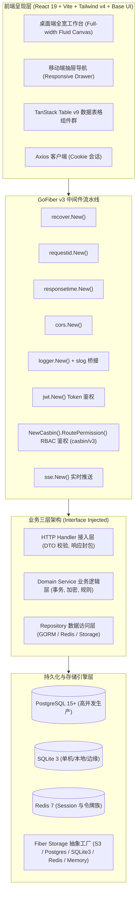

# InfraNexus 具体系统架构与工程实现方案 (Architecture & Implementation Plan)

本文档详细阐述 **InfraNexus** 全栈企业脚手架的系统架构、模块分层、数据库表结构、安全认证模型、接口定义以及前端组件与状态流转设计。

> 2026-10-23 日志专项：已接入 Context Handler、独立 SQL 适配器、stdout/file/both、轮转与生命周期管理。当前使用契约见 [日志说明](BACKEND_LOGGING.md)，设计见 [实施方案](BACKEND_LOGGING_PLAN.md)，验收状态见 [日志专项看板](TODOLIST.md)。下方旧日志示例以本增量为准。

> 2026-10-22 深度复审修订：M0–M6 后的授权并发、LDAP 回滚、资源回收、SSE 与编辑 CAS 的最新增量契约及发布门禁见 [深度复审整改方案](DEEP_REVIEW_REMEDIATION_PLAN.md)，任务状态见 [当前看板](TODOLIST.md)。原 [问题处理与交互改造方案](REMEDIATION_AND_UX_PLAN.md) 保留为前阶段设计；下方旧实现示例不表示整改已完成，冲突处以最新增量方案为目标契约，当前运行行为以代码与测试证据为准。

---

## 1. 总体架构拓扑图



---

## 2. 后端工程架构设计 (Backend Architecture)

### 2.1 极简薄入口 `main.go` 模式
`main.go` 严格遵循控制反转与装配器模式，代码行数精简在 80 行以内，不含任何业务逻辑：
```go
package main

import (
	"context"
	"os"
	"os/signal"
	"syscall"
	"time"

	"infranexus/internal/bootstrap"
	"infranexus/internal/config"
	"infranexus/internal/core/logger"
)

func main() {
	// 1. 初始化 Viper 配置
	cfg := config.MustLoad()

	// 2. 初始化 slog 全局结构化日志
	log := logger.Init(cfg.App.Debug)

	// 3. 构建依赖注入上下文 (DB, Redis, Storage, Repos, Services, Handlers)
	appContainer := bootstrap.NewAppContainer(cfg, log)
	defer appContainer.Close()

	// 4. 构建并装配 GoFiber v3 引擎 (全局中间件 + 路由)
	fiberApp := bootstrap.NewFiberApp(appContainer)

	// 5. 优雅启动与平滑退出 (Graceful Shutdown)
	go func() {
		if err := fiberApp.Listen(":" + cfg.App.Port); err != nil {
			log.Error("Fiber listen failed", "error", err)
		}
	}()

	quit := make(chan os.Signal, 1)
	signal.Notify(quit, syscall.SIGINT, syscall.SIGTERM)
	<-quit

	log.Info("Shutting down InfraNexus server gracefully...")
	ctx, cancel := context.WithTimeout(context.Background(), 10*time.Second)
	defer cancel()

	if err := fiberApp.ShutdownWithContext(ctx); err != nil {
		log.Error("Server forced to shutdown", "error", err)
	}
	log.Info("Server exited cleanly.")
}
```

### 2.2 泛型仓储契约与领域模型 (Go 1.27+ Generics & JSONB)
在 `internal/domain` 目录中声明纯粹的契约接口，解耦实现细节，并全面拥抱泛型与 `datatypes.JSONType[T]`：

```go
// internal/domain/base.go
package domain

import (
	"context"
	"time"
	"github.com/google/uuid"
	"gorm.io/gorm"
)

// 全局基础实体，主键统一使用 UUID
type BaseEntity struct {
	ID        uuid.UUID      `gorm:"type:uuid;primaryKey" json:"id"`
	CreatedAt time.Time      `json:"created_at"`
	UpdatedAt time.Time      `json:"updated_at"`
	DeletedAt gorm.DeletedAt `gorm:"index" json:"-"`
}

func (b *BaseEntity) BeforeCreate(tx *gorm.DB) error {
	if b.ID == uuid.Nil {
		b.ID = uuid.New() // 优先使用有序 UUIDv7 或标准 UUID
	}
	return nil
}

// 泛型仓储通用接口定义 (Go 1.27+)
type Repository[T any, ID comparable] interface {
	GetByID(ctx context.Context, id ID) (*T, error)
	List(ctx context.Context, page, pageSize int, filters map[string]any) ([]T, int64, error)
	Create(ctx context.Context, entity *T) error
	Update(ctx context.Context, entity *T) error
	Delete(ctx context.Context, id ID) error
}

// internal/domain/user.go
package domain

import (
	"context"
	"github.com/google/uuid"
	"gorm.io/datatypes"
)

type UserPreferences struct {
	Theme         string   `json:"theme"`         // "dark" | "light" | "system"
	Locale        string   `json:"locale"`        // "zh-CN" | "en-US"
	PinnedRoutes  []string `json:"pinned_routes"` // 侧栏常用图钉快捷路由
}

type User struct {
	BaseEntity
	Username    string                              `gorm:"size:64;uniqueIndex;not null" json:"username"`
	Email       string                              `gorm:"size:128;uniqueIndex;not null" json:"email"`
	Password    string                              `gorm:"size:255;not null" json:"-"`
	Nickname    string                              `gorm:"size:64" json:"nickname"`
	Avatar      string                              `gorm:"size:255" json:"avatar"`
	Status      int                                 `gorm:"default:1" json:"status"` // 1: 启用, 2: 禁用
	Preferences datatypes.JSONType[UserPreferences] `gorm:"type:jsonb" json:"preferences"`
	ExtraData   datatypes.JSON                      `gorm:"type:jsonb" json:"extra_data"`
	Roles       []Role                              `gorm:"many2many:sys_user_roles;foreignKey:ID;joinForeignKey:UserID;References:ID;joinReferences:RoleID" json:"roles"`
}

type UserRepository interface {
	Repository[User, uuid.UUID]
	GetByUsername(ctx context.Context, username string) (*User, error)
	GetByEmail(ctx context.Context, email string) (*User, error)
	AssignRoles(ctx context.Context, userID uuid.UUID, roleIDs []uuid.UUID) error
}

type UserService interface {
	Authenticate(ctx context.Context, username, password string) (*User, error)
	CreateUser(ctx context.Context, req CreateUserRequest) (*User, error)
	UpdateUser(ctx context.Context, id uuid.UUID, req UpdateUserRequest) (*User, error)
	DeleteUser(ctx context.Context, id uuid.UUID) error
	ToggleStatus(ctx context.Context, id uuid.UUID, status int) error
	UpdatePreferences(ctx context.Context, id uuid.UUID, pref UserPreferences) error
}
```

### 2.3 数据库模型与双驱动支持 (SQLite / PostgreSQL)
系统通过统一的 GORM 初始化器，自动根据 `cfg.Database.Driver` 执行切换，并设置标准连接池参数：

```go
// internal/bootstrap/database.go
package bootstrap

import (
	"fmt"
	"log/slog"
	"time"

	"gorm.io/driver/postgres"
	"gorm.io/driver/sqlite"
	"gorm.io/gorm"
	gormlogger "gorm.io/gorm/logger"

	"infranexus/internal/config"
	"infranexus/internal/domain"
)

func InitDatabase(cfg *config.Config, log *slog.Logger) (*gorm.DB, error) {
	var dialector gorm.Dialector

	switch cfg.Database.Driver {
	case "sqlite":
		dialector = sqlite.Open(cfg.Database.SQLite.DBPath)
	case "postgres":
		dsn := fmt.Sprintf(
			"host=%s port=%d user=%s password=%s dbname=%s sslmode=%s",
			cfg.Database.Postgres.Host,
			cfg.Database.Postgres.Port,
			cfg.Database.Postgres.User,
			cfg.Database.Postgres.Password,
			cfg.Database.Postgres.DBName,
			cfg.Database.Postgres.SSLMode,
		)
		dialector = postgres.Open(dsn)
	default:
		return nil, fmt.Errorf("unsupported database driver: %s", cfg.Database.Driver)
	}

	db, err := gorm.Open(dialector, &gorm.Config{
		Logger: gormlogger.Default.LogMode(gormlogger.Warn),
	})
	if err != nil {
		return nil, err
	}

	sqlDB, err := db.DB()
	if err != nil {
		return nil, err
	}

	sqlDB.SetMaxIdleConns(cfg.Database.Pool.MaxIdleConns)
	sqlDB.SetMaxOpenConns(cfg.Database.Pool.MaxOpenConns)
	sqlDB.SetConnMaxLifetime(time.Duration(cfg.Database.Pool.ConnMaxLifetime) * time.Second)

	// 自动运行迁移
	if err := db.AutoMigrate(
		&domain.User{},
		&domain.Role{},
		&domain.Permission{},
	); err != nil {
		return nil, fmt.Errorf("auto migration failed: %w", err)
	}

	return db, nil
}
```

### 2.4 可插拔 Fiber Storage 工厂
GoFiber 官方提供了多种统一抽象的存储驱动，本脚手架通过统一接口工厂统一提供 `fiber.Storage`：
```go
// internal/storage/factory.go
package storage

import (
	"fmt"
	"time"

	"github.com/gofiber/fiber/v3"
	"github.com/gofiber/storage/memory/v2"
	"github.com/gofiber/storage/postgres/v3"
	"github.com/gofiber/storage/redis/v3"
	"github.com/gofiber/storage/s3/v2"
	"github.com/gofiber/storage/sqlite3/v2"

	"infranexus/internal/config"
)

func NewStorage(cfg *config.Config) (fiber.Storage, error) {
	switch cfg.Storage.Driver {
	case "memory":
		return memory.New(memory.Config{
			GCInterval: 10 * time.Minute,
		}), nil
	case "redis":
		return redis.New(redis.Config{
			Host:     cfg.Redis.Host,
			Port:     cfg.Redis.Port,
			Password: cfg.Redis.Password,
			Database: cfg.Redis.DB,
		}), nil
	case "sqlite3":
		return sqlite3.New(sqlite3.Config{
			Database: cfg.Database.SQLite.DBPath,
			Table:    "fiber_storage",
		}), nil
	case "postgres":
		return postgres.New(postgres.Config{
			Host:     cfg.Database.Postgres.Host,
			Port:     cfg.Database.Postgres.Port,
			Username: cfg.Database.Postgres.User,
			Password: cfg.Database.Postgres.Password,
			Database: cfg.Database.Postgres.DBName,
			Table:    "fiber_storage",
		}), nil
	case "s3":
		return s3.New(s3.Config{
			Bucket:    cfg.Storage.S3.Bucket,
			Endpoint:  cfg.Storage.S3.Endpoint,
			Region:    cfg.Storage.S3.Region,
			AccessKey: cfg.Storage.S3.AccessKey,
			SecretKey: cfg.Storage.S3.SecretKey,
		}), nil
	default:
		return memory.New(), nil
	}
}
```

### 2.5 统一验证器、泛型响应与业务状态码映射 (Validation & Generic Response Envelope)
按照 Fiber 官方指引，创建结合 `go-playground/validator/v10` 的统一校验管道，并在全局 ErrorHandler 中将错误转换为强类型的标准业务响应：

```go
// internal/core/response/response.go
package response

import (
	"time"
	"github.com/gofiber/fiber/v3"
)

// 业务状态码枚举
type BusinessCode int

const (
	CodeSuccess            BusinessCode = 200000 // 成功
	CodeParamInvalid       BusinessCode = 400001 // 请求参数错误
	CodeTokenExpired       BusinessCode = 401001 // 会话或Token过期
	CodeInvalidCredentials BusinessCode = 401002 // 凭证无效
	CodePermissionDenied   BusinessCode = 403001 // 权限不足
	CodeAccountDisabled    BusinessCode = 403002 // 账号停用
	CodeUserNotFound       BusinessCode = 404001 // 用户未找到
	CodeRoleNotFound       BusinessCode = 404002 // 角色未找到
	CodeDatabaseError      BusinessCode = 500001 // 数据库异常
	CodeInternalError      BusinessCode = 500002 // 内部未知错误
)

// Go 1.27+ 泛型响应结构体
type Envelope[T any] struct {
	Code      BusinessCode `json:"code"`
	Message   string       `json:"message"`
	Data      T            `json:"data"`
	RequestID string       `json:"request_id"`
	Timestamp int64        `json:"timestamp"`
}

type PageData[T any] struct {
	Items    []T   `json:"items"`
	Total    int64 `json:"total"`
	Page     int   `json:"page"`
	PageSize int   `json:"page_size"`
}

func Success[T any](c fiber.Ctx, data T) error {
	reqID, _ := c.Locals("requestid").(string)
	return c.Status(fiber.StatusOK).JSON(Envelope[T]{
		Code:      CodeSuccess,
		Message:   "success",
		Data:      data,
		RequestID: reqID,
		Timestamp: time.Now().Unix(),
	})
}

func Page[T any](c fiber.Ctx, items []T, total int64, page, pageSize int) error {
	reqID, _ := c.Locals("requestid").(string)
	return c.Status(fiber.StatusOK).JSON(Envelope[PageData[T]]{
		Code:    CodeSuccess,
		Message: "success",
		Data: PageData[T]{
			Items:    items,
			Total:    total,
			Page:     page,
			PageSize: pageSize,
		},
		RequestID: reqID,
		Timestamp: time.Now().Unix(),
	})
}

func Error(c fiber.Ctx, httpStatus int, bizCode BusinessCode, message string, extra ...any) error {
	reqID, _ := c.Locals("requestid").(string)
	var data any
	if len(extra) > 0 {
		data = extra[0]
	}
	return c.Status(httpStatus).JSON(Envelope[any]{
		Code:      bizCode,
		Message:   message,
		Data:      data,
		RequestID: reqID,
		Timestamp: time.Now().Unix(),
	})
}
```

### 2.6 认证双通道体系实现架构
Web `POST /auth/login` 设置 HttpOnly Session Cookie，只返回用户；Session 具有空闲与绝对有效期，续期同步更新 Cookie。`GET /auth/me` 从 Service 读取当前用户。外部客户端 `POST /auth/token` 获取 Access/Refresh JWT；`POST /auth/refresh` 以原子比较交换轮换 Refresh JTI，令牌族保留初始绝对 TTL，新 Refresh 的 exp 不超过初始族到期时间。Bearer 存在时严格校验，失败不回退 Cookie。两种凭据均在每次访问时读取当前用户状态及角色。注销撤销当前 Session 或令牌族；存储故障拒绝请求。Redis 生产不可用时启动失败，内存模式适合单实例开发。

---

## 3. 前端工程架构、Base UI 网格与流式布局设计 (Frontend Architecture)

### 3.1 Base UI 原语与 12 列代码网格规范
系统前端组件库基于 `@base-ui/react` 封装：
- **无头原语解构**：采用语义化的 Parts 架构（例如 `<Dialog.Root>`, `<Dialog.Backdrop>`, `<Dialog.Popup>`, `<Popover.Root>`, `<Select.Root>`）。
- **12 列流式自适应网格规范**：
  工作台页面统一遵循 12 列响应式流式布局，不锁定固定像素宽：
  ```tsx
  // 示例：标准 SaaS 模块页面网格骨架
  export const DashboardGrid = () => (
    <div className="grid grid-cols-12 gap-4 md:gap-6 w-full">
      {/* 顶部关键指标 KPI 统计卡片 (在大屏上平铺 4 列，在移动端自动单列折叠) */}
      <div className="col-span-12 sm:col-span-6 lg:col-span-3">...</div>
      <div className="col-span-12 sm:col-span-6 lg:col-span-3">...</div>
      <div className="col-span-12 sm:col-span-6 lg:col-span-3">...</div>
      <div className="col-span-12 sm:col-span-6 lg:col-span-3">...</div>

      {/* 主数据分析区 (8 列) 与 快捷操作侧栏 (4 列) */}
      <div className="col-span-12 lg:col-span-8">...</div>
      <div className="col-span-12 lg:col-span-4">...</div>
    </div>
  );
  ```

### 3.2 目录组织与数据表格模块集成
将 `@[/Users/liangyx/Documents/GoProject/storage-net/frontend/src/components/data-table]` 整体无缝接入前端核心组件库：
```
src/
├── components/
│   ├── data-table/
│   │   ├── data-table.tsx                 # 核心 Table 容器
│   │   ├── data-table-column-header.tsx    # 具备升降序切换的列头
│   │   ├── data-table-pagination.tsx       # 现代化分页工具栏
│   │   ├── data-table-toolbar.tsx          # 标题操作行、搜索筛选行与批量操作
│   │   ├── data-table-faceted-filter.tsx   # 多值筛选标签组
│   │   ├── data-table-date-range-filter.tsx# 时间范围选择器
│   │   ├── data-table-view-options.tsx     # 列动态显隐切换菜单
│   │   ├── data-table-skeleton.tsx         # 骨架加载屏
│   │   ├── data-table-empty.tsx            # 空状态渲染组件
│   │   └── types.ts                        # 完整 DataTable 类型声明
```

### 3.2 SaaS 全宽流式布局组件 (`layouts/admin-layout.tsx`)
外壳固定视口，侧栏与 Header 不随内容滚动，只有 `<main>` 滚动；内容区全宽铺满，在 1920px、2K、4K 超宽屏幕下不缩水受限：
```tsx
<SidebarProvider className="h-svh w-full overflow-hidden">
  <AppSidebar />
  <SidebarInset className="flex h-svh w-full flex-col overflow-hidden">
    <Header onLogout={handleLogout} /> {/* h-14 shrink-0 */}
    <main className="w-full flex-1 overflow-x-hidden overflow-y-auto">
      <div className="w-full space-y-5 p-4 md:p-6 2xl:px-8">
        <Outlet />
      </div>
    </main>
  </SidebarInset>
</SidebarProvider>
```

### 3.3 Web Axios Cookie 客户端 (`services/api.ts`)
浏览器使用 `withCredentials: true`，登录后只将用户资料保存在内存。启动时通过 `/auth/me` 恢复身份；401 清理内存身份，登录失败保留表单错误，网络与 500 错误显示重试。浏览器不保存 Access/Refresh Token，也不排队或自动重放请求。外部 API 客户端自行管理 JWT。

---

## 4. API 路由与 Casbin 权限矩阵规划

### 4.1 核心 RESTful 端点
RBAC 表示经 Casbin 校验 `(role, 路由模板, Method)`，对应权限编码为 `api:<METHOD>:<路由模板>`；`admin` 超级角色直通。

| 模块 | 方法 | 路径 | 鉴权 | 描述 |
| :--- | :--- | :--- | :--- | :--- |
| **Auth** | POST | `/api/v1/auth/login` | 公开 | Web 登录（可带 `domain` 走域认证）：设置 Session Cookie，仅返回用户 |
| **Auth** | POST | `/api/v1/auth/token` | 公开 | 外部客户端换取 JWT TokenPair |
| **Auth** | POST | `/api/v1/auth/refresh` | 公开 (需有效 RefreshToken) | 原子轮换 Refresh Token |
| **Auth** | GET | `/api/v1/auth/domains` | 公开 | 登录页可选的启用认证域 |
| **Auth** | GET | `/api/v1/auth/me` | Session/JWT | 当前用户、有效权限编码与是否超级管理员 |
| **Auth** | POST | `/api/v1/auth/logout` | Session/JWT | 撤销当前会话或令牌族 |
| **Option** | GET | `/api/v1/options/roles` · `/options/departments` | Session/JWT | 表单下拉所需的角色、部门参考数据 |
| **Dashboard** | GET | `/api/v1/dashboard/overview` | RBAC | 概览指标 |
| **User** | GET | `/api/v1/users` · `/users/stats` · `/users/:id` | RBAC | 分页筛选（部门/含下级/角色/来源/状态）、统计、详情 |
| **User** | POST | `/api/v1/users` | RBAC | 新建本地用户 |
| **User** | PUT | `/api/v1/users/:id` | RBAC | 更新资料、部门与角色 |
| **User** | PATCH | `/api/v1/users/:id/status` | RBAC | 启用/停用 |
| **User** | POST | `/api/v1/users/:id/reset-password` | RBAC | 重置密码并撤销会话 |
| **User** | PUT | `/api/v1/users/:id/roles` | RBAC | 分配多角色 |
| **User** | POST | `/api/v1/users/batch-move-department` | RBAC | 事务化批量调岗 `{user_ids, target_dept_id}` |
| **User** | DELETE | `/api/v1/users/:id` | RBAC | 软删除用户 |
| **Dept** | GET | `/api/v1/departments/tree` · `/departments/:id` | RBAC | 部门树（含直属/含下级成员数）、详情 |
| **Dept** | POST · PUT · DELETE | `/api/v1/departments` · `/departments/:id` | RBAC | 新建、编辑、删除（子部门/成员保护） |
| **Dept** | POST · PUT | `/api/v1/departments/:id/move` · `/departments/reorder` | RBAC | 移动上级、同级排序 |
| **Role** | GET | `/api/v1/roles` · `/roles/:id` | RBAC | 角色列表（含成员数）、详情 |
| **Role** | POST · PUT · DELETE | `/api/v1/roles` · `/roles/:id` | RBAC | 新建、编辑、删除（内置保护） |
| **Role** | GET | `/api/v1/roles/permission-tree` | RBAC | 授权面板使用的权限树 |
| **Role** | POST | `/api/v1/roles/:id/permissions` | RBAC | 分配权限并差量同步 Casbin 策略 |
| **Perm** | GET | `/api/v1/permissions` | RBAC | 菜单 → 按钮 → API 权限树 |
| **Perm** | POST · PUT · DELETE | `/api/v1/permissions` · `/permissions/:id` | RBAC | 权限点维护（内置保护） |
| **Perm** | POST | `/api/v1/permissions/sync` | RBAC | 扫描受控路由补登记接口权限点并重建策略 |
| **LDAP** | GET · POST | `/api/v1/ldap/configs` | RBAC | 目录配置列表、新建 |
| **LDAP** | GET · PUT · DELETE | `/api/v1/ldap/configs/:id` | RBAC | 目录配置详情、编辑、删除 |
| **LDAP** | POST | `/api/v1/ldap/test` | RBAC | 连接测试（connect → bind → search 分阶段结果） |
| **LDAP** | POST | `/api/v1/ldap/preview` | RBAC | 检查目录并持久化 10 分钟计划；返回变更摘要与预览 |
| **LDAP** | POST | `/api/v1/ldap/sync` | RBAC | 以 `plan_id` 和 `idempotency_key` 消费已审阅计划；过期或数据变化返回 409 |
| **LDAP** | GET | `/api/v1/ldap/sync-logs` · `/sync-logs/:id` | RBAC | 查询持久化任务快照与摘要 |
| **LDAP** | GET | `/api/v1/ldap/sync-plans/:id/items` | RBAC + 详情权限 | 分页读取 Before/After 明细；与任务摘要权限分离 |
| **SSE** | GET | `/api/v1/sse/notifications` | Session/JWT + 日志读取权限 | Redis Stream 实时事件；支持 `Last-Event-ID`、断档快照恢复与会话/权限复核 |

LDAP 请求字段、冲突语义、敏感明细权限和 SSE 事件负载见 [API 行为与实时事件契约](API.md)。发布验证矩阵与当前可量化限制见 [M6 发布验证记录](RELEASE_VALIDATION.md)。

## 2026-10-24 稳定性维护边界

- 探针遵循 HealthHandler → HealthService → HealthRepository；Repository 持有连接，Service 统一设置时间预算和领域错误，HTTP 边界不直接访问数据库。
- RetentionRepository 在事务中按主键选择有界批次，Retention worker 属于应用生命周期，关闭时取消。删除只涉及到期的已处理/终态数据，不修改授权 revision，不影响 pending 事件的收敛协议。
- `bootstrap/directory.go` 集中拥有 LDAP Repository、Service、事件存储与调度器装配/关闭；认证只通过 DirectoryAuthenticator，仪表盘通过 LDAPRepository 读取。当前保持所有路由与种子权限；裁剪模块仍须同步检查认证注入、仪表盘目录摘要、SSE 路由与权限种子、前端导航及目录入口，不能只关闭 scheduler 就视为完成模块移除。
- LDAP 任务诊断查询与筛选由 `ldap-task-dialog` 管理；部门成员列为独立静态定义；用户单行 pending 状态由 `user-status-cell` 管理。保持既有请求、缓存键、权限与并发编辑协议，不以文件长度为目标追加无关重构。
