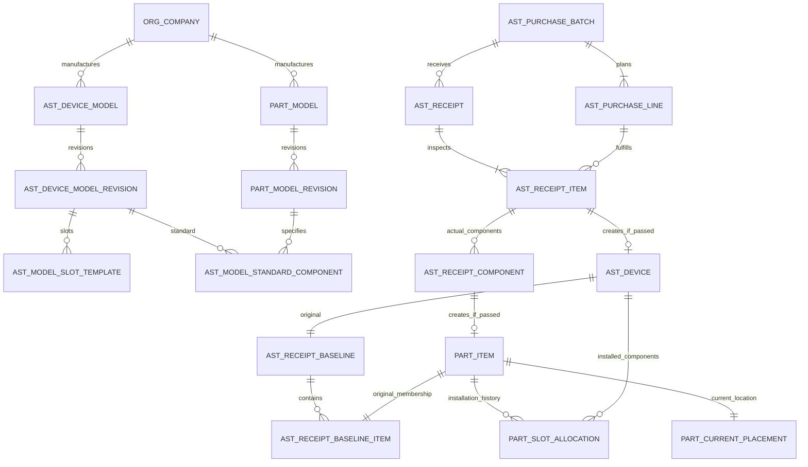

# 到货验收与实物资产领域设计

日期：2026-11-14。状态：后端实现与契约说明；已接入新增迁移、领域实体、服务、API 和权限，前端业务页面尚未建设。配套 [前端 API 契约](ASSET_RECEIVING_API.md)。

## 1. 本批目标与既有设计的关系

交付链路：维护组件/设备模型 → 创建到货单及计划配置 → 分批逐台验收 → 提交设备序列号、验收图片、库房位置和实际组件 → 原子生成设备及组件实物 → 查询原始/当前配置 → 补录组件序列号。

本设计按 2026-11-14 用户确认细化 B3 和 B5：

- 模型标准配置、采购计划配置、到货原始配置、当前安装配置、未来采集观测分开保存。
- 到货单代表收货计划，可关联外部采购订单号；本批不包含采购审批、付款、发票或合同履约。
- 验收草稿和拒收记录不是设备资产。仅验收通过并提交后生成设备、组件实物；这细化并调整了旧文“到货时先创建 pending_inspect 实物”的本批落地时机。
- 组件实物身份及安装关系提前在本批交付，不延迟到 B7；B7 复用这些身份，不再次创建同一实物。
- 本批组件逐件管理，即使没有序列号也有独立内部编号。数量用于输入和展开，不把 16 根内存只存成一条 quantity=16 的实物记录。数量型耗材库存后续单独接入。
- 当前硬件配置表示已确认的安装事实，不表示设备已运行、已加电或采集验证成功。
- 组件移动、工单审批、上下架、库存预留/余额/盘点、退换货执行、基线更正及采集写入本批不提供操作接口；预留其事实关联方式。

实现入口：[领域实体](../backend/internal/domain/receiving.go)、[事务仓储](../backend/internal/repository/receiving_repository.go)、[迁移与约束](../backend/internal/bootstrap/receiving_schema.sql)、[路由清单](../backend/internal/domain/receiving_routes.go)。新增迁移为 `20261114_v13_asset_receiving`。既有 `foundation_receipts` 是基础档案幂等回执，不是到货单。

## 2. 核心关系

图中必选关系描述成功提交后的本批资产；空草稿允许没有明细，未来独立备件入库可产生不属于整机基线的组件。

## 3. 通用存储约定

- 所有实体 ID 为 PostgreSQL `uuid`，服务端生成 UUIDv7；展示编号另存并建唯一索引。外键不使用自由文本、JSON 内 ID 或通用 resource_type/resource_id 代替必要关系。
- 时间列 `timestamptz`，API RFC3339；日期 `date`。`recorded_at` 为服务端记录时间，`effective_at` 为核实的现场时间，未知允许 NULL。不得用验收提交时间冒充组件的实际安装时间。
- 可编辑聚合有 `version bigint NOT NULL DEFAULT 1 CHECK(version > 0)`；模型业务修订号另用 `revision_no integer`，不能混用。
- 档案主表采用 `AssetRecord`，沿用基础档案的启停 `status=1/2`。验收/订单用显式业务状态，不复用该整数；状态只由命令改变。
- 已发布版本、已完成验收、基线、事实和审计不采用带普通 Update/Delete 的泛型 CRUD。历史表不嵌入可软删除的 `BaseEntity`；使用 ID、创建时间和明确的不可变字段。
- 必填列 NOT NULL；文中 `?` 为 nullable；集合 API 返回 `[]`。除明确声明的默认值之外，必填字段无隐式业务默认值。JSONB 的结构版本必填，通过 `datatypes.JSONType[T]` 定义和验证，不接受任意 map。
- 模型、订单、验收及设备编号最多 64 字符；名称 128；SN/料号最多 128；备注/原因 1024。数量为正整数，模型无标配允许零条明细。额定功率单位 W，容量 bytes，传输速率按协议固定单位，禁止单位不明的数值。
- 冻结事实用数据库触发器拒绝 UPDATE/DELETE；冻结父对象时同时保护子表和证据关系。已发布版本的发布状态转换受专用命令约束。迁移由独立权限执行，不宣称可阻止数据库管理员篡改。
- 审计字段至少包含 actor_user_id（FK users）、request_id、action_id、before/after 类型化载荷。用户停用或删除不级联删除历史。未来服务主体接入再迁移 `core_principal`，本批不伪造服务账号。

## 4. 模型聚合

### 4.1 身份与版本

| 表 | 业务字段 | 约束 |
| --- | --- | --- |
| `part_model` | manufacturer_id FK org_company、part_no、normalized_key、name、kind、status、version、description、created_at、updated_at、deleted_at? | 制造商身份为 1/3；(manufacturer_id, normalized_key) 唯一，软删除不释放编号 |
| `part_model_revision` | model_id、revision_no、state、spec_schema_version、spec JSONB、tracking_mode、unit、version、published_at?、published_by?、created_at、updated_at | (model_id, revision_no) 唯一；state=draft/published；本批 tracking_mode=individual、unit=piece |
| `ast_device_model` | manufacturer_id、model_name、normalized_key、name、category、status、version、description、时间/软删除字段 | (manufacturer_id, normalized_key) 唯一；制造商身份为 1/3 |
| `ast_device_model_revision` | model_id、revision_no、state、mounting_type、height_u?、rated_power_w?、spec_schema_version、spec JSONB、version、published_at?、published_by?、created_at、updated_at | mounting_type=rack/blade/standalone；rack 的 height_u 为正整数；其余不得用假 U 高占位；功率已知时 >0 |

组件 kind 首批：cpu/memory/disk/nic/hba/power_supply/fan/controller/optical_module/other；设备 category：server/storage/fc_switch/network_switch/other。新增枚举需同时更新规格验证器和 API 元数据。

SN 规范化首版为去除首尾空白并做 ASCII 大写，不删除连字符或前导零；中间空白和非 ASCII SN 拒绝并提示人工核验。保留用户输入原文。型号/料号仅去首尾空白并 ASCII 大小写折叠，保留其他字符。规则版本持久化，后续更改必须做冲突分析。

kind/category、制造商、料号/型号标识在创建后固定；错误且尚无引用时删除重建，不能把被引用模型改成另一个型号。展示名称、备注可编辑并审计。

规格固定 schema v1：memory 要求 capacity_bytes、memory_generation、speed_mt_s，ecc 可空；disk 要求 capacity_bytes、interface、media_type，form_factor 可空；其余类型按字段字典返回受控属性（见 API 元数据），没有已知规格可存 schema v1 的空结构并明确未知。发布校验类型对应规则，不能通过 other 绕过已选类别的必填项。JSONB 仅保存差异化规格，参与关联、排序、唯一性及占用的字段使用普通列。

### 4.2 版本子表

| 表 | 字段 | 约束 |
| --- | --- | --- |
| `ast_model_slot_template` | id、device_model_revision_id、stable_key、name、kind、interface?、form_factor?、position JSONB | (revision_id, stable_key) 唯一；位置键跨版本语义稳定，显示名可变 |
| `ast_model_port_template` | id、device_model_revision_id、stable_key、name、protocol、connector、speed_mbps?、source_kind、slot_template_id? | source_kind=fixed/option_slot；可选卡的端口不得当固定端口生成；slot 必须属于本版本 |
| `ast_model_standard_component` | id、device_model_revision_id、part_model_revision_id、slot_template_id?、quantity、required | 有槽位时 quantity=1，槽位本版本内唯一；无槽位 quantity>0；引用已发布组件版本 |
| `part_compatibility` | id、device_model_revision_id、slot_template_id?、part_model_revision_id、status、evidence_note、confirmed_by?、confirmed_at? | status=pending/confirmed/incompatible；同 revision/slot/part 组合唯一，NULL 槽位也按唯一处理 |

兼容关系随设备模型版本冻结；slot=NULL 表示设备级兼容，不能覆盖某个槽位明确 incompatible 的结论。实际安装和标配须有 confirmed 关系，且满足槽位接口/类型约束。无槽位但确认已装机时使用设备级 confirmed 关系。已发布版本的兼容清单需增补时创建新修订，本批不另做替代料工作流。

发布设备模型时校验全部子项、组件版本和制造商仍启用；未确认的兼容记录可以保留为不可用候选，但不能被标配使用。同一设备版本整体发布，不支持只发布一半槽位。发布后的型号停用不隐藏历史，新订单/验收提交不得新增引用。已生成资产继续查询和补录身份。

## 5. 到货单与计划配置

沿用领域总图已有名称，API 对用户称“到货单”：

| 表 | 字段 |
| --- | --- |
| `ast_purchase_batch` | id、number 唯一、name、supplier_id FK org_company、external_order_no?、expected_arrival_date?、state、version、description、created_by、created_at、updated_at、opened_at?、completed_at?、closed_at?、close_reason? |
| `ast_purchase_line` | id、purchase_batch_id、line_no、device_model_revision_id、planned_quantity、accepted_quantity DEFAULT 0、version、note |
| `ast_purchase_line_component` | id、purchase_line_id、part_model_revision_id、slot_key?、quantity、required |

行号在单内唯一；`0 <= accepted_quantity <= planned_quantity`，型号引用已发布版本。计划组件从选定模型版本复制并允许在到货单草稿内调整，作为“每台预期配置”，不随模型最新版本变化。修改型号必须明确重建计划配置，不能静默保留不兼容槽位。

订单状态：draft → open → completed；open 可 close 成 closed（部分交付后结束剩余计划）；draft/open 且尚无成功验收资产时可 canceled。completed/closed/canceled 为终态。open 自动在全部明细数量满足后 completed。关闭/取消均必须先取消未完成验收草稿，不留下可提交的悬空草稿。

draft 才能改供应商、行项目、数量和配置；open 后冻结计划。需要补购另建单并记录外部订单号，不提供普通编辑增减已经开放收货的计划。供应商必须启用且 type=2/3。至少一条明细才能 open。实际分批次数不限。

`accepted_quantity` 是可重算投影，来源为 completed 验收中 pass 的设备条数；在最终提交事务内锁住订单/行并递增，不根据前端提供的汇总更新。验收草稿不预占计划数量，多个草稿竞争剩余量时后提交者得到冲突。

## 6. 验收聚合

| 表 | 字段与含义 |
| --- | --- |
| `ast_receipt` | id、number 唯一、purchase_batch_id、state=draft/completed/canceled、version、note、created_by、created_at、updated_at、completed_by?、completed_at?、canceled_at?、cancel_reason? |
| `ast_receipt_item` | id、receipt_id、purchase_line_id、device_model_revision_id、serial_number?、normalized_sn?、sn_rule_version、custody_location_id?、inspection_result=pending/pass/reject、inspected_at?、difference_reason?、reject_reason?、configuration_confirmed DEFAULT false、created_at、updated_at |
| `ast_receipt_component` | id、receipt_item_id、part_model_revision_id、serial_number?、normalized_sn?、sn_rule_version、initial_placement=installed/stored、slot_key?、custody_location_id?、created_at、updated_at |

验收 item 每条代表一台待核验设备，不能用 quantity=6 的一行代替 6 台 SN。草稿允许 SN/图片/库位不全；同一草稿内同制造商已知 SN 不重复。item 的设备版本固定为采购行版本，本批不支持验收时直接替换整机型号。

组件批量输入数量后展开为多条 `ast_receipt_component` 草稿，有稳定草稿 ID；尚无实物 ID。编辑和删减按草稿 ID 操作，不依赖 SN 或数组下标识别。模板只用于显式初始化，后续保存不会悄悄补回删除的组件。

对 pass 条目，提交时要求：设备 SN 非空；至少一张该设备的验收图片；库房/库位有效；现场核验时间 inspected_at 已填写且不晚于当前服务端时间；逐件实际配置已确认；所有引用符合版本/启停和兼容约束。零组件必须显式确认，防止遗漏输入被当作零配置。与计划在组件型号、数量、槽位或必配项上有差异时提供 difference_reason，差异允许留证验收但不能绕过不兼容或重复身份。

组件 installed 时 custody_location_id 必须为空；已知 slot_key 必须属于本设备版本，同一设备已知槽位不重复；槽位未知允许 NULL，不生成虚假槽位。stored 表示随整机到货的散件，必须填写有效保管位置且 slot_key 为空；不算当前装机配置。

对 reject 条目要求已知设备 SN、reject_reason、现场核验时间和至少一张证据图片；不要求通过组件配置校验或填写合格入库位置。记录拒收事实但不创建设备/组件资产、不消耗计划数量。再次送货使用新验收草稿，旧拒收记录保留；退换货物流及与既有资产的更换关联后续实现。

至少有一台验收项，且所有条目完成 pass/reject 判定后可 complete；允许全 reject，此时生成资产数为 0，订单仍可继续收货。未核验条目不能随整批偷偷完成，应先从本草稿移出。completed 即完成并自动归档，不另设人工归档动作。草稿取消保留记录及附件来源，不能取消已完成验收。

所有嵌套写入统一检查并递增 receipt.version，包括图片上传/解除关联、组件新增/修改/删除、判定更新。预检和提交都基于同一聚合版本，避免“主单版本没变但组件已被别人修改”。

## 7. 文件与库房引用

### 7.1 位置桥接

本批实现已有规划中的 `ast_custody_location` 最小集：id、kind=warehouse/bin、warehouse_id? FK dc_warehouse、bin_id? FK dc_bin、created_at。两种 FK 恰一非空，按来源 FK 唯一；有库位时由 bin→shelf→warehouse 解析所属仓库，不接受客户端填两套可能冲突的归属。

现有仓储资源创建/首次引用时由 Repository 事务 get-or-create 桥接，不要求用户新增第二套库房。前端提交 `{warehouse_id, bin_id?}`，Service 校验归属及全路径启用，保存 custody_location_id。有引用时阻止底层库位删除或改变父级，位置名称改变不覆盖基线里的历史路径快照。

本批设备位置保存在 `ast_device.current_custody_location_id`，仅支持在库。后续上架按专用位置事务迁移到统一位置投影，不能通过资产普通编辑写 rack_id/IP。组件装机位置由其设备解析。

### 7.2 验收附件（本批采用 PostgreSQL 原子存储）

- `core_attachment`：id、receipt_item_id FK、baseline_id? FK、original_filename、detected_mime、size_bytes、sha256、content bytea、uploaded_by、created_at；关联字段直接外键引用验收项和原始基线，不另外创建两张纯关联表。
- 本批由专用 `ReceivingAttachmentRepository` 持久化图片字节和元数据，与验收草稿版本在同一 PostgreSQL 事务内提交。无需跨对象存储补偿，不依赖应用的 memory storage。没有长时间外部网络 IO 处于验收事务中。
- 普通详情/列表查询省略 content，下载鉴权后才读取二进制。完成验收时绑定 baseline_id，并由 completed 父聚合触发器冻结图片及关系；原图不可通过普通编辑替换。
- 草稿解除图片时删除该未冻结附件；已经归档的通过/拒收证据均不能删除。数据库备份包含图片，容量预算必须计入证据体积。后续有容量需求时通过专用存储接口迁移到 S3，并另外实施上传完成确认、清理及补偿协议。
- JPEG/PNG，单张 10 MiB，每台 20 张，解码像素上限 40MP；校验实际图片内容而不是扩展名。当前不接受 WebP，前端以 metadata.accepted_image_types 为准。

## 8. 实物、原始基线与当前配置

### 8.1 实物身份

本批建立最小 `res_object(id, object_type, created_at)`，object_type=device/component；具体实体复用此 UUID 作为 PK/FK，同事务创建，类型不可变。后续扩展统一资源身份，不重复生成资产。

| 表 | 字段 |
| --- | --- |
| `ast_device` | id FK res_object、asset_code 唯一、device_model_revision_id、manufacturer_id、serial_number、normalized_sn、sn_rule_version、supplier_id、source_receipt_item_id 唯一、lifecycle_state=in_stock、current_custody_location_id、configuration_version DEFAULT 1、version DEFAULT 1、created_at、updated_at |
| `part_item` | id FK res_object、internal_code 唯一、part_model_revision_id、manufacturer_id、serial_number?、normalized_sn?、sn_rule_version、source_receipt_component_id 唯一、quality_state=usable、version DEFAULT 1、created_at、updated_at |

制造商由模型继承，通过复合外键或约束触发器保证不能填写不一致值。设备 (manufacturer_id, normalized_sn) 唯一且不可空；组件相同范围对非空 SN 建部分唯一索引。设备/组件是不同身份命名空间，不跨两表互相误判。报废、停用不释放 SN 唯一性；已知有非唯一厂商 SN 的设备/组件必须另行定义身份策略后接入，不允许在本批静默合并。

组件 SN 初次补录需 expected_version、reason，同事务新增身份事件；本批仅允许 NULL→已知，已知→不同或清空须后续更正流程，不能用补录接口覆盖。相同内容的新命令返回无变化成功。补录不受模型停用阻断，因为不创建新实物引用。

### 8.2 不可变到货基线

| 表 | 字段 |
| --- | --- |
| `ast_receipt_baseline` | id、device_id 唯一、receipt_item_id 唯一、device_model_revision_id、snapshot JSONB（含设备与位置快照）、accepted_at、accepted_by、action_id、created_at |
| `ast_receipt_baseline_item` | id、baseline_id、part_item_id 唯一（本批每件只有一个原始来源）、part_model_revision_id、snapshot JSONB、serial_number_at_receipt?、original_slot_key?、original_placement（散件位置快照在 snapshot.location）、created_at |

snapshot 带 schema_version，冻结当时型号/制造商/供应商名称、规格、序列号、库房路径及数量口径。关系用真实 FK，快照用于重现当时可见事实。原始实物成员一件一行，不用之后的安装关系回算。

原始基线不因模型更新、序列号补录、组件移动或位置重命名改变。查询可额外返回 `current_identity`，但必须独立标明，不替换 serial_number_at_receipt。未来错误更正以新记录引用 corrects_baseline_id，初始版本保留，本批不提供更正命令。

### 8.3 当前安装与位置

| 表 | 字段与约束 |
| --- | --- |
| `part_slot_allocation` | id、part_item_id、device_id、slot_key?、installed_at?、recorded_at、removed_at?、ended_recorded_at?、start_action_id、end_action_id?；ended_recorded_at=NULL 表示当前有效，不能用未知的现场时间判有效性 |
| `part_current_placement` | id、part_item_id 唯一、kind=installed/stored、allocation_id?、custody_location_id?、last_action_id、version；两种目标恰一有效 |

当前安装的部分唯一索引：part_item_id WHERE ended_recorded_at IS NULL；(device_id, slot_key) WHERE ended_recorded_at IS NULL AND slot_key IS NOT NULL。未知槽位可并存，已知槽位不得冲突。

installed 只能指向本组件的有效 allocation；stored 必须没有有效 allocation。以可延迟约束触发器在事务提交时校验跨表一致性，避免短暂插入顺序导致误报。每件组件必须恰有一个 current_placement。结束安装关系必须有 end_action_id/ended_recorded_at；现场 removed_at 可以未知，已知时不得早于已知 installed_at。

验收只确认“当时已安装”，若不知道何时安装则 installed_at=NULL，recorded_at 为验收提交时间。stored 散件进入实物存放记录；installed 组件随设备在库，不同时计入可领用散件库存。

当前配置 = 有效安装关系关联组件实物/型号；不另存一份可编辑组件数量 JSON。数量汇总、已知 SN 数、待补 SN 数是查询结果。设备有 configuration_version，未来拆装递增；序列号补录只递增组件 version，不伪造硬件配置变化。

### 8.4 事实与身份补录

- `ast_asset_action`：id、kind=receipt_accept/part_serial_fill（后续扩展）、receipt_id?、actor_user_id、request_id、recorded_at；只追加。
- `part_movement_event`：id、part_item_id、action_id、event_type=receipt_installed/receipt_stored（后续增加 remove/store/install）、from_device_id?、from_custody_location_id?、to_device_id?、to_custody_location_id?、slot_key?、effective_at?、recorded_at、corrects_event_id?；来源/去向采用互斥 FK，不存自由文本位置。
- `part_identity_event`：id、part_item_id、action_id、old_serial_number?、new_serial_number、reason、actor_user_id、recorded_at；只追加。
- 上述 action_id/start_action_id/end_action_id/last_action_id 均为 ast_asset_action 外键。完成验收先创建动作，再创建依赖记录；事件的同动作组件唯一约束防止重复初始事实。初始 device 与 component UUID 同时用于后续配置项/端口关联，不另外创建一个代表同一组件的虚假实物。
- 后续移动必须同事务写事实、结束/建立 allocation、更新 current_placement 和设备 configuration_version，并接入库存流水。不能再用收货事件扣第二次库存。未来采集单独存观测批次、来源和匹配结果，未经确认不能修改这些人工已确认事实。

## 9. 验收事务、幂等与并发

### 9.1 完成验收

1. 校验当前身份/API 权限与请求格式，验证 Idempotency-Key；事务内先尝试读取已完成的同键命令回执，同内容直接返回原业务结果（不再次执行版本检查），不同内容冲突。
2. 按固定顺序锁订单主记录、相关订单行（UUID 排序）、验收主记录；验证 expected_version、draft/open 状态和剩余数量。嵌套编辑也必须锁验收主记录；关单命令采用同样的订单→验收锁顺序。
3. 重读全部设备/组件、已发布模型及启停状态、库位、证据引用和判定；对会被并发停用/改变的基础记录持共享行锁到提交。所有行重新验证，preview 不构成授权或预留。
4. 为 pass 项生成 res_object、设备、组件及内部编号。唯一索引最终裁决 SN 冲突；按 receipt_item/component 唯一来源防止不同幂等键重复生成资产。
5. 写入验收基线及附件冻结关系、初始安装关系、当前位置和初始事实。reject 项仅冻结原验收证据，不创建任何实物。
6. 增加订单行 accepted_quantity，按累计数量更新订单状态，验收置 completed 并写 completed_at/by。保存审计、action 与命令回执，同事务提交。
7. 返回固定业务结果摘要（JSON 字段顺序不属于契约）。任一步失败回滚全部数据库变化；已上传附件仍在草稿中，不因失败丢失用户输入。

完成响应丢失后，同键同请求重试返回原结果；新键提交 completed 验收返回 RECEIPT_ALREADY_COMPLETED 和结果查询路径，禁止重建资产。永久保存完成验收和身份补录的回执，不用短 TTL 代替来源唯一约束。

### 9.2 命令回执

新增 `ast_command_receipt`：id、actor_user_id、operation、target_scope、key、request_digest、result JSONB、action_id?、created_at；唯一 (actor_user_id, operation, target_scope, key)。创建时 target_scope 使用父资源 ID 或固定 collection，不能以尚未生成的实体 ID 作为去重作用域。

回执与业务写入同事务；并发同键插入冲突后回滚并读取胜者的已提交结果，不能捕获唯一异常后继续使用已失败的 PostgreSQL 事务。保存响应 data 和稳定业务结果，重放用当前 request_id/timestamp 包装。失败不记录成功回执。

多表写入通过 domain 中的 ReceivingUnitOfWork 和强类型泛型仓储完成，Service 不直接执行 GORM 查询；Handler 只调用 ReceivingService。不复用通用 ManagedService 绕过事务边界。本批不自动重试未知事务结果；客户端使用同一幂等键重试。写事务先与现有基础档案写锁协调，再串行执行接收业务命令；读取持共享接收锁，保证跨表配置视图一致。这是初版的正确性边界，扩大并发前须压测并细化锁粒度。

### 9.3 服务边界

- `domain.ReceivingService` 是 HTTP 接入门面，方法 Execute 接收固定路由操作及身份；操作集合由 `ReceivingRoutes()` 注册，客户端不能指定任意操作名。
- Service 在 `receiving_models/orders/receipts/complete/assets` 中按领域分工，进入规则前把请求解码为各操作的强类型 DTO 并拒绝未知字段。业务规则不放入 Handler 或 Repository。
- `ReceivingUnitOfWork` 为一个事务提供所有强类型 `AssetRepository[T]`；组件和设备型号使用独立表，但复用公共 Go 档案/版本结构（model_id、normalized_key 等字段）。不让多个仓储分别开启独立提交。
- `ReceivingAttachmentRepository` 额外提供鉴权后的二进制读取；普通查询仅取元数据。初始实现全部通过 PostgreSQL 持久化，不依赖临时内存。
- 原始基线、安装/位置和事实使用独立实体及数据库约束，即使通用仓储被误调用，已冻结记录仍拒绝更新或删除。

所有请求链继续传原 Context，使用注入 slog；禁止日志输出完整请求体、图片内容、存储凭据或原始数据库错误。非致命清理错误在处理处安全 Warn，事务失败由边界统一记录。

## 10. 需要落实的数据库约束和索引

除字段字典中的唯一约束外，迁移必须包含：

- 订单行、验收项、组件、附件的所属关系一致性：receipt_item.purchase_line 必须属于 receipt.purchase_batch；嵌套路由 ID 不得仅按子表主键更新。
- 模型版本和槽位归属以复合 FK/约束触发器校验；已发布子项和 completed 验收子项不可变。
- 一条验收项最多生成一台设备，一条组件草稿最多生成一个组件，生成资产与基线一一对应。
- 同设备已知槽位唯一、组件有效安装唯一、当前保管位置唯一；所有事件/基线的外键禁止级联删除。
- 订单列表 (created_at DESC,id DESC)、验收 (purchase_batch_id,created_at DESC,id DESC)、设备 (created_at DESC,id DESC)、组件 (source_receipt_component_id)；已知 SN 查找用规范化索引；有效安装按 device_id 查找；事件 (part_item_id,recorded_at,id)。
- serial_number/normalized_sn 同空同非空，已知值非空字符串；SN 规范化一致性在写路径校验，唯一性最终由数据库保证。
- 正式库存流水接入前不得增加与 current_placement 不一致的独立“库存数量”；当前散件数量查询 stored 组件逐件计数。

## 11. 实施顺序与验证清单

实现顺序：模型及版本 → 到货计划 → 位置桥接与持久附件 → 验收草稿/预检 → 完成事务与实物查询 → SN 补录 → 前后端联调。新增迁移独立编号，不编辑已应用迁移。本批交付不包含组件移动 API。

| 编号 | 必须验证的场景 |
| --- | --- |
| RCV-01 | 计划 10 台，本次验收 6 台且每台 16 根内存：生成 6 台设备、96 个组件及对应基线；剩余 4 台 |
| RCV-02 | 草稿或拒收不产生实物；全拒收不消耗订单量；通过/拒收混合正确冻结 |
| RCV-03 | 两份草稿并发争抢最后一台额度：只允许一份成功，另一份保留草稿 |
| RCV-04 | 同键重复、响应丢失、不同键重提、同键改内容：不重复建资产、不重复计数量 |
| RCV-05 | 设备/组件 SN 在本单及跨单重复、不同厂商相同 SN、未知组件 SN：符合身份约束 |
| RCV-06 | 任一资产插入、证据冻结或审计失败：无半台设备/半批组件/错误累计数 |
| RCV-07 | 原始 16 根，测试夹具通过未来事务模拟拆下 8 根、另装 8 根：原始成员仍为最初 16 根，当前成员按实物 ID 改变；不暴露移动路由 |
| RCV-08 | SN 补录后基线仍为 NULL；身份事件追加；并发补录和重复 SN 不覆盖；已知 SN 禁止用补录接口更改 |
| RCV-09 | 模型新版本/名称改动、库位重命名不改变基线；停用引用并发与最终提交按锁顺序裁决 |
| RCV-10 | 两件组件占同一已知槽位、一个组件两处存放、装机件又计为散件：数据库拒绝 |
| RCV-11 | 普通角色的查询/创建/提交/图片下载/SN 补录正反例；跨父资源 ID 不可串改；撤权后幂等重放仍拒绝 |
| RCV-12 | 图片伪 MIME/超限/上传失败/关联失败/孤立清理/冻结后删除均有明确结果；无权限不可读图片 |
| RCV-13 | 版本冲突保留前端草稿；组件/附件变化让旧预检与旧提交版本失效；禁止盲目替换版本重试 |
| RCV-14 | 真实 PostgreSQL、HTTP→Service→Repository request_id、敏感日志哨兵、race/vet，以及前端实际联调 |

验证证据以 [后端验收实现说明](ASSET_RECEIVING_IMPLEMENTATION.md) 为准；上表是完整验收清单，不能由少量用例推定全部通过。单批上限初始建议 50 台、4096 件组件，总量超限拆为多份验收；具体时延与限额须由实现阶段压测验证。
