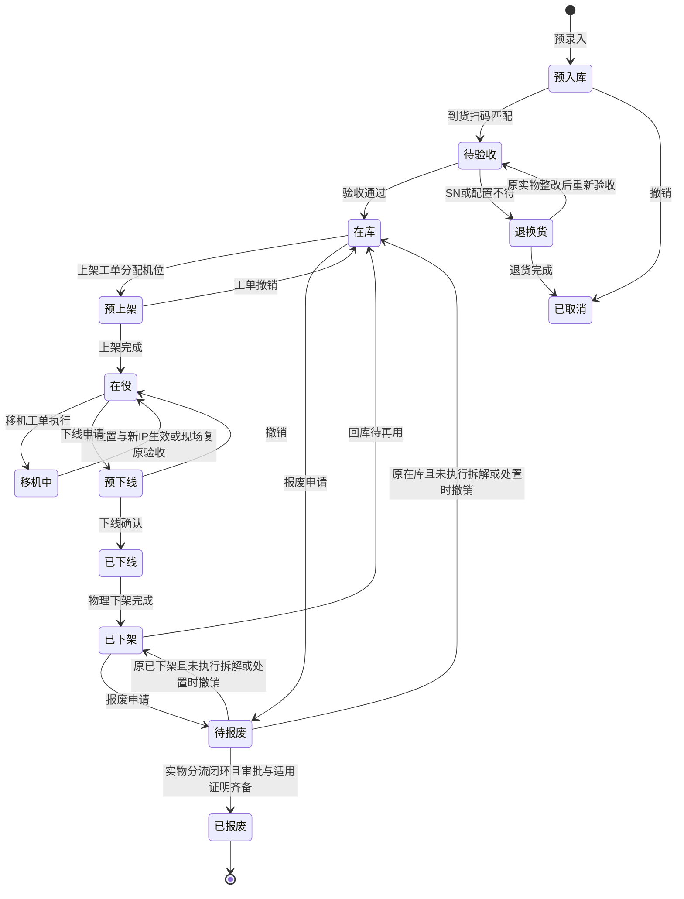
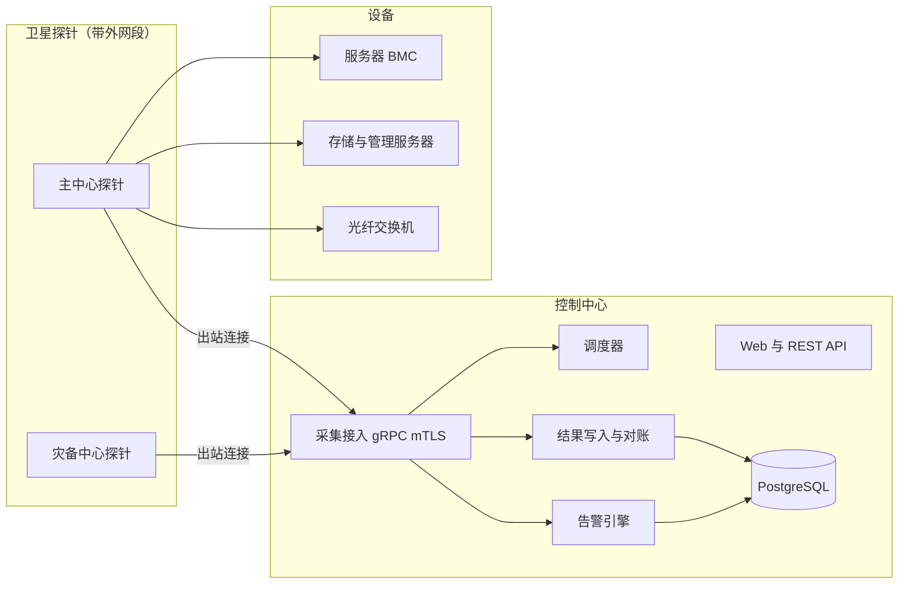
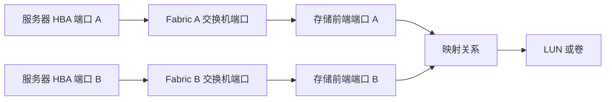

# 银行数据中心基础设施与存储网络资产运维管理系统
## 业务需求规格说明书

| 项目 | 内容 |
| --- | --- |
| 文档版本 | v1.9.0 |
| 编制日期 | 2026-11-05 |
| 文档状态 | 需求评审修订稿（确立 IPAM 双底座地位并补充 IP 历史占用溯源与双向审计履历） |
| 适用对象 | 数据中心硬件运维组、存储网络运维组、架构与研发团队 |

### 修订记录

| 版本 | 日期 | 主要变更 |
| --- | --- | --- |
| v1.0.0 | 2026-11-03 | 需求初稿 |
| v1.1.0 | 2026-11-03 | 补充 LUN Group/Port Group、NetApp SVM、StorageGRID；协议收敛为 REST + SNMP；参考 storage-net 卫星采集 |
| v1.2.0 | 2026-11-03 | 增加立即采集、错峰调度、Trap Server 与 MIB 库 |
| v1.3.0 | 2026-11-04 | 增加预入库扫码、批量移机、主备管理 IP 切换采集 |
| v1.4.0 | 2026-11-04 | 更正技术错误；补充存量导入、部件台账、合同覆盖、端口/跳线/ODF 路由、采集端点、台账对账、规模与容量基线；阶段重新划分为 7 个可独立验收的阶段 |
| v1.4.1 | 2026-11-04 | 对齐开发授权，拆分阶段职责，补充业务异常路径、技术依赖和验收用例 |
| v1.5.0 | 2026-11-04 | 增设前置验证，将串行路线改为按契约并行推进、按依赖分段验收 |
| v1.6.0 | 2026-11-05 | 强化跨模块级联联动：下线/下架级联释放线路与停采静默；批量移机自动挂载维护窗口与 IP 时序切换；维修关单即时自检卡点；备件-工单-FRU 原子置换；物理与 SAN 拓扑双向对账与光衰穿透；待报废 FRU 拆机利旧入库与涉密磁盘消磁分流 |
| v1.7.0 | 2026-11-05 | 修正 SSD 处置、停采恢复、移机地址时序、维修关单、线路释放及共享系统身份；补齐实物流转、SAN 推断、工单异常、权限与可靠性规则；拆分基础/联合验收，新增对象字典、状态副作用、事务事件契约和编号验收场景 |
| v1.8.0 | 2026-11-05 | 确立 IPAM 与机柜空间管理平级的双底座体系：增设网段/VLAN/安全域模型、IP 五态生命周期（空闲/预留/在用/冷却/冲突）、子网地址池矩阵可视化、机柜-网段绑定推荐，确立空间与 IP 在全生命周期中对等的级联卡点与回收机制 |
| v1.9.0 | 2026-11-05 | 补充 IP 历史占用全生命周期溯源与双向审计履历体系：建立不可篡改（Append-Only）的 IP 占用流水表，支持按“IP + 历史时间段”反查设备/工单/操作人，以及“按设备”穿透查询历史所持 IP 轨迹，满足安全溯源与金融合规审计要求 |

### 已确认的业务决策

| 编号 | 决策 |
| --- | --- |
| D1 | 采集只使用 **REST API 与 SNMP（含 Trap）**；不使用 CLI/SSH、SMI-S、IPMI；不部署操作系统 Agent |
| D2 | 告警接收只接 **SNMP Trap**，不接收 Syslog |
| D3 | 需要跳线管理，并延伸到 **ODF 路由管理** |
| D4 | 规模基线：约 **2,000 台服务器、50 台存储、80 台光纤交换机** |
| D5 | 通知渠道：**企业微信、短信** |
| D6 | 采集与告警能力在 InfraNexus 中**按本项目架构重新实现**，storage-net 只作为设计参考 |
| D7 | 流程工单先在本系统内闭环，预留对接外部 ITSM 平台的扩展点（不在本期实施） |
| D8 | 待报废处置分流：可复用部件完成适用的数据清除及质检后流入备件库；涉密介质不随整机处置或还厂，HDD 按行内标准消磁或物理销毁，SSD 必须采用适用的物理销毁，不接受消磁；带非易失数据缓存的部件同样纳入介质核查；残余机箱与无留置部件经审批后报废销毁。证明绑定具体实物及实际处置方法 |
| D9 | IPAM 与机柜空间管理同等重要：建立独立完整的 IP 地址空间管理（IPAM）底座，支持网段/VLAN/安全域分层建模、IP 五态状态机（空闲/预留/在用/冷却/冲突）、子网地址池网格矩阵可视化、机柜与接入网段绑定推荐；支持全生命周期历史占用溯源与双向审计回放；在设备全生命周期中，IP 的预留锁定、分配绑定、移机原子切换与下架冷却隔离回收，与机柜 U 位享有完全对等的事务级级联卡点 |

---

## 一、系统定位与建设目标

### 1.1 业务背景与痛点
1. **账实不符与空间地址脱节**：Excel/CMDB 台账与机房实际机柜 U 位、带外/业务 IP 地址、物理跳线、设备状态多头割裂；设备下线后“占着机位不挪、占着 IP 不放”，造成空间虚高与地址池耗尽。
2. **维保与备件难追溯**：原厂维保与第三方续保并存，脱保空档难发现；更换部件与设备、工单缺少关联；易损件缺少安全库存预警。
3. **硬件状态盲区**：坏盘、电源故障、光模块弱光、端口误码依赖人工巡检发现。
4. **线路与 SAN 链路黑盒**：跳线和 ODF 路由靠纸质或表格记录；主机到交换机再到存储的映射靠人工核对，难以定位单点故障。

### 1.2 建设目标
建设集“机房物理空间、**IP 地址空间 (IPAM)**、资产生命周期、维保备件、线路管理、带外采集监控、SAN 逻辑拓扑”于一体的硬件运维系统：
- 确立**机柜物理空间（DCIM）与 IP 网络空间（IPAM）同等重要的双底座**，设备从预入库到报废的全生命周期中，机位与 IP 同步规划、预占、绑定、切换与冷却回收；
- 端口、跳线、ODF 路由可视化，可端到端追溯物理链路；
- 采用“控制中心 + 卫星采集探针”架构，适配带外管理网与多数据中心；
- 采集结果与台账、物理线路与逻辑连接自动对账，持续保持账实一致；
- SNMP Trap 与原生告警闭环处理，通过企业微信与短信通知。

### 1.3 范围外事项
- 操作系统内采集（OS Agent）、主机多路径与逻辑盘信息；
- Syslog 接收；
- 强电、PDU 进线与动力环境监控；
- 对设备的任何写操作（配置下发、Zone 修改等），系统对设备只读；
- 对接外部 ITSM 平台（本期只预留接口）。

---

## 二、管理范围与协议基线

### 2.1 设备类型与管理要素

| 设备类型 | 机型/系统 | 规模基线 | 管理要素 |
| --- | --- | --- | --- |
| 服务器 | x86 机架服务器、刀片服务器 | 约 2,000 台 | BMC 状态、CPU/内存/硬盘/电源/风扇/温度、HBA 卡与 WWPN（BMC 能提供时） |
| 集中式存储 | 华为 OceanStor（Dorado、V3/V5/V6）、Dell EMC（PowerMax/VMAX、Unity、PowerStore）、NetApp ONTAP（FAS/AFF，统一存储） | 合计约 50 台 | 控制器、电池、硬盘、存储池、LUN/卷、前端端口、主机映射关系；ONTAP 另含 SVM、Aggregate、NFS/CIFS 共享 |
| 对象存储 | NetApp StorageGRID | 计入存储数量 | Grid 节点（Admin/Storage/Gateway）、存储池、租户、Bucket 容量 |
| 光纤交换机 | Brocade（Broadcom FOS） | 约 80 台 | 端口状态与速率、光模块收发光功率与阈值、CRC/链路失败计数、Virtual Fabric（逻辑交换机/FID）、Fabric、Alias、Zone、生效 Zone 配置、ISL/Trunk |

### 2.2 协议基线

| 对象 | 采集方式 | 说明 |
| --- | --- | --- |
| 华为 OceanStor | DeviceManager REST API、SNMP | 版本差异由适配器处理 |
| Dell EMC PowerMax/VMAX | Unisphere for PowerMax REST API、SNMP | **通过 Unisphere 管理服务器采集，不直连阵列**；一台 Unisphere 可管理多台阵列 |
| Dell EMC Unity / PowerStore | 阵列自带 REST API、SNMP | |
| NetApp ONTAP | ONTAP REST API（ONTAP 9.6+）、SNMP | 以集群管理地址为采集端点，一个端点对应多个节点 |
| NetApp StorageGRID | Grid Management API（Admin Node）、SNMP | 以 Grid 为采集端点 |
| Brocade FOS | FOS REST API（RESTCONF，FOS 8.2+）、SNMP | FOS 8.2 以下只能用 SNMP，适配器需按版本降级；上线前梳理现网 FOS 版本 |
| 服务器 BMC | Redfish REST API、SNMP | 不支持 Redfish 的型号按已验证的 SNMP 能力降级；无可用协议能力时标记不支持采集 |

> [!NOTE]
> 管理入口、逻辑系统和物理资产必须分开建模：Unisphere 管理端点可以访问多个阵列系统；ONTAP 集群和 StorageGRID Grid 下既有物理节点，也有不能归属于单个节点的逻辑资源。协议版本门槛不代表所有能力可用，逐型号、固件、能力的支持范围以阶段 0 和适配器实测为准（见模块 7.2）。

---

## 三、功能需求

### 模块 1：数据中心空间与 IPAM 地址底座 (DCIM & IPAM)

> **设计原则**：在设备全生命周期中，**IP 地址管理与机柜管理具有完全对等的底层重要性**。机柜管理掌管“物理空间坐标”（机房/机柜/U位），IPAM 掌管“网络逻辑坐标”（安全域/网段/IP）。二者在规划预占、正式分配、移机切换、下线释放与回收冷却等环节深度交织、同等卡点。

#### 1.1 机房空间与机柜 U 位管理
1. **空间层级**：数据中心（主中心/同城灾备/异地灾备）→ 楼栋/楼层 → 机房/模块 → 机柜列 → 机柜 → U 位。
2. **机柜视图**：42U/48U 正面/背面视图，区分已占用、预占用、空闲；支持多 U 设备与刀片机箱槽位。正背面共享同一 U 位占用，不因切换视图重复分配；刀片只占机箱槽位，机箱占 U 位，移动机箱时同步维护所装刀片的位置关系。
3. **机柜属性**：U 数、承重、所属安全域（生产/测试等）、物理标签。不管理强电与 PDU。
4. **占用冲突校验**：上架、移机校验 U 位边界、高度、槽位兼容性及安全域。目标被其他设备或工单占用/预占则拒绝；同一设备在同一机柜内平移可复用自身源区间重叠部分，只新增锁定目标差集，验收前保留源区间。首期不支持一单内多设备互换仍被占用的位置，须经空闲中转位置分单完成。
5. **库房与库位**：备件库、设备库房、货架，供在库设备和备件使用。已下架到正式回库之间记录临时保管位置及责任人，不能只保留已释放的原 U 位。

#### 1.2 IP 地址与网段空间管理 (IPAM 核心体系)
1. **网段与子网分层建模**：
   - 建立“数据中心 → 安全域（生产/测试/外联/DMZ） → 子网/网段（Subnet）”的分层台账。
   - 子网属性：IPv4 CIDR（如 `10.20.30.0/24`）、网关（Gateway）、子网掩码（Netmask）、DNS、所属 VLAN ID、网络安全域。
   - 网段用途类型（Subnet Usage Type）：带外 BMC 管理网、存储控制/管理网、业务管理网、业务生产数据网、心跳/同步网、浮动 VIP 网等。
2. **IP 地址全生命周期状态机**：
   - `空闲可用 (Free)`：网段内未被分配的合法地址，可供工单规划与申请；
   - `预分配/预留 (Reserved)`：预入库规划机位时、上架工单审批通过时、批量移机规划目标地址时，**原子预占锁定目标 IP**，防止并发冲突与其他工单抢占；
   - `在役在用 (In-Use)`：设备正式上架加电验收后生效，强绑定【设备 ID + 物理控制器/网卡槽位 + 用途类型 + MAC 地址（可选）】；
   - `回收冷却 (Quarantined / Cooldown)`：**银行合规防冲突核心机制**。设备下线、下架或移机腾出旧 IP 后，**严禁立即释放回可用池**！必须强制进入冷却隔离期（默认 7~30 天可配置）。冷却期间禁止分配，避免交换机 ARP 缓存未刷新、DNS/配置未完全清理或旧机未彻底断电导致生产 IP 冲突；冷却期满后自动或经人工复核释放为“空闲可用”；
   - `冲突/异常 (Conflict)`：带外探针或定期 Ping 发现未经系统登记的未知存活主机占用该 IP，或同一 IP 被多方争抢时标记冲突，告警提示人工排查。
3. **子网地址池可视化矩阵视图**：
   - 提供类似机柜 42U/48U 空间视图的 **IP 地址池网格矩阵（如 /24 网段展示 256 格全量地址网格）**；
   - 以不同颜色直观呈现网络保留（网络号/广播/网关）、空闲、预留、在用、回收冷却及冲突状态；
   - 支持点击或悬浮卡片即时查看 IP 当前绑定的设备名称、序列号、网卡槽位、用途及占用历史流水。
4. **机柜与网段拓扑绑定（智能推荐与防错）**：
   - 支持维护机房模块/机柜与接入交换机默认子网（ToR Subnet Binding）的关联关系；
   - 在设备规划或分配 IP 时，系统联动所选机柜智能过滤并推荐合规的带外网段与业务网段，防止跨网段配错 IP。
5. **IP 历史占用溯源与双向履历审计 (IP Allocation & Occupancy History Tracking)**：
   - **IP 占用流水实体（Append-Only 只增不减）**：在任何工单分配、移机切换、下架冷却、期满释放或状态变更时，系统必须在同一业务事务内同步写入不可篡改的 IP 历史占用流水记录（`ipam_ip_history`），严禁直接覆盖物理字段导致历史抹除。
   - **流水关键字段**：
     - 时间戳：分配生效时间（Allocated At）、释放解绑时间（Released At）、占用时长（Duration）；
     - 占用实物主体：绑定设备资产 ID、设备名称/主机名、序列号（SN）、物理控制器/网卡槽位/端口角色（Port Role）、MAC 地址；
     - 网络与用途属性：所属子网 CIDR、VLAN ID、用途分类（主管理/备管理/业务/存储/心跳等）；
     - 关联审计来源：来源工单 ID 与工单类型（上架/批量移机/下架/处置）、申请人、审批人、操作人、变更原因；
     - 状态轨迹：完整记录 `Free → Reserved → In-Use → Quarantined → Free` 的每次状态转换节点与耗时。
   - **双向穿透检索与安全审计反查**：
     - **以 IP 查设备（安全溯源应急）**：输入任意 IPv4 地址与历史时间点（精确到分秒），能够瞬间回放并精准反查出当时该 IP 由哪台物理设备占用、SN 是多少、装在哪个机柜哪一 U 位、由哪个工单哪位工程师分配（解决安全事件发生时的责任溯源与实物定性）；
     - **以设备查 IP 历史（设备网络履历）**：在设备资产台账中，不仅呈现当前有效的主备管理 IP 和业务 IP，同时支持一键展开该设备在全生命周期中**曾经持有过的所有历史 IP 记录**（包括移机前的历史管理 IP、临时过渡 IP、起止时间及工单变更链条）；
     - **网段级利用率与流转审计**：支持按子网导出历史占用周转率、高频变更 IP 列表、长期空闲 IP 及安全合规审计台账。

#### 1.3 空间与 IP 在全生命周期中的级联流转与卡点
在整个设备生命周期流转中，机柜 U 位与 IP 地址必须作为**孪生基础设施资源**联动，享受完全对等的事务级并发防冲突与卡点控制：
- **预入库与预上架**：分配物理机柜 U 位的同时，从对应子网中**同时预分配锁定主管理 IP、备用管理 IP 与业务 IP**（进入 `Reserved` 状态）；
- **正式上架验收**：U 位转入正式占用，主备管理 IP 与业务 IP 同步转入 `In-Use` 状态并建立设备强绑定（校验 IP 必须处于所选网段合法范围，非本网段或被占用直接阻断）；**同时原子写入首期 IP 占用流水记录**；
- **批量移机**：源机位与源 IP 保持占用，目标机位与目标网段新 IP 预占；现场在新机位通电探活通过后，整单验收时原子切换：源机位释放、**源 IP 转入回收冷却隔离（记入源 IP 释放流水并开启冷却计时）**、目标机位转正式占用、**目标 IP 正式转入 In-Use（记入目标 IP 占用流水）**，时间序列严格连续；
- **停用下线与下架**：设备进入已下线状态时，采集调度自动停采；**物理下架验收时，U 位释放、跳线释放，所有主备管理 IP 与业务 IP 级联释放并转入【回收冷却】（流水记录下架释放事实与冷却期）**，彻底杜绝银行机房设备已搬走但“占着 IP 不放导致地址池枯竭”的顽疾！

### 模块 2：设备资产台账与生命周期

#### 2.1 设备台账
- 基本信息：资产编号、SN、厂商、型号、设备类型、所属安全域、负责人/团队、采购合同、投产日期。
- 位置：机柜与起始 U 位、机箱槽位或库房库位；正式位置与移机现场进度分别记录，不把计划位置当成实际位置。
- 管理地址：**主管理 IP、备用管理 IP**（标明各自所属控制器/板卡）、业务 IP，**强关联 IPAM 子网与 IP 实体外键**，记录网络地址范围及生效历史。资产地址不自动等同于采集端点地址；共享管理入口由端点独立维护，移动其中一台资产不自动修改整个端点地址。提供**网络历史履历面板**，可随时穿透回溯该资产曾经绑定过的全部历史 IP 记录、槽位角色及变更工单。
- **设备型号模板**：维护型号的高度（U 数）、端口模板（端口名称、类型、速率）、标准配置，1A 新建设备时生成基础配置项及稳定标识；这些配置项不代表已验收的实物。1B 接入 FRU 时关联既有配置项，1C 为新设备生成端口实例并按模板为存量设备补建；模板变更不覆盖已维护的实物和端口。

#### 2.2 存量导入
- 支持 Excel 模板批量导入设备台账（含位置、管理 IP、维保信息），导入前预校验（身份重复、U 位冲突、**IPAM 子网范围与 IP 占用冲突**、字段缺失），给出逐行错误报告，确认时重新校验并整批提交；任一行失败则整批回滚。首期导入只新建，命中既有身份返回冲突或已有导入结果，不静默覆盖；批次和行使用稳定幂等标识，重复确认不重复创建。
- 存量初始化允许直接登记在库、在役、已下线、已下架等已核实的稳定状态，记录来源、基线时间、位置和核验人，不伪造入库上架历史。待报废/已报废导入仍须提供处置清单及适用证明；不通过导入创建移机中等未闭环执行状态。未知历史单独标记，不补造时间。
- 1A 保留维保原始信息供核对，1B 确认合同覆盖后用于保修计算。所有设备、线路导入统一限制文件大小和行数，先完成解析及预校验再开启提交事务；上线前在 5.3 验收基线中冻结限额。

#### 2.3 生命周期状态机
生命周期状态与运维标记分开管理：
- **生命周期状态**：描述设备处于哪个阶段（见下图）。
- **运维标记**：维修中、维护窗口中，可叠加在“在役”上。更换一块硬盘不改变设备的生命周期状态。

状态转换必须由授权业务操作触发，禁止通用编辑接口直接改状态。审批拒绝、执行失败和验收退回的处理见模块 6；第六节定义跨模块状态副作用。

#### 2.4 关键动作
- **预入库与扫码入库**：
  - 到货前按采购合同/批次及行项目导入预入库清单（厂商、型号、标准配置、维保信息、预计数量），允许此时未知 SN，不能用空 SN 作为匹配键；
  - 到货时选择批次/行项目后扫码或录入 SN、资产标签，带出预入库模板。多个批次同型号时必须明确选择，校验剩余数量，现场核对配置并上传验收单后确认入库；
  - SN 或配置不符进入“退换货”，保留差异；更换整机使用新的实物资产记录关联原退换货单，不覆盖原整机身份。按“批次行项目 + 实物身份 + 本次操作”去重，重复扫码返回既有结果；后续盘点、维修扫码不因历史扫码被错误拦截。
- **上架**：通过上架工单分配机柜、预占 U 位并分配主/备管理 IP。1A 在工单记录人工线路清单与现场地址核验，1C 接入线路占用，2A 接入已配置端点的只读身份探活；未配置/不支持采集的设备仍可经人工核验上架，不自动创建或启用采集端点。
- **批量移机**：
  - 一单包含多台设备，逐台记录源/目标位置、主备地址、负责探针及线路拆建计划。新地址先预分配，不能被周期采集提前使用；共享端点的管理入口单独评估，不能随单台资产自动搬迁。
  - 进入执行时记录设备级暂停原因和维护范围；2A 生效停采，2B 抑制通知。默认范围是工单设备及受影响的源/目标直连端口，不静默整个机柜；扩大范围须明确审批（见模块 6）。
  - 逐台登记断电、实际位置、通电及新地址核验时间。2A 由目标侧获准探针执行新地址连通性及目标身份测试；未配置/不支持测试时按人工核验路径留证，不把测试失败当成通过。跨中心同步校验探针、凭据引用和地址范围授权，不能将源端凭据无条件复制给目标端。
  - 部分执行时保留源占用和目标预占；整单验收重新校验位置、地址和工单版本，在同一事务内切换正式位置、地址历史与生命周期，1C 同步提交已确认线路变更。正式地址历史采用 `[validFrom, validUntil)`，旧版本结束与新版本开始使用同一事务时间；实际采样空档如实记录，不补造数据。过渡期 Trap 与旧结果规则见模块 7.5、8.1。
  - 撤销仅限未执行，或逐台完成现场复原并确认线路、地址、身份及位置；复原时也递增采集配置版本，解除本单暂停并释放目标预占。现场无法复原时保持执行异常，不靠数据库回滚假装实物已恢复；重复验收返回既有结果。
- **下线与下架**：下线申请进入预下线，申请阶段继续正常采集；实际执行下线时才施加暂停和通知抑制。1A 人工确认映射、Zone 和线路清理，1C 提供逐段线路核对，3A 提供可见配置辅助核验，系统不下发设备配置。已下线仍占 U 位，物理下架验收后释放 U 位并登记保管位置；1C 只同事务释放本单已核验可释放的线路资源，固定主干连接及其他有效路径引用保留（见模块 3）。撤销只解除本流程施加的暂停，不改变人工启停配置。
- **利旧**：已下架设备回库后可再次上架；跨安全域前必须按实际介质完成获批的数据清除并上传验证证明。利旧清除不得简单等同于消磁，HDD 消磁不能作为保持可用性的默认清除方法，SSD 不接受消磁。清除与设备操作均在系统外由授权人员执行，本系统只记录与校验证据。
- **待报废处置与拆机利旧分流**：进入待报废后建立逐件处置清单，按实物标识、介质类型、原槽位和去向核对；无介质也须明确登记核验结果，不能用空清单默认放行。
  1. **可复用部件**：登记 RAID 卡、HBA、内存、电源、光模块等的拆卸和质检；带非易失数据缓存的部件须先完成适用数据清除及验证。合格后进入拆机利旧可用库存，保留原设备 ID/SN、槽位及历次流转记录；不合格转待处置，不计入可用库存。
  2. **涉密介质**：报废设备的 HDD 在行内按标准消磁或物理销毁，SSD 采用适用的物理销毁，严禁以消磁替代；其他存储介质按实际存储技术适用方法处理。上传与方法相符的处置证明，绑定逐件清单、操作人、复核人及时间，严禁随整机处置或还厂。
  3. **机箱与残件**：拆件去向和介质处置全部核验闭环后，经审批记录残值评估、处置批文及实物销毁影像，才允许转已报废。执行拆解或不可逆处置后，不允许直接撤销回原状态；错误记录通过审批更正并保留历史，不能恢复已销毁实物。
  - 1A 交付逐件人工清单、证明及卡点，1B 将清单关联统一实物标识并验收 FRU/库存自动流转；1A 不宣称已完成库存入账自动化，也不得省略介质处置证据。

#### 2.5 部件（FRU）台账
- 在设备下维护部件实物 ID、品类、型号、槽位、SN（存在时）和安装有效期。FRU 是实物在设备上的安装关系，不另复制一份可用库存；数量件按批次追踪，安装到具体槽位时建立内部实物标识，不伪造厂商 SN。
- **备件-工单-FRU 原子置换**：领料时只转为已领用；授权人员确认实物换件后，在同一事务内将新件设为在机、结束旧件安装关系、登记旧件保管位置，并按实际情况转待质检、待还厂或待处置，记录置换流水。涉及 HBA 等自带端口的部件时，保留旧端口历史，关联新部件及端口身份，不把旧 WWPN 直接继承给新件；线路变化由对应工单核对。
- **人工确认与观测核实**：授权换件验收本身即构成人工确认，不再要求同一事实重复审批；采集差异确认不能再次触发领料扣库。2A 使用换件后取得且覆盖相应槽位的 configuration 快照核验 SN；匹配时标记“SN 已核实”，不一致为待复核，无 SN/不支持能力为“无法自动核实”，均保留人工验收证据。
- **与关单解耦**：已完成实物换件即记录台账和库存事实，随后健康检查失败时工单继续执行，不回滚实物事实；再次换件须新置换记录，重复健康复核不得重复扣库或置换。

### 模块 3：端口、跳线与 ODF 路由管理

#### 3.1 对象模型
| 对象 | 说明 |
| --- | --- |
| 设备端口 | 由型号模板生成：交换机端口、HBA 端口、存储前端端口、BMC 管理口等；属性含类型（FC/以太网）、速率、接口形态（LC/RJ45/MPO） |
| 配线架 / ODF | 安装在机柜或独立 ODF 架中；包含面板与端口（LC 双工、MPO 等） |
| 主干光缆 | 连接两个 ODF 之间的光缆，按物理光纤芯管理，支持按芯对预占和使用，记录类型（OM3/OM4/OS2）、芯数、长度 |
| 跳线 | 连接设备端口与 ODF 端口、ODF 与 ODF、设备与设备；记录编号/标签、类型、长度、颜色 |
| 路由 | 一条端到端物理路径，例如：服务器 HBA 端口 → 跳线 → 本列 ODF → 主干光缆芯 → 交换机区 ODF → 跳线 → 交换机端口 |

#### 3.2 功能
1. **端口占用视图**：分别展示实物连接、业务占用/预占及健康状态，故障不是空闲。ODF 前后侧分别记录连接；LC 双工芯对锁定组成芯，MPO 按通道/纤芯映射管理，未明确映射的连接不得自动分配或释放。
2. **路由追踪**：从任一端口追踪完整路径，逐跳展示跳线、ODF 前后侧、主干芯与极性/通道对应关系；断路、成环和未维护段显式标记，不推测补齐。
3. **可用路由查找**：根据两端位置、接口、光纤类型和通道数查找可用组合；固定主干连接可以承载可用业务通道，但同一物理连接侧不能重复插接。候选不等于预占，提交时重新校验并发冲突。
4. **跳线工单与受控释放**：与上架、移机、下架工单联动，自动生成逐段拆除、保留、解除业务占用清单。验收仅释放本单已核验且无其他有效业务/工单引用的资源；仍插接的远端跳线不能标为空闲，ODF 后侧及固定主干连接不随设备下架删除。尚未清理的线路保留占用与关联后续任务，不妨碍如实登记已完成物理下架的 U 位事实。
5. **标签**：按规则生成跳线与端口标签编号，支持导出打印。
6. **批量导入**：支持 Excel 导入 ODF、光缆和跳线，沿用模块 2.2 的预校验、幂等及整批回滚规则；先校验两端对象、通道映射和占用，不自动覆盖既有连接。
7. **物理与逻辑对账**（3A 联合验收）：使用端口登录与身份依据生成疑似私接/插错、疑似闲置（僵尸跳线）、台账缺失候选；不凭单次 Offline 或未知 WWPN 认定违规，差异须经核验，不能直接触发拆线或释放（见模块 9.4）。

### 模块 4：供应商与维保管理
1. **供应商档案**：原厂、第三方维保商、备件供应商；联系人、报修电话、服务级别。
2. **维保合同**：原厂保修与第三方续保合同；合同与设备**多对多**，每台设备在合同内有各自的起止日期和服务级别。合同日期按约定业务时区、含首尾日计算，不与地址的时间戳区间混用。
3. **有效保修计算**：按设备计算已确认且有效的覆盖区间并集，重叠或相邻区间合并，间隔列为脱保空档；当前连续覆盖区间结束日为当前到期日，无当前覆盖则显示脱保并列出下一覆盖期。并行合同时按配置优先级推荐服务商，展示其他有效服务商及各自 SLA，不能把不同服务级别合并成最高级别。
4. **覆盖调整与到期预警**：报废或利旧转出生成待确认的覆盖调整，不自动终止合同或改写 SLA；确认后保留变更历史。90/60/30 天分级提醒可配置，1B 交付页面提醒及待续保清单，2B 接入企业微信/短信发送；按设备、覆盖版本与提醒档位去重，续保后重新计算。
5. **报修指引**：维修工单带出当前有效服务商及服务级别，并保留报修时快照；无有效覆盖时明确提示，不自动指定失效合同。
6. **服务记录**：现场巡检报告、服务记录等附件存档。

### 模块 5：备件库管理
1. **备件目录**：料号、品类、适用型号、替代料号的已确认兼容关系；所有权为行内自有或维保商寄存，与库位、质量状态分开。寄存件领用/还件记录归属，不能通过移库改变所有权。
2. **两种管理方式**：
   - 序列化件：实物 ID 为主键，记录厂商 SN，适用于硬盘、HBA、控制器板卡及需要逐件管理的光模块；
   - 数量件：按料号、库位、所有权、批次及质量状态分别计数，适用于无 SN 光模块、线缆等。安装到具体槽位或线路时建立内部实物/安装标识，将相应批次的已领用数量转为已安装，不再次扣减可用量；拆回沿用该标识，不新增重复实物，不伪造 SN。
3. **入库来源**：采购、维保商寄存、报废拆机利旧；拆机件保留来源设备 ID/SN、原槽位、处置清单行和质检结果。待质检或待处置件可以登记保管入库，但不得计入可用库存。
4. **领用与安装**：领料/还件单须关联维修、上架、移机或跳线等适用业务工单，以及目标设备、槽位或线路。预留冻结可用量，领用转为已领用；确认安装后转为在机/已安装，不能再次扣减可用量。维修换件按模块 2.5 同事务置换；取消未领预留释放一次，已领未用件实际退回并验收后才回补一次，不能仅凭撤销工单回补库存。
5. **实物状态与坏件处理**：基本流转为待质检 → 可用 → 预留 → 已领用 → 在机/已安装；拆回后按检验转待质检、待还厂或待处置，最终为已还厂/已处置。旧坏件入库不增加可用量；不含涉密数据的一般坏件可清点还厂，涉密介质不还厂，按模块 2.4 完成适用处置及证明。已处置件不可再次领用。
6. **安全库存**：按料号和库位设置最低可用库存；在机、预留、已领用、待检、坏件均不计入可用量。1B 提供页面提醒，2B 接入通知渠道。
7. **盘点**：记录库位盘点基准时点与期间出入库流水，生成可解释的盘盈盘亏；审批后以调账流水修正，不能覆盖总数或把已安装实物再次盘盈入库。实物任一时刻只能处于一个保管/安装位置，各状态数量守恒，流水与实物来源可互查。

### 模块 6：运维工单
1. **类型与通用流程**：入库验收、维修、领料/还件、上架、批量移机、下线、下架、跳线变更、报废；固定流程为申请 → 审批 → 执行 → 验收 → 归档。领料等子单关联主单，库存/处置事实不重复提交。审批人按角色与数据范围配置，申请人不得审批自己的申请，介质处置操作人与复核人须分离。
2. **异常与互斥**：审批拒绝回申请待修改，释放该申请的资源预占；重新提交须重新校验。执行失败留在执行阶段并标记异常，验收退回到执行阶段，已发生的实物事实及占用不能自动撤销。未执行可取消，已执行须完成现场复原后取消；报废不可逆边界见模块 2.4。首期同一设备禁止并行执行相互影响的维修、移机、下线和报废主单；同一主单的领料、换件、线路子任务按依赖顺序执行。已归档单不原地改写事实，更正通过关联工单留痕。
3. **维修验收与关单**：
   - 换件验收、部件观测核实、健康复核分别记录。1B 以现场检查和人工证据完成验收；2A 增加部件观测，2B 接入告警后完成自动关单联合验收，不能把后期能力设为 1B 基础验收前提。
   - 自动复核从中心受理起共用 90 秒预算，按能力执行 health、alarms，需核验换件身份时加 configuration。结果必须晚于最后一次维修动作且覆盖维修对象；归一化健康值 normal 不等同于告警 resolved，按适配器和告警规则分别核对。
   - 冻结本单关联故障、受影响组件/路径及执行前基线；确认关联故障已恢复，且受影响范围内无本次操作后新增的活动故障，方可自动通过。其他既有故障单独展示并关联跟踪单，不因与本单无关而删除。关闭时重查工单动作版本和最新告警，发生新动作或相关新故障后须重新复核。
   - 无端点、未适配、无相关能力、停采或探针不可用时标记“无法自动复核”；超时/失败保留其真实结果。允许附现场检查证据、原因并由独立授权验收人审批后人工关闭，不能伪装自动通过。
   - 身份不一致必须先核实纠正，人工告警关闭不能解除身份卡点。关联告警仍活动时，须先取得有效恢复证据，或在现场核验已修复后完成模块 8.3 的人工告警关闭及证据流程；`closed_manual` 不代表自动确认故障恢复，明确未修复的关联故障仍阻断正常维修关单。
   - 自动失败不撤销已完成的换件和库存流水；复核可重试，幂等关单仅发生一次。90 秒是返回成功/失败/超时终态的预算，不保证设备在此时间内恢复。
4. **维护人员与窗口联动**：可指派行内、驻场或厂商工程师，不强制原厂报修单号。2B 支持告警转维修单并去重关联，进入执行时为实际受影响对象建立窗口；移机窗口覆盖工单设备和明确列出的源/目标直连端口，扩大到机柜须列出额外受影响资产并审批。1C 未接入时用人工确认的对象清单，不能猜测端口。
   - 每个窗口有来源工单、对象范围、开始/预计结束时间和责任人；重叠窗口分别保存，任一有效窗口仍存在即保持抑制。成功验收或复原取消只结束本单窗口，关闭维修单不等于关闭告警。
   - 超过预计结束时间时提醒责任人复核/续期；未获续期则按到期策略结束窗口并复核故障。窗口到期不自动解除移机/下线停采，也不代表现场已完成。窗口内保留状态并抑制通知，结束行为见模块 8.3。
5. **外部 ITSM 扩展点**：按服务接口预留状态映射与同步适配器，本期不实现外部平台对接。

### 模块 7：卫星采集与调度

#### 7.1 架构

- 探针主动向中心发起出站连接，中心不需要访问带外网段。
- 探针准入：通过受信任的中心 TLS 入口首次注册为待审批，管理员核对一次性配对码后批准，中心签发客户端证书；之后使用 mTLS。2A 验证证书续期、过期拒绝与撤销，撤销的探针不能继续领取任务或凭据。
- 心跳默认 10 秒，最后有效心跳超过 30 秒标记离线（阈值可配置且至少覆盖三个心跳间隔），恢复需收到有效心跳。探针离线表示采集链路不可用，不等同于其管理的全部设备故障。
- 探针使用有界内存缓冲，容量按条数和字节双重限制；指标/快照与 Trap 分队列计量。满载淘汰最旧完整消息并记录丢弃数量和时间范围，不能截断快照却标为完整。断网恢复后重放，进程重启会丢失未确认缓冲；记录重启及可能缺口，不能承诺重启前丢失数量精确可知。周期重采只能恢复当前可观测状态，无法找回历史指标或漏收 Trap。
- 中心按消息/任务标识确认接收并去重；2A 交付轮询结果缓冲和重放，2B 将同一可靠性边界扩展到 Trap。立即采集断网后仍由中心按 90 秒预算产生超时终态。
- 设备凭据按需下发给负责端点的探针，不写入日志。中心本身也可执行采集，但须使用同样的执行者身份、授权、调度租约与结果校验，不建立旁路。

#### 7.2 采集端点
- 采集端点是管理入口配置，包含主备地址版本、各协议凭据引用、适配器、负责探针及允许采集范围，不是物理资产本身。
- 端点可直接关联物理资产（BMC、交换机），也可关联逻辑系统（阵列、ONTAP 集群、StorageGRID Grid）；逻辑系统再关联物理节点、部件与逻辑资源。Unisphere 一个入口可关联多个阵列，SVM、租户、Bucket 等保持系统级归属，不强挂单一物理节点。
- 使用“对象类型 + 厂商稳定标识 + 所属系统/父对象作用域”解析身份，SN 为匹配证据而非通用主键。原始标识、来源端点、采集时间与关联依据均保留；无法唯一确认时进入待核对区，不创建重复资产、不覆盖台账、不投递到猜测对象。
- 同一目标及能力只指定一个当前采集责任端点/执行者；主备是同目标的入口，不是两个独立采集任务。切换端点或探针递增绑定版本，禁止旧执行者的结果覆盖新责任范围。

#### 7.2.1 适配器目录与端点绑定

- **设备型号**用于描述物理资产；**适配器**绑定采集端点，按模块 7.2 的系统/资产/资源身份分发结果。适配器契约必须包含对象身份作用域、能力列表、快照覆盖范围及健康值映射，不能让厂商适配器各自创建另一套资产模型。
- 维护适配器能力矩阵，按厂商、型号系列、管理控制器及固件、协议和能力标记已验证、部分支持或未适配。同一服务器厂商的不同机型可使用不同适配器；通用 Redfish 或 SNMP 适配器可覆盖多个已验证型号。
- 新建端点时按已知信息推荐已验证的适配器；匹配有歧义或信息不足时，由授权管理员选择并执行只读连通性、身份和能力测试。测试结果用于确认绑定，测试操作不启动周期采集。协议降级仅使用已验证的备选方式，并记录实际使用的协议。
- 台账允许录入无端点或未适配的设备。页面区分未配置、未适配、部分支持、已停用和运行失败；未适配设备不进入调度，已部分适配的端点仅调度支持且已启用的能力。不支持、停采和失败均不产生资产缺失差异或设备故障告警。

#### 7.2.2 凭据配置与变更

- 按协议维护独立的凭据记录，端点以引用方式绑定；REST 使用设备支持的账号或令牌，SNMP 使用相应版本的凭据。主备地址可共用或分别绑定凭据；共享端点按管理入口授权，沿用设备端最小只读权限。
- 凭据按数据中心授权管理，凭据的创建、绑定、更换、撤销以及测试操作均记录审计。页面仅显示凭据名称和状态；密文、明文和令牌均不进入导出及审计内容。仅允许负责该端点的获准探针取得执行所需凭据。
- 支持测试候选凭据后切换，递增配置版本，后续任务使用新版本；撤销后拒绝新任务和凭据下发，尽力取消在途任务，中心拒绝其结果影响当前状态。不能承诺立即撤回已发送给离线探针的凭据；设备端禁用账号/令牌仍由授权人员执行。鉴权失败单独呈现，保留上一次有效结果及其时间，遵循调度退避规则。

#### 7.2.3 采集启停与生效范围

- 新端点默认关闭，管理员确认适配器和凭据后显式启用，并分别设置四类能力开关。配置启停、资产纳管选择、生命周期限制、工单暂停原因和运行失败分开存储；页面展示配置状态、实际状态、阻断原因及最近成功时间，2A 即交付。
- **有效轮询条件**：端点及能力已启用、目标已纳管、生命周期允许、没有工单暂停、能力受支持且执行者与凭据有效。新入库资产不因创建端点而自动采集；在役及尚未执行下线的预下线资产允许轮询，其余生命周期默认阻断。逻辑系统单独维护纳管状态，其共享资源不由任一子节点生命周期决定；系统整体停用需单独确认影响范围。授权的只读绑定测试、上架/移机身份探活是单独操作，可在暂停期间执行，但不启动周期采集、不写当前观测、不触发告警。
- **生命周期联动**：预下线申请本身不停采；实际执行下线或移机时添加带工单 ID 的暂停原因，已下线/已下架/待报废/已报废及回库期间保持生命周期阻断。预下线撤销、移机验收或复原、利旧再上架只解除对应原因并重算有效状态，不重置人工开关、单资产退出选择或其他工单暂停。
- 定时与立即采集使用同样的有效条件。停用、暂停、恢复、移机或纳管范围改变都递增相关配置/绑定版本；撤销待执行任务并尽力取消在途任务。旧版本或已超时结果不得更新当前观测、对账和告警，可保留处理状态供审计。恢复按正常周期调度，不补跑停采期间周期。
- 手动停用共享端点影响全部目标，操作前列出影响范围并校验权限；单资产退出只从**允许采集目标集合**移除该资产及其专属资源。设备侧仍可能返回这些数据，写入前必须过滤；系统级共享资源及其他资产继续按各自纳管配置处理，不把它们错误归入被停用节点。
- 停采保留历史及最后采集时间，不据此生成硬件故障或自动恢复既有告警。Trap 接收配置独立，由 2B 交付，手动关轮询不改变它。生命周期/工单联动仅增加对应对象的**通知抑制原因**，不关闭整个共享来源 IP 的接收；有效 Trap 仍更新来源状态，来源不可唯一归属时保留待核对（见模块 8）。

#### 7.3 采集能力与默认周期
采集拆为四类独立任务，各自维护周期、状态和失败计数，不因另一类失败而停止；执行仍受端点级限流，独立调度不意味着无限并行。默认周期可在全局、设备类型、端点三级覆盖；单目标周期覆盖仅用于适配器支持目标级独立请求的情况，否则共享入口使用端点周期，避免为每台资产重复全量请求：

| 能力 | 职责 | 光纤交换机 | 存储 | 服务器 BMC |
| --- | --- | --- | --- | --- |
| configuration | 硬件清单、部件 SN；3A 起采集 SAN 逻辑配置；唯一可根据完整有效快照在采集侧识别新增或缺失资源的任务 | 3600 秒 | 3600 秒 | 86400 秒 |
| health | 部件与端口运行状态，只更新状态 | 60 秒 | 60 秒 | 300 秒 |
| performance | 时序指标：光功率、CRC、链路失败、流量、容量、温度、功耗 | 60 秒 | 300 秒 | 300 秒 |
| alarms | 读取设备当前原生告警列表并核对新增与恢复 | 不支持时依赖 Trap | 60 秒 | 300 秒 |

> [!NOTE]
> 服务器 BMC 处理能力有限，2,000 台规模下 configuration 默认每天一次、health 与 performance 每 5 分钟一次，避免压垮 BMC。

#### 7.4 调度规则
- **错峰**：首次执行按“采集端点 ID + 能力类型”的稳定散列在 0–30 秒内错开；之后以“本次完成时间 + 周期”计算下次时间，不对齐整点。中心重启恢复已持久化的下次调度时间，对积压限流，不重新集中触发全量采集。
- **并发控制**：每探针有总任务上限，configuration 默认占至多 1/4 槽位、向下取整且至少 1 个；每端点同能力不得并发，跨能力共享端点请求并发上限，BMC 默认 1。主备重试及只读测试也计入请求限流；拿不到槽位顺延，不算设备失败。调度保留周期任务公平性，不能被连续立即采集长期饿死。
- **失败退避**：以基础周期 T 计算，连续失败前两次仍为 T，第三次后依次使用 2T、4T、8T，最大 8T；成功恢复 T，停用/取消/排队不增加设备失败计数。不补跑错过的周期。
- **立即采集**：勾选能力后创建可查询的请求记录，从中心受理起共用 90 秒总预算，包含排队、主备切换、执行和写入，各能力分别显示成功、失败、超时或因有效条件不满足而拒绝。与周期任务冲突时等待已有任务释放，不重复并发；维修复核不得用维修动作前启动的旧任务冒充新检查。排队也消耗预算，重复提交同一幂等键返回原请求。
- **终态与恢复**：任务保存执行者、配置/绑定版本、尝试号、租约及截止时间；中心恢复后超期请求立即结算，租约失效的旧执行者不能覆盖新尝试。SSE 只推送结果，不是唯一结果存储；断线可通过请求 ID 查询，SSE 和查询均校验数据范围。超过预算后不再把晚到成功改为成功终态。

#### 7.5 主备管理 IP 切换
- 默认用主管理 IP，连接失败或超时才按剩余任务预算尝试备用 IP；备用入口必须经身份核验属于同一目标。鉴权失败和能力不支持单独记录，不通过盲目换协议或入口绕过权限。
- 记录实际地址、协议、配置版本与切换事件；主入口限流探测恢复并通过身份核验后回切，探测计入端点并发。2A 记录入口状态，2B 将入口异常与恢复接入平台/采集链路告警，不伪装成设备硬件故障。
- **移机地址时序**：分别记录计划地址、现场启用时间和正式验收版本；实际采样可能有空档，UI 标明移机暂停，不插值冒充真实观测。目标侧探针探活必须校验当前工单版本、地址、凭据和目标身份；上述任一变化或探活后再次断电/操作使证据失效，验收前需重测或按规定人工核验。
- 新地址正式生效前可登记经身份核验的临时 Trap 来源绑定，绑定到工单、接收范围及现场启用区间；旧地址实际停用时结束其来源区间，不能让复用 IP 收到的报文继续落到旧设备。正式地址历史连续不等于 Trap 来源区间必须连续。来源复原或切换使用新版本，历史不覆盖。
- 主备地址均可配置为 Trap 来源，但不得假定设备一定从它们发送；共享管理服务器、集群节点或其他通知地址须独立登记并校验。晚到轮询结果与 Trap 分别遵循模块 7.2.3、8.1 的版本及时间规则。

#### 7.6 采集与台账对账
- configuration 结果生成 SN/型号不一致、部件增减或更换、账有实无、实有账无等差异；差异绑定目标、对象、字段及证据版本，同一未解决差异只更新证据，不重复新建。
- 快照声明覆盖的系统/资产/资源类型及分页完成状态，只有完整有效且覆盖对应对象的快照可产生缺失候选；超时、鉴权失败、部分响应、不支持、停采和数据过期单独标记。共享系统只完成一部分节点时不得据此判定其他节点资源缺失。
- 差异由授权人员确认更新台账、关联维修或忽略；确认时检查台账及证据版本，已被新观测或工单替代则重新核对。忽略须记录原因及适用证据范围，不能永久掩盖之后不同的变化。**采集不自动覆盖台账核心字段**；已验收换件可关联核实，不重复变更库存。

#### 7.7 时序数据容量与保留
按规模估算：80 台交换机约 5,000 个端口，每端口约 6 项指标每分钟一次；服务器与存储 performance 默认每 5 分钟一次。
- 采用“每对象每次采样一行、多指标多列”的宽表，按天分区：端口约 720 万行/天、30 天约 2.16 亿行，增长 50% 后约 3.24 亿行。此为端口原始样本估算，不含服务器各部件、存储各资源、索引、WAL、配置快照和告警；这些须单列对象数、采样率及容量。
- 原始指标保留 30 天，小时汇总保留 1 年（可配置）；按指标类型定义均值/极值/有效样本数或计数器增量汇总，不把累计计数器直接求和。缺采保留样本覆盖率，不补零冒充正常。历史补入仅限相同有效版本、未过期且授权有效的样本，更新对应汇总但不能倒退当前观测。
- **生产必须使用 PostgreSQL**；分区预建、汇总、过期清理与备份恢复均须实测。业务审计、工单、介质证明及原始告警有独立保留策略，不随 30 天指标分区一起删除。

### 模块 8：SNMP Trap 与告警

#### 8.1 Trap 接收
- 中心与探针均可监听，设备默认发往 UDP 162，监听端口可配置，非 root 运行通过端口转发映射。Trap 不保证必达、顺序或可重放，支持 SNMPv1/v2c/v3 不等于提供传输可靠性。
- 校验来源地址及凭据，不匹配拒收并计数；v3 按配置的安全级别验证认证、加密和时效，不能只匹配用户名。community、认证密钥和解密材料不得进入事件正文、日志或导出。
- 来源按“地址 + 生效区间 + 接收范围（中心/探针）”定位入口，再按报文中的系统/节点标识解析目标；不同接收范围可用相同私网地址。共享入口无法定位到资产时只保留系统级事件或待核对结果，不能套用单资产静默到整个来源。
- 保存探针原始接收时间、中心入库时间、来源绑定版本及可用的设备事件时间/序号。重放按原接收上下文解析，不能用中心入库时间重新匹配已经复用的 IP；晚到且无法区分新旧身份的报文标记待核对，不驱动当前告警。设备时钟不可信、计数重启或事件顺序不明时不得用不确定的恢复关闭新故障。
- 新地址验收前按模块 7.5 的临时绑定处理；授权校验通过但身份有歧义的事件保存在受限范围，不越权展示。队列有界、批量入库、溢出计数，同一事件短窗口合并计数；停采对象的有效 Trap 仍接收并按规则更新来源状态，通知单独抑制。

#### 8.2 MIB 库
- 中心与探针共享纯 Go MIB 解析能力，内置标准 MIB；厂商 MIB 上传识别模块名及依赖，整批编译成功才发布。限制大小和解析资源，缺依赖、循环依赖及同名冲突返回明确错误，不部分发布。
- MIB 关联适配器，中心发布带版本的编译结果，探针确认所用版本；保存当次 OID 名称、变量及枚举的解译快照，升级不重写历史。
- 去重指纹使用规范化目标身份、事件类型、原始 OID 及规则选定的原始值，不使用译名；sysUpTime 等变化字段按规则排除，组件身份与故障类型不得排除。另保留接收记录/消息 ID 用于重放去重，不能混淆“同一次投递重放”和“设备再次发生同类故障”。
- MIB 只翻译；是否告警由规则决定。可完成来源认证但 MIB/规则未匹配的事件仍保留，不能猜测级别。

#### 8.3 告警规则与状态
- 规则包含故障/恢复通知 OID、组件索引，可选 `conditionOid` 与故障/恢复值；同时声明故障类型、级别、来源优先级及适用范围。共享系统级告警可以关联影响资产，但不能复制为每台设备独立故障。
- 正常状态流转为 `firing` → `acknowledged` → `resolved`，未认领也可恢复；恢复匹配目标、组件、故障类型及本次故障实例，校验来源事件时序。认领与人工关闭不等于物理恢复；已恢复或已关闭后发生的新故障创建新实例及通知周期。
- **恢复证据**：原生 alarms 完整成功列表才可据缺席判恢复，部分列表/失败不能；health normal 只有被规则明确授权为该故障恢复证据时才可使用。仅 Trap 且恢复报文漏收/不支持时保留待复核，不因超时、停采或长期无报文自动 resolved。
- **多来源与人工关闭**：保留轮询、阈值、Trap 各来源状态及时间，由规则确定权威恢复或多来源条件。来源过期显示未知，不伪装正常；无法自动确认恢复时，允许上传现场核验证据并经独立授权人审批，标记 `closed_manual` 及理由，保留来源最后状态。设备退出管理也可按此流程结案，不能冒充已恢复；仍能收到明确新故障证据时须新建活动实例。已知故障未修复不能以缺采为由批准正常维修关单。
- **阈值告警**：收发光功率使用 DDM 阈值，可人工覆盖并保留单位、来源；缺阈值或无效样本不当成零值。CRC/链路失败按连续有效样本增量或按间隔归一化的速率计算，规则注明口径；设备重启、端口更换、计数器重置时重建基线，只有已知位宽和连续性可验证时处理回绕。阈值规则配置持续次数/时间与恢复迟滞，避免抖动。
- **通知抑制**：生命周期抑制与维护窗口独立，任一有效原因存在均抑制新故障通知，但保留事件和状态，恢复照常更新。最后一个抑制原因解除后复核：确认仍活动的故障按策略通知，数据不足则提示待复核，不能用过期状态直接制造通知风暴。恢复通知遵循渠道策略，不因抑制而丢失内部恢复状态。

#### 8.4 通知
- 渠道：**企业微信、短信**；另提供通用 Webhook 用于北向对接行内监控平台。
- 按级别和设备范围配置通知策略（例如严重告警发短信加企业微信，一般告警只发企业微信）。
- 按告警实例、状态、渠道和接收目标创建唯一通知任务并限频；维保/库存提醒使用各自业务事件键，不伪装为设备故障。通知通过事务 Outbox 异步发送，重试沿用同一幂等键；回执不确定时记录未知并按渠道查询/幂等能力处理，不承诺外部必达且只达一次。
- 发送前重查通知资格、有效抑制原因及接收目标授权，已恢复或进入维护的过期故障通知不继续发送。已交给外部渠道的请求不能保证撤回，记录发送尝试和状态，不用本地事务回滚掩盖外部事实。

### 模块 9：SAN 逻辑拓扑与分析

#### 9.1 逻辑配置采集
- **Brocade**：Fabric、交换机、Domain ID、主交换机角色、Virtual Fabric（逻辑交换机/FID）、端口类型（F/E 端口）、ISL/Trunk、Name Server 登录记录（端口 → WWPN）、Alias、Zone、生效 Zone 配置。
- **存储**：前端端口 WWPN、存储池、LUN/卷、主机及其发起端 WWPN、映射关系。
- **主机 WWPN 来源**：交换机 Name Server、登录/FDMI 记录、存储侧主机定义、BMC（能提供时）及人工维护；各来源保留原始证据，不把登录自动等同于物理主机归属。区分物理 HBA WWPN 与 NPIV 虚拟 WWPN，一个物理端口允许多个登录；不采集 OS，虚拟登录归属不明时保持未知。
- **作用域**：Fabric 使用独立内部身份并保留成员关系证据；FID 仅标识机箱内逻辑交换机范围，不能用相同 FID 跨机箱自动合并 Fabric。Domain ID 在所属 Fabric 内解释，Alias/Zone 在对应 Fabric 配置范围内解释；Fabric 分裂/合并和成员变化保留版本，身份不确定时待核对。

#### 9.2 厂商中立映射模型

| 中立概念 | 华为 OceanStor | PowerMax | Unity / PowerStore | NetApp ONTAP |
| --- | --- | --- | --- | --- |
| 主机发起端集合 | Host Group | Initiator Group | Host | igroup |
| 目标端口集合 | Port Group | Port Group | 无 | portset |
| 卷集合 | LUN Group | Storage Group | 无 | 无 |
| 映射关系 | Mapping View | Masking View | Host LUN Access | LUN Map |

页面展示中立概念及厂商原始名称；上表是语义对应示意，不要求对象一一同构。“无”仅表示不要求创建同名显式组对象，不能推断该产品所有版本没有分组能力。Host 与 Host Group、发起端及嵌套组分别保留成员关系；目标端口组/卷组可选，缺组不等于空集合或无可见路径，必须按厂商实际映射语义解释。保留原始对象 ID、宿主系统、映射及主机侧 LUN 编号等关联；未验证的分组/映射类型标为不支持，不能凭名称猜测。

#### 9.3 端到端拓扑

- 按模块 9.1 的 Fabric 身份和逻辑交换机作用域组织拓扑，区分物理连接/登录观测、依据生效 Zone 与存储映射推断的路径、数据不足的未知状态。各边显示来源、采集时间及证据版本，不把不同时间的不一致快照拼接成确定可用路径。
- 可叠加跳线和 ODF 路由。数据新鲜度、允许快照时间偏差和残留观察期在规则中配置并纳入验收样例；维护、停采、未适配及身份冲突须优先显示原因，不能当成无路径。
- 仅评估**剩余可见路径和潜在影响**，不保证操作系统多路径健康或业务 I/O 可用；双端口也不必然代表双 HBA 或控制器级冗余，按可见实物关系分别评估。

#### 9.4 分析
- **单点隐患**：根据有效证据识别单 Fabric、单 HBA/端口、单控制器等风险；只覆盖一个采集范围或证据不完整时为未知，不直接判单点。
- **配置残留**：识别在配置观察期内无登录的 WWPN、未被映射引用的主机/端口/卷组候选；排除已登记停机、维护等情况，不自动删除设备配置。
- **物理与逻辑对账**：差异统一保存“待核对、已确认、已纠正、已忽略”处理状态及证据；规则产生候选，而非直接认定私接或释放线路。
  1. `疑似私接/插错`：台账对端与已确认归属的物理 WWPN 不符，且排除了 NPIV、正常虚拟登录迁移、近期换 HBA 和计划移机；身份不足只报待核对，多个登录本身不是插错依据。
  2. `疑似闲置（僵尸跳线）`：预期应在线且不在维护/停采的已连接端口，在配置观察期内持续 Offline、无登录。合法关机或灾备离线不据此判线路废弃；现场确认前继续保留占用。
  3. `台账缺失候选`：当前有效端口状态和登录证据表明有连接，但相应物理连接台账为空；不要求同时存在流量，空闲业务也可能正常登录。
- **故障影响与物理链路穿透**：弱光、CRC 增量异常或链路离线时展示关联事件、可能受影响的主机/LUN 及剩余可见路径；一键逐段追踪 HBA、跳线、ODF 和主干纤芯，缺失段标未知。输出待现场核查、清洁或更换的候选清单，弱光不能单凭拓扑认定某根纤芯故障，不能据此自动拆线。

---

## 四、非功能需求

| 类别 | 要求 |
| --- | --- |
| 规模 | 按 2,000 台服务器、50 台存储、80 台光纤交换机（约 5,000 个 FC 端口）设计，预留 50% 增长 |
| 性能 | 在冻结的硬件、数据量、并发与缓存条件下，常用列表端到端 P95 ≤ 2 秒、单 Fabric 拓扑 P95 ≤ 5 秒，并记录 P99、最大值及错误率；立即采集受理后 90 秒内有终态，成功率另行记录，不能用全部超时冒充性能通过 |
| 网络 | 探针只主动连接中心并只读访问设备；设备 REST 校验服务端证书，行内自签证书通过受信任 CA/明确证书信任配置接入，不默认跳过 TLS 验证 |
| 凭据 | AES-256-GCM 加密、密钥与数据库分离；页面、日志、审计与导出不含密文或明文。备份恢复验证密钥可用性；设备端账号权限与吊销不由本系统写入设备 |
| 审计 | 记录状态、位置、审批、库存、线路、凭据配置、规则及人工告警关闭的操作人、请求/任务 ID、对象版本、时间和脱敏前后值；审计不可通过普通业务编辑删除 |
| 权限 | 1A 起增加数据中心范围，覆盖列表、详情、导入导出、工单、附件、SSE、聚合/拓扑与异步结果。移机校验源/目标权限，当前对象按当前归属授权，历史记录按发生时范围授权，不借历史引用泄露目标中心现状；共享端点配置变更须拥有全部受影响范围，查询仅返回获准资源与必要的未知占位 |
| 异步授权 | 用户触发任务执行前与结果访问时校验当前权限；定时任务使用明确的服务身份及最小范围，不能把请求 ID 当授权。权限撤销后终止后续越权处理，持续 SSE 重新校验，探针回传按其获准端点/版本/范围过滤 |
| 附件与证据 | 验收单、介质证明绑定工单/实物/处置方法及上传人、时间、内容校验值；下载与业务对象同范围授权。限制类型、大小，禁止执行上传内容；已用于审批的证据不可原地替换，作废须授权、记录原因并保留原件及替代关系 |
| 数据库 | 生产 PostgreSQL，SQLite 仅开发演示；版本化迁移、数据库约束及事务保护核心不变量，时序按天分区；2A 验证基线及增长场景写入、查询、汇总和清理 |
| 可用性 | 明确备份范围与 RPO/RTO，部署前完成恢复演练；包含数据库、附件、必要密钥及配置。探针离线不影响台账/工单基础操作；依赖实时证据的操作显示不可自动验证，使用规定的人工核验路径而非伪造成功 |
| 时间与保留 | 中心、探针使用统一 NTP，保存 UTC 时间并按业务时区显示；检测时钟偏差并标记不可信证据。审计、工单、介质证明及告警保留期按行内制度在部署前确认，未确认前不自动清理这些记录 |

---

## 五、分阶段实施

### 5.1 路线评估

- **1A 同时承载底层不变量与复杂现场流程。** 空间、资产标识、数据范围、工单状态和占用事务一旦晚定，维保、布线和采集都会返工。先以一台设备从预入库到上架跑通纵向流程，再加入批量移机、存量迁移与退出路径。
- **原串行顺序放大了等待。** 维保和布线共享资产与工单契约，业务上可分别交付。采集的探针、调度和端点身份可先验证，FRU 差异的人工确认才需要 1B。逻辑拓扑的基础查询依赖有效快照，物理对账和故障影响分别需要线路和告警。
- **2A 同时引入网络信任、设备适配和高写入量。** 仅交换机端口原始数据即约 2.16 亿行／30 天，增长场景约 3.24 亿行。若把证书准入、真实设备能力和容量验证留到集成末期，任一项失败都会阻塞告警和拓扑。
- **厂商扩展启动过晚。** Unisphere、ONTAP 和 StorageGRID 的一对多身份应提前进入端点契约验证。具备端点契约即可联调，涉及 SAN 映射的交付再接入中立模型。现有认证、权限和日志可复用，数据中心行级授权、业务审计和工单状态机仍需在业务入口验证。

### 5.2 推进顺序与交付边界

保留七个业务阶段及前置验证 0，区分**开工契约、基础验收、联合验收**。后期联动不能倒设为前期基础验收的条件；基础验收通过也不代表尚未实现的自动化已交付。第六节是共同契约基线，各阶段补成接口/事件样例和可执行测试后冻结，变更须同步消费者，不由各智能体另定口径。

| 阶段 | 开工输入与基础交付 | 基础验收 | 联合验收归属 |
| --- | --- | --- | --- |
| **0 现场可行性验证** | 型号/固件/协议盘点，探针网段到中心及设备连通性，用现有工具执行代表性只读请求，确认 PostgreSQL 与通知测试目标 | 能力清单、请求记录、脱敏样本、缺口与责任人/补验时间；覆盖共享管理入口身份样本，不实现生产采集程序 | 真实能力按 2A/3B 逐项补验；通知目标按 2B 实测 |
| **1A 台账与资产工单** | 先冻结空间（机柜/U位）、IPAM（网段/VLAN/安全域/IP五态生命周期/地址池矩阵/推荐机柜网段绑定/IP历史占用流水）、设备资产（主备IP强外键及网络履历面板）、数据范围及工单契约，跑通入库上架；再交付 Excel 存量导入（空间+IP+SN多重预检）、扫码、批量移机（空间与IP原子切换）、下线下架（U位/跳线释放+IP回收冷却隔离）、IP历史双向反查溯源、利旧、待报废逐件处置清单（FRU拆解/涉密消磁/机箱核销）及证明卡点 | 并发占位/并发预占IP仅一笔成功、越权拒绝、导入回滚、扫码/验收幂等；现场位置/IP与正式位置/IP分开，地址版本切换（旧IP冷却、新IP在用）正确；下架释放 U 位并触发 IP 进入冷却隔离期；IP 历史占用流水完整且支持按时间戳/IP精确反查设备，设备网络历史履历不可篡改；SSD 错误处置方法及证明缺失阻断；人工线路/介质核验可追溯 | 1B 验收 FRU/库存分流；1C 验收线路受控释放；2A 验收停采/探活；2B 验收窗口与通知。不以这些能力为 1A 基础通过条件 |
| **1B 维保、维修与库存** | 复用 1A 契约，与 1C 并行；交付合同、FRU、备件、换件、拆机质检入库、盘点及人工维修验收；提醒先在页面展示 | 合同覆盖/优先级及提醒正确，生命周期变化不擅改合同；SN 与数量件守恒、并发领用仅一笔成功；置换及退料幂等；坏件不计可用库存，涉密件还厂拒绝，拆机来源可追溯 | 本阶段接入 1A 处置清单；2A 验收换件观测，2B 验收健康/告警关单与外部提醒，均不反向阻塞 1B 基础验收 |
| **1C 线路与资产工单联动** | 复用 1A 对象及事务契约；端口实例、ODF、光缆、跳线、导入、标签与路由 | 存量补建保留已有端口，断路/成环/未知区分；同芯对、共享芯并发预占互斥；逐段保留/拆除及重复提交正确 | 本阶段与 1A 验收资产和已确认线路的同事务提交，失败整笔回滚，未拆线路/共享引用不误释放；3A 再验物理逻辑对账 |
| **2A 采集与观测** | 依据 1A 契约先做身份、探针准入、租约、写入和立即采集；提前做容量验证，再接首批 Brocade、OceanStor、Redfish 与适配器/凭据/启停配置 | 越权/未批准/已撤销探针拒绝，凭据不泄露；系统与物理资源归属正确；重放幂等、主备核验与回切、端点限流/退避；90 秒终态与断线查询；部分数据不判缺失，差异经人工确认；容量按 5.3 实测 | 与 1A 验停采/人工配置保留、移机目标探针与旧版本拒绝；与 1B 验 FRU 快照核实，完成后关闭该联合项。2A 基础验收不等待 2B 告警规则 |
| **2B 告警与维修闭环** | 回放报文可先开发 Trap、共享 MIB、规则、窗口和通知；依据 2A 事件契约及 1A/1B 工单契约集成 | 来源范围隔离、共享入口归属、无效凭据拒绝、MIB 原子发布、条件 OID、乱序去重、多来源恢复和人工关闭正确；重叠窗口不误解除，渠道重试/不确定回执可追溯 | 本阶段接入 2A 原生告警/指标/入口事件，与 1A/1B 验停采通知抑制、移机窗口、维修自动与人工复核、维保/库存通知；实时采集未知不能假通过 |
| **3A SAN 拓扑与分析** | 依据 2A 配置快照契约实现 Brocade/华为 SAN 采集、中立模型、基础拓扑 | 区分双路径/单路径/无可见路径/未知；Fabric 身份与 FID 作用域正确，NPIV 不误判；映射有来源，性能满足单 Fabric P95 目标 | 本阶段与 1C 验三类差异候选与物理穿透；与 2B 验潜在故障影响及剩余可见路径，不承诺 OS/业务可用性 |
| **3B 厂商扩展** | 端点/观测契约冻结即可分别联调 PowerMax/Unisphere、Unity、PowerStore、ONTAP、StorageGRID | 逐厂商/型号/固件/能力记录通过、降级或不支持；验证多阵列/多节点、SVM/igroup/portset/NAS、Grid 租户/Bucket 容量及权限归属 | 涉及 SAN 的能力接入 3A 中立契约后验收；NAS/对象能力独立验收，不因非 SAN 能力等待整套 3A |

阶段 0 每类至少选择可用的代表设备读取身份及代表性状态，记录真实差异；设备或网络未就绪不阻止 1A 开发，2A 可用样本开发但保留实机待验收项。任何模拟、手工替代或尚未接入的能力均须显式标明，不能以阶段拆分为由取消最终联合验收。

后续模块接入已有生产数据时，先核对当前状态、历史清单及消费起点，再处理接入后的事件；历史换件、报废和移机事实只迁移关联，不重复执行扣库、释放或通知。1A 的暂停意图在 2A 启用采集前重算，不能先采集再补停用。每个联合项由上表指定的后期阶段负责，依赖方基础验收不等待该联合项。

### 5.3 共用验收门槛

1. **数据正确性与权限**：在 PostgreSQL 验证占用、库存、工单、Outbox 和重放的并发、回滚、重复提交及版本冲突；涉及授权的阶段覆盖跨中心、共享对象、附件、SSE 与后台任务。SQLite 开发回归不能替代 PostgreSQL 约束/锁语义验证。
2. **容量与时限**：2A 在基线及 50% 增长负载下各运行至少 24 小时，记录各能力调度延迟、队列深度、有效样本率、读写量、索引/WAL/存储占用；预置 30 天等价历史分区验证查询、汇总、清理。测试前由研发与运维冻结服务器/数据库资源、探针数及并发、对象数量、查询并发、网络条件、允许延迟/积压/恢复消退时间和成功率门槛，不在出结果后追认指标。列表/拓扑按第四节 P95 目标验收；同场验证立即采集 90 秒终态及有效成功率，不能全超时仍算通过。
3. **故障恢复**：覆盖中心/探针重启、缓冲满载、断线重放、租约失效、凭据/证书撤销、SSE 断开和时钟偏差；数据缺口可识别，旧执行结果不能倒退状态，积压在冻结时限内消退。部署前演练数据库、附件与必要密钥恢复，达到运维确认的 RPO/RTO，并验证探针离线时基础业务仍可用。
4. **证据与交付**：每项保留环境、用例、预期/实际、日志/查询证据及未覆盖项和责任。模拟只能关闭逻辑用例，实机、通知渠道、生产同类数据库分别保留实测记录；基础通过、联合通过、待实机补验分开标记。第 6.4 节场景必须映射到测试编号，不以单模块测试替代跨模块验收。

---

## 六、智能体开发共用契约与验收场景

本节与模块正文共同构成开发基线，不代表接口和代码已经实现。修改冲突规则时须同步对应正文、阶段归属和用例，不能另建一套相同业务对象或仅靠调用顺序保证不变量。

### 6.1 对象、身份与历史字典

所有核心对象使用稳定内部 UUID；名称、IP、SN、WWPN、FID 均不充当通用主键。业务唯一性在规定作用域内由数据库约束和事务保障，碰撞返回待核对或冲突，不自动合并。

| 对象 | 身份及关联规则 | 首次冻结阶段 |
| --- | --- | --- |
| 采购批次/行项目、预入库记录 | 批次行与预计数量独立；预入库单位可无 SN，到货后关联实物身份。批次不因重复扫码多消耗数量 | 1A |
| 物理资产 | 资产编号全局唯一；厂商 + 规范化整机 SN 用于查重，异常/缺失 SN 须人工确认内部标签身份。更换整机保留旧资产，关联新资产；报废不删除身份及历史 | 1A |
| 型号配置项、机箱/槽位、位置 | 型号是模板，不是实物。机箱槽位由父机箱 + 槽号标识，U 位由机柜 + U 序号标识；刀片不得同时占独立 U 位。配置项可关联后续 FRU/端口，不重复生成 | 1A，1B/1C 扩充关联 |
| IPAM 子网与 IP 地址五态实体 | 子网以 CIDR + 安全域 + 数据中心唯一标识，记录网关、掩码、VLAN 及用途类型；IP 归属于子网，受五态状态机（空闲/预留/在用/冷却/冲突）约束。在役绑定设备 ID 与端口/网卡角色；释放后强制进入冷却隔离期。同网段内 IP 唯一，禁止并发重复预占与分配 | 1A |
| IP 历史占用流水实体 | 记录 IP 每次分配与释放事件，包含 IP ID、子网 ID、设备 ID、网卡/槽位角色、用途、状态流转动作、生效时间、释放时间、持续时长、来源工单 ID、操作人；历史不可变（Append-Only），支持按时间和 IP 溯源回放 | 1A |
| 管理地址与 Trap 来源绑定 | 引用 IPAM 地址实体，来源绑定另带接收者范围与目标。主备角色的正式地址区间不得自相重叠，同地址在同范围内不能同时分配不同目标；过渡绑定按现场时间记录。无改址的移机可延续地址值，但配置/责任版本仍递增 | 1A 地址引用，2A/2B 扩充绑定 |
| 工单、子任务、执行事实 | 工单 ID 与动作版本稳定，逐台/逐件记录执行事实、现场时间、证据及前置依赖；业务状态与物理事实分别保存，归档后更正另留记录 | 1A |
| 部件实物、安装关系、库存流水 | 实物 ID 不随设备/库位变更；SN 为可选厂商属性，数量件追溯批次及内部安装标识。安装关系记录父设备、槽位和有效期，同槽位不能同时装两件；库存与 FRU 共用实物身份 | 1B，复用 1A 清单标识 |
| 端口、ODF 侧/通道、纤芯、路由 | 端口标识归属于实物/组件，ODF 明确前后侧与通道；业务占用、预占和实物连接分离。路由由引用组成，不复制底层资源，固定主干连接不随业务路由销毁 | 1C |
| 采集端点、逻辑系统及资源 | 端点为入口；逻辑系统为阵列/集群/Grid 等；物理节点与系统级资源分别归属。原始资源键为对象类型 + 宿主作用域 + 厂商稳定 ID，跨端点迁移仍保持内部身份 | 2A，3B 验证扩展 |
| Fabric、逻辑交换机、WWPN 登录 | Fabric 内部身份独立于 FID；逻辑交换机作用域含机箱/FID，登录是带端口、时间及来源的关系，可一端口多 WWPN，不能代替物理归属确认 | 3A |
| 观测、快照、差异 | 带来源/目标/配置版本、任务尝试、采样时间及完整性范围；观测不能直接改核心台账，差异确认引用确定证据版本 | 2A |
| 告警、维护窗口、通知任务 | 告警身份包含目标、组件、故障类型和本次实例；窗口带来源单及范围，重叠独立；通知用业务实例/状态/渠道/接收者幂等键，不混用报文指纹 | 2B |
| 合同覆盖、处置证明与审计 | 覆盖带资产/合同/日期/SLA；处置证明关联具体实物和方法，保留内容校验值及版本；审计保留发生时数据范围，生命周期变化不覆盖历史法律/业务事实 | 1A 证据，1B 合同 |

### 6.2 状态转移与副作用矩阵

下表中的联动仅在对应阶段接入后自动执行；未接入时使用模块正文规定的人工证据，界面不能显示为自动核实成功。所有动作均校验当前权限、状态、对象版本与幂等键。

| 动作 | 前置条件/目标状态 | 同一业务事务内的变化 | 异步动作及异常边界 |
| --- | --- | --- | --- |
| 到货及验收入库 | 选定批次，身份/数量核验；预入库 → 待验收 → 在库 | 批次匹配数量、资产、位置、验收记录及审计一致 | 同次扫码重放不新增；退换新机用新资产，原实物退货后转已取消 |
| 上架分配/验收 | 在库 → 预上架 → 在役，地址/位置与现场核验齐备 | 本单 U 位及 IP 预占转实际占用（IP 转 In-Use 强绑定）、库位关系结束、写入正式分配流水、地址历史及已验收线路提交 | 2A 按有效配置恢复调度，未手动启用仍关闭；外部操作失败不伪装上架未发生 |
| 审批拒绝/未执行取消 | 尚无现场动作，退回申请或取消 | 释放本单资源预占（含 U 位与 IP 预留恢复空闲），资产恢复申请前状态，计划地址不生效；工单保留原因 | 重新申请重新预占；不能释放其他单或已使用资源 |
| 移机开始 | 在役且无互斥执行主单 → 移机中 | 冻结源/目标计划、工单暂停意图和版本，保留源机位/IP占用及目标机位/IP预留；2B 接入后同事务建立窗口与抑制资格 | 2A 异步停探针任务，但中心立即拒绝旧版本结果；部分失败保留执行异常 |
| 移机验收/复原 | 每台现场结果已核验 → 在役 | 整单提交位置与地址版本、已确认线路、工单结果；验收释放源机位、源 IP 级联转入【回收冷却】隔离期（写释放流水并启动冷却计时）；目标机位转正式占用、目标 IP 正式转入 In-Use（写新占用流水）；复原释放目标差集；只结束本单暂停/窗口 | 新配置按责任探针分发，失败可重试并显示未生效；不回滚现场搬迁，过渡 Trap 保留历史 |
| 下线申请/执行/确认 | 在役 → 预下线 → 已下线 | 申请不加暂停；执行记录暂停和抑制，确认状态但保留 U 位 | 2A 取消采集，2B 抑制通知但保留告警来源状态；未执行或现场复原后才能撤销 |
| 物理下架 | 已下线 → 已下架，现场已移出机位 | U 位释放、所有主备管理 IP 与业务 IP 级联释放并转入【回收冷却】隔离期（写下架释放与冷却流水）、保管位置、已核验可释放线路和未清理清单一致 | 残留线路保留占用并跟踪，不级联删除主干；返库后保持停采 |
| 领料/退料 | 可用/预留 → 已领用，或未用实物退回验收 | 实物状态、各库存计数、流水及子单结果一致 | 已领不能只靠取消回补；重试同流水不重复增减 |
| 换件验收 | 实物已更换，部件与槽位兼容 | 新件在机、旧件待检/还厂/处置，安装历史、库存状态、工单事实及流水一致 | 2A 核实 SN，2B 健康复核；复核失败不撤销置换，重试复核不扣库 |
| 维修关闭 | 本单换件/领退料等子项已处理，自动复核通过或人工证据获批 | 重查维修动作/告警版本后记录验收方式及归档，只结束本单窗口 | 不自动把告警置 resolved；告警再次发生创建新实例 |
| 拆解与报废 | 待报废，逐件去向和适用数据处置已批准 | 拆卸事实与来源清单一致，1B 同事务转部件状态/库存；最终处置证明、审批及生命周期核销一致 | 处置和质检在事务外执行并留证；已销毁不可恢复，未闭环阻断整机核销 |
| 采集配置/范围变更 | 获准管理员或合法生命周期动作 | 保存人工配置/自动原因及版本、撤销待执行任务并写事件 | 旧版本结果不生效；只读测试独立授权，不借测试启动轮询 |

### 6.3 事务、事件及接口最小契约

1. **模块与事务所有权**：沿用当前后端分层，以单数据库事务协调需要原子提交的业务。由应用 Service 编排，通过 Repository/工作单元共享同一事务；嵌套 Service 不能各自独立提交再声称整体原子。资产/工单、线路、库存各自拥有实体规则，跨模块验收只有一个事务入口。数据库唯一约束、版本校验及一致锁定顺序保障并发，不只依赖页面按钮禁用。
2. **一致性边界**：工单事实、对应占用/库存变化、审计和待发布事件一起提交；通知、探针网络请求、现场操作及文件传输不能放入持锁事务。附件先持久化为待关联对象，核验成功后在业务事务内关联，未关联附件按独立策略清理。失败回滚数据库变化，不声称撤回已发生的外部/实物事实。
3. **幂等与冲突**：修改请求带幂等键及必要对象版本。相同作用域/幂等键/请求内容返回已有结果，不再次执行；同键不同内容、过期版本或资源竞争返回明确冲突，不自动覆盖。动作记录、实物流转和导入批次有持久化唯一性，不能只用短期缓存去重。错误使用项目统一响应与业务码，区分越权、状态冲突、库存不足、无法核验和任务超时。
4. **业务事件封套**：至少含 `event_id`、`schema_version`、`event_type`、对象类型/ID/版本、`occurred_at`、发生时数据范围、来源工单/任务/操作者及可用的 `request_id`。载荷只放必要业务字段或引用，不放凭据与附件正文。1A 定义通用封套和生命周期事件，1B/1C 扩展库存/线路事件，2A/2B 扩展采集/告警，不更换既有身份。
5. **投递与顺序**：Outbox 提供至少一次投递，消费者按事件 ID 去重，并在同一事务记录消费结果与本地变化。按对象版本防止乱序回退，版本缺口先读取当前权威状态或补齐必要事件；不能仅按到达时间重放过时动作。重试有退避、次数/人工处理状态，失败可查询；运维重新处理沿用原幂等标识。通知任务去重不代表渠道只送一次。
6. **任务与观测封套**：任务至少含请求/任务 ID、尝试号、责任执行者、端点与目标集合、配置/绑定版本、能力、受理/截止时间；结果另含真实采样时间、中心接收时间、实际地址/协议、覆盖范围、完整性与失败类别。当前状态只接受获准有效版本和更晚的有效证据；周期历史补入、即时超时和 Trap 重放按模块 7/8 各自规则处理，不能互相套用。
7. **同步意图与异步生效**：下线/移机开始必须先在中心事务内建立停采/抑制资格再分发任务；UI 区分已提交、探针已确认和执行失败。即使探针短暂未收到停采，中心也不能接纳旧结果触发告警。恢复需重新核对全部有效条件，不能由单个旧事件无条件启用。
8. **契约冻结交付**：每个对象所有者在相关阶段开工前提供字段/枚举/权限矩阵、请求与事件样例、业务错误、事务入口及正常/重复/冲突测试；消费者使用同一契约测试。变更同时更新本文与样例并验证所有受影响消费者，不通过创建兼容实体或第二套状态机绕过冲突。

### 6.4 必须覆盖的编号验收场景

下列为最低跨模块回归集，与 5.3 的权限、并发、容量及实机门槛共同验收；阶段列标明最终自动化联合项责任，不反向阻塞前期基础验收。

| 编号 | 场景与预期结果 | 负责阶段 |
| --- | --- | --- |
| AC-01 | 两单并发占同 U 位/槽位/IP 或导入提交时发生位置与 IP 冲突，仅一单成功；失败批次无部分资产或残余预占（含 IP 预留） | 1A |
| AC-02 | 同型号多采购批次须明确匹配；重复到货扫码不重复扣预计数量；在役存量可直接初始化且无伪造历史 | 1A |
| AC-03 | 同柜自重叠移位只预占目标差集；刀片不重复占 U 位；两设备原地互换或 IP 互换明确拒绝而非死锁 | 1A |
| AC-04 | 部分移机失败保留源机位/IP占用、目标机位/IP预占与实际状态；未复原不能撤销，复原后重复取消无重复释放 | 1A，1C 验线路 |
| AC-05 | SSD 仅提供消磁证明不能报废；带非易失缓存的 RAID 卡未完成数据核验不能作为可用利旧件；介质清单遗漏阻断核销 | 1A，1B 验库存 |
| AC-06 | 并发领取最后数量/同一 SN 仅一笔成功；无 SN 光模块可领用安装追溯，重复验收不重复扣减，坏件退库不增加可用量 | 1B |
| AC-07 | 实物已换后健康复核失败，FRU/库存仍反映真实置换；重试复核不再扣库，新旧件历史可查 | 2B，接入 1B/2A |
| AC-08 | 取消已领未用子单不直接回补；实际退回验收仅回补一次；安装在设备上的实物不能盘盈为可用件 | 1B |
| AC-09 | 下架仅拆设备侧跳线，未拆远端仍占用；固定主干连接及其他路径引用保留；同芯对/共享组成芯并发预占互斥 | 1C |
| AC-10 | 资产与已确认线路验收在事务中途失败，全笔数据库变化回滚；重试不重复占用，现场进度不伪装复原 | 1C |
| AC-11 | 手动关闭端点或单资产退出后利旧上架，不被自动开启；预下线申请仍采集，执行时停采，撤销只解除本单原因 | 2A |
| AC-12 | 共享端点一台资产下线，其专属结果被过滤，其他资产及系统级资源继续采集；共享来源 Trap 不被整 IP 静默 | 2A 采集，2B Trap |
| AC-13 | 移机旧探针晚到结果不覆盖新状态；目标探活身份不符阻断验收；新 IP 验收前 Trap 按临时绑定归属，旧 IP 复用/重放不串设备 | 2A 探活，2B Trap |
| AC-14 | 中心/探针重启、租约过期后旧尝试不能覆盖新结果；缓冲满载/重启缺口可见，完整快照不被截断后标成功 | 2A，2B 扩展 Trap |
| AC-15 | 立即采集排队也计入 90 秒；与周期采集不并发冲突，SSE 断线后能查终态；超时晚到结果不改成功，周期任务不被长期饿死 | 2A |
| AC-16 | 300 秒基础周期第三次失败后确实延长，成功恢复原周期；BMC 多能力、探活、主备切换共同遵守端点请求上限 | 2A |
| AC-17 | 部分快照/未知身份不判资源缺失，换件前旧快照不核实新 SN；差异确认碰到新台账版本返回冲突，不能重复触发换件 | 2A，接入 1B |
| AC-18 | 无端点/无能力维修可以留证并经独立审批人工关单，不标自动通过；明确仍未修复的关联故障不能借超时关闭，SN 仍不一致不能因告警已人工关闭而绕过核验 | 2B，接入 1B |
| AC-19 | 两个窗口重叠结束一个仍抑制；移机同柜无关设备正常通知；窗口到期不解除移机停采，待发送过期故障通知不再发出 | 2B |
| AC-20 | 恢复 Trap 漏收不自动 resolved，人工关闭留证；重复/乱序恢复不关新故障，计数器重置不产生巨大 CRC 增量 | 2B |
| AC-21 | v3 仅用户名匹配但认证失败拒收；缺依赖 MIB 不部分发布，MIB 升级不改变历史指纹；渠道回执未知不宣称只送一次 | 2B |
| AC-22 | NPIV 多 WWPN 不直接判插错；合法关机不判僵尸；有登录但零流量仍可发现台账缺失；证据不足标未知而非无路径 | 3A |
| AC-23 | 相同 FID 的独立 Fabric 不合并，主机/组/可选端口集合映射保持厂商语义；弱光只输出有证据的潜在路径和现场核查清单 | 3A |
| AC-24 | Unisphere 多阵列、ONTAP SVM、Grid 租户资源归属正确；单节点退出不删除系统资源，共享目标无权限数据不泄露 | 2A 契约样例，3B 实机 |
| AC-25 | 下架或报废不直接终止合同，覆盖变更确认后保留历史；续保重算提醒，1B 页面及 2B 渠道任务均不重复 | 1B，2B 渠道 |
| AC-26 | 跨中心权限撤销后附件/SSE/后台结果被拒，源中心历史访问不泄露目标当前数据；共享端点变更缺任一影响范围权限即拒绝 | 各阶段，2A/2B 联合 |
| AC-27 | 后期模块接入历史换件/报废清单只关联核对，不再次扣库或通知；2A 启用前先计算已有生命周期暂停 | 1B/1C/2A/2B 各接入点 |
| AC-28 | 备份恢复满足已冻结 RPO/RTO，附件与证据关联可用；停采/故障/数据缺口不被汇总补零掩盖，原始分区清理不删除处置证明 | 各部署阶段，2A 容量 |
| AC-29 | 下架或移机释放的 IP 必须强制进入【回收冷却】隔离期（7~30 天），冷却期间任何工单与导入申请均无法分配该 IP；冷却期满自动/审核释放转为空闲；带冲突状态的 IP 禁止分配 | 1A |
| AC-30 | IP 历史占用溯源反查：支持输入任意历史时间戳与 IP 地址，能够 100% 精确反查当时绑定的设备 SN、资产编号、端口角色、工单号及操作人；设备移机/下架后其历史 IP 履历只增不减（Append-Only），审计日志与工单关联不可篡改 | 1A |

### 6.5 现场参数与开工检查

下列参数依赖真实环境或行内制度，不由智能体猜测，也不阻止无关模块开发；对应负责人须在列明的验收/部署节点前填写确认值，缺项标待验收。

| 待冻结内容 | 责任方与时点 |
| --- | --- |
| 代表机型/固件/协议及身份样本，设备 REST 证书信任、探针网络范围、通知测试目标 | 运维与适配器负责人；阶段 0 初版，2A/3B 对应能力实测前确认 |
| 介质分类、获批清除/销毁方法及证明模板，审批角色、审计与附件保留期、业务时区 | 资产/安全管理责任人与业务负责人；1A 对应流程验收及生产使用前确认，不能以未确认放行不合规方法 |
| 导入/附件限额，数据库/探针硬件与并发、缓冲上限、容量/成功率/积压消退门槛、RPO/RTO | 研发与运维；相关阶段测试前冻结，生产部署前实测 |
| 数据新鲜度、证据时间偏差、残留观察期、阈值持续/迟滞、窗口到期策略与通知限频 | 运维与规则负责人；2B/3A 验收前固定可执行样例及生产取值 |

开工检查依次确认：所属阶段和联合项责任、已有对象及接口、状态/事务契约、权限与证据边界、相关 AC 编号及测试环境。未实现的依赖必须明示，不搭建假成功接口通过验收；新增功能不得越过本期只读协议、无 OS Agent 和不对接外部 ITSM 的范围。
