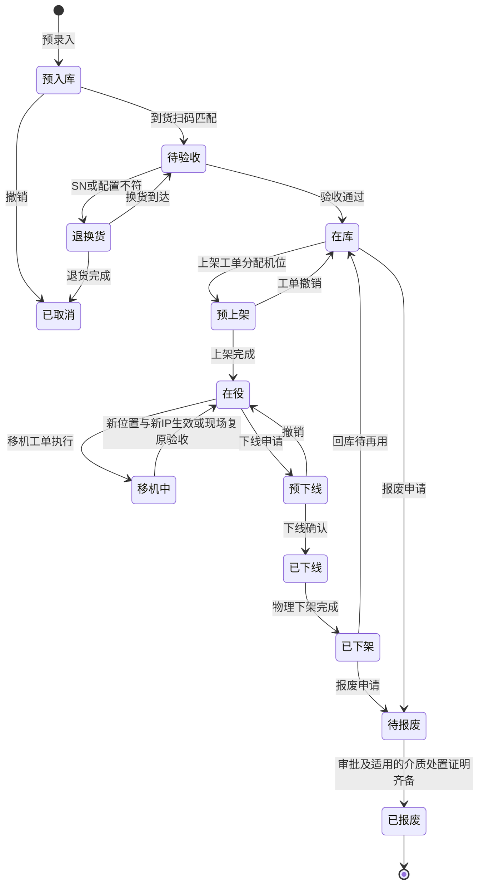
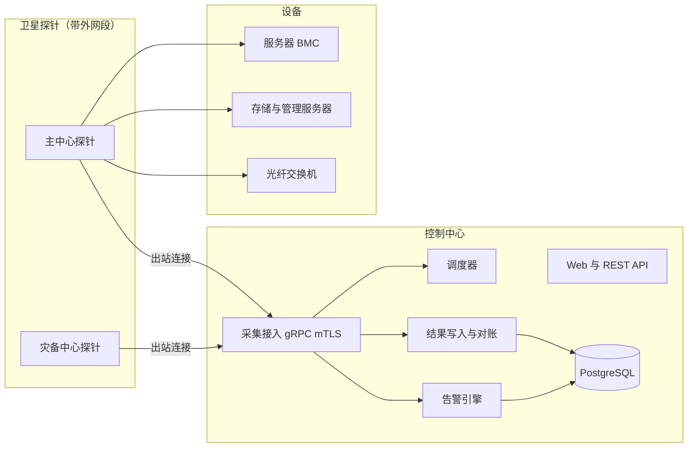
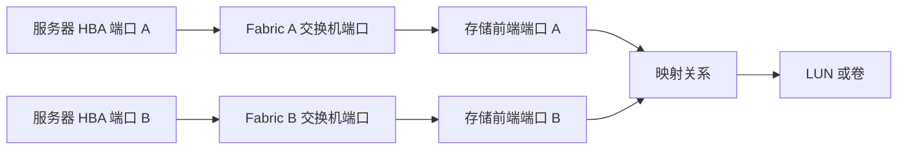
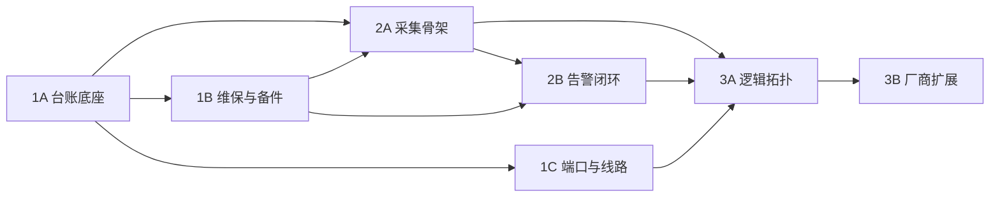

# 银行数据中心基础设施与存储网络资产运维管理系统
## 业务需求规格说明书

| 项目 | 内容 |
| --- | --- |
| 文档版本 | v1.4.1 |
| 编制日期 | 2026-11-04 |
| 文档状态 | 需求评审修订稿（阶段边界与验收口径已细化） |
| 适用对象 | 数据中心硬件运维组、存储网络运维组、架构与研发团队 |

### 修订记录

| 版本 | 日期 | 主要变更 |
| --- | --- | --- |
| v1.0.0 | 2026-11-03 | 需求初稿 |
| v1.1.0 | 2026-11-03 | 补充 LUN Group/Port Group、NetApp SVM、StorageGRID；协议收敛为 REST + SNMP；参考 storage-net 卫星采集 |
| v1.2.0 | 2026-11-03 | 增加立即采集、错峰调度、Trap Server 与 MIB 库 |
| v1.3.0 | 2026-11-04 | 增加预入库扫码、批量移机、主备管理 IP 切换采集 |
| v1.4.0 | 2026-11-04 | 更正技术错误；补充存量导入、部件台账、合同覆盖、端口/跳线/ODF 路由、采集端点、台账对账、规模与容量基线；阶段重新划分为 7 个可独立验收的阶段 |

| v1.4.1 | 2026-11-04 | 对齐开发授权，拆分阶段职责，补充业务异常路径、技术依赖和验收用例 |

### 已确认的业务决策

| 编号 | 决策 |
| --- | --- |
| D1 | 采集只使用 **REST API 与 SNMP（含 Trap）**；不使用 CLI/SSH、SMI-S、IPMI；不部署操作系统 Agent |
| D2 | 告警接收只接 **SNMP Trap**，不接收 Syslog |
| D3 | 需要跳线管理，并延伸到 **ODF 路由管理** |
| D4 | 规模基线：约 **2,000 台服务器、50 台存储、80 台光纤交换机** |
| D5 | 通知渠道：**企业微信、短信** |
| D6 | 采集与告警能力在 InfraNexus 中**按本项目架构重新实现**，storage-net 只作为设计参考 |
| D7 | 流程工单先在本系统内闭环，预留对接外部 ITSM 平台的扩展点（不在本期实施） |

---

## 一、系统定位与建设目标

### 1.1 业务背景与痛点
1. **账实不符**：Excel/CMDB 台账与机房实际 U 位、跳线、设备状态脱节。
2. **维保与备件难追溯**：原厂维保与第三方续保并存，脱保空档难发现；更换部件与设备、工单缺少关联；易损件缺少安全库存预警。
3. **硬件状态盲区**：坏盘、电源故障、光模块弱光、端口误码依赖人工巡检发现。
4. **线路与 SAN 链路黑盒**：跳线和 ODF 路由靠纸质或表格记录；主机到交换机再到存储的映射靠人工核对，难以定位单点故障。

### 1.2 建设目标
建设集“机房空间、资产生命周期、维保备件、线路管理、带外采集监控、SAN 逻辑拓扑”于一体的硬件运维系统：
- 设备从预入库到报废的全生命周期闭环，存量台账可批量导入；
- 端口、跳线、ODF 路由可视化，可端到端追溯物理链路；
- 采用“控制中心 + 卫星采集探针”架构，适配带外管理网与多数据中心；
- 采集结果与台账、物理线路与逻辑连接自动对账，持续保持账实一致；
- SNMP Trap 与原生告警闭环处理，通过企业微信与短信通知。

### 1.3 范围外事项
- 操作系统内采集（OS Agent）、主机多路径与逻辑盘信息；
- Syslog 接收；
- 强电、PDU 进线与动力环境监控；
- 对设备的任何写操作（配置下发、Zone 修改等），系统对设备只读；
- 对接外部 ITSM 平台（本期只预留接口）。

---

## 二、管理范围与协议基线

### 2.1 设备类型与管理要素

| 设备类型 | 机型/系统 | 规模基线 | 管理要素 |
| --- | --- | --- | --- |
| 服务器 | x86 机架服务器、刀片服务器 | 约 2,000 台 | BMC 状态、CPU/内存/硬盘/电源/风扇/温度、HBA 卡与 WWPN（BMC 能提供时） |
| 集中式存储 | 华为 OceanStor（Dorado、V3/V5/V6）、Dell EMC（PowerMax/VMAX、Unity、PowerStore）、NetApp ONTAP（FAS/AFF，统一存储） | 合计约 50 台 | 控制器、电池、硬盘、存储池、LUN/卷、前端端口、主机映射关系；ONTAP 另含 SVM、Aggregate、NFS/CIFS 共享 |
| 对象存储 | NetApp StorageGRID | 计入存储数量 | Grid 节点（Admin/Storage/Gateway）、存储池、租户、Bucket 容量 |
| 光纤交换机 | Brocade（Broadcom FOS） | 约 80 台 | 端口状态与速率、光模块收发光功率与阈值、CRC/链路失败计数、Virtual Fabric（逻辑交换机/FID）、Fabric、Alias、Zone、生效 Zone 配置、ISL/Trunk |

### 2.2 协议基线

| 对象 | 采集方式 | 说明 |
| --- | --- | --- |
| 华为 OceanStor | DeviceManager REST API、SNMP | 版本差异由适配器处理 |
| Dell EMC PowerMax/VMAX | Unisphere for PowerMax REST API、SNMP | **通过 Unisphere 管理服务器采集，不直连阵列**；一台 Unisphere 可管理多台阵列 |
| Dell EMC Unity / PowerStore | 阵列自带 REST API、SNMP | |
| NetApp ONTAP | ONTAP REST API（ONTAP 9.6+）、SNMP | 以集群管理地址为采集端点，一个端点对应多个节点 |
| NetApp StorageGRID | Grid Management API（Admin Node）、SNMP | 以 Grid 为采集端点 |
| Brocade FOS | FOS REST API（RESTCONF，FOS 8.2+）、SNMP | FOS 8.2 以下只能用 SNMP，适配器需按版本降级；上线前梳理现网 FOS 版本 |
| 服务器 BMC | Redfish REST API、SNMP | 不支持 Redfish 的型号按已验证的 SNMP 能力降级；无可用协议能力时标记不支持采集 |

> [!NOTE]
> “采集端点”与“物理资产”是两个概念：Unisphere 服务器、ONTAP 集群、StorageGRID Grid 都是一个端点对应多台物理设备或节点。数据模型必须分开建模（见模块 7.2）。

---

## 三、功能需求

### 模块 1：机房空间管理
1. **空间层级**：数据中心（主中心/同城灾备/异地灾备）→ 楼栋/楼层 → 机房/模块 → 机柜列 → 机柜 → U 位。
2. **机柜视图**：42U/48U 正面/背面视图，区分已占用、预占用、空闲；支持多 U 设备与刀片机箱槽位。
3. **机柜属性**：U 数、承重、所属安全域（生产/测试等）、物理标签。不管理强电与 PDU。
4. **U 位冲突校验**：上架、移机时 U 位被占用或预占用则拒绝。
5. **库房与库位**：备件库、设备库房、货架，供在库设备和备件使用。

### 模块 2：设备资产台账与生命周期

#### 2.1 设备台账
- 基本信息：资产编号、SN、厂商、型号、设备类型、所属安全域、负责人/团队、采购合同、投产日期。
- 位置：机柜与起始 U 位，或库房库位。
- 管理地址：**主管理 IP、备用管理 IP**（标明各自所属控制器/板卡）、业务 IP。
- **设备型号模板**：维护型号的高度（U 数）、端口模板（端口名称、类型、速率）、标准配置，1A 新建设备时生成基础配置项；1C 支持为新设备生成端口实例，并按模板为存量设备补建，已维护的端口保留。

#### 2.2 存量导入
- 支持 Excel 模板批量导入设备台账（含位置、管理 IP、维保信息），导入前预校验（SN 重复、U 位冲突、字段缺失），给出逐行错误报告，确认时重新校验并整批提交；任一行失败则整批回滚。1A 保留维保原始信息供核对，1B 确认合同覆盖后用于保修计算。

#### 2.3 生命周期状态机
生命周期状态与运维标记分开管理：
- **生命周期状态**：描述设备处于哪个阶段（见下图）。
- **运维标记**：维修中、维护窗口中，可叠加在“在役”上。更换一块硬盘不改变设备的生命周期状态。

#### 2.4 关键动作
- **预入库与扫码入库**：
  - 到货前按采购合同/批次导入预入库清单（厂商、型号、标准配置、维保信息、预计数量）；
  - 到货时扫码或录入 SN、资产标签，自动带出预入库模板，现场核对配置并上传验收单后确认入库；
  - SN 或配置不符时进入“退换货”，记录差异。重复扫码返回既有匹配结果，避免重复创建资产或推进状态。
- **上架**：通过上架工单分配机柜、预占 U 位并分配主/备管理 IP。1A 在工单记录人工线路清单，1C 接入跳线工单与端口占用。
- **批量移机**：一张工单包含多台设备，逐台记录原位置/原管理 IP → 新位置/新主备管理 IP，以及跳线拆除与新建清单。逐台记录现场进度；部分执行时保留源机位占用和目标预占，登记实际位置并继续执行或复原。整单验收时重新校验冲突，在同一事务内更新位置、管理地址（旧地址按生效时间失效）及生命周期；1C 同步提交已验收的线路变更。撤销须确认未执行或现场已复原，再释放目标预占；重复验收提交返回既有结果。
- **下线与下架**：1A 由工单人工确认映射、Zone 和跳线的清理情况；1C 提供跳线核对，3A 提供可见的映射和 Zone 查询。下线确认后仍占用 U 位，物理下架验收后释放 U 位，1C 同步更新线路占用。
- **利旧**：已下架设备回库后可再次上架；**跨安全域（如生产调往测试）再上架前必须上传数据擦除/消磁证明**。
- **报废**：所有报废须经审批并记录处置批文和凭证；含涉密介质时，还须提交消磁或销毁证明。跨安全域利旧按相应的擦除或消磁证明要求校验。

#### 2.5 部件（FRU）台账
- 在设备下维护硬盘、电源、风扇、内存、HBA 卡、光模块等部件的位置、型号、SN。
- 更换部件时关联维修工单和备件出入库记录，保留部件更换历史。
- 2A 起采集写入部件观测快照，台账部件新增、缺失处置和核心字段修改须人工确认（见模块 7.6）。

### 模块 3：端口、跳线与 ODF 路由管理

#### 3.1 对象模型
| 对象 | 说明 |
| --- | --- |
| 设备端口 | 由型号模板生成：交换机端口、HBA 端口、存储前端端口、BMC 管理口等；属性含类型（FC/以太网）、速率、接口形态（LC/RJ45/MPO） |
| 配线架 / ODF | 安装在机柜或独立 ODF 架中；包含面板与端口（LC 双工、MPO 等） |
| 主干光缆 | 连接两个 ODF 之间的光缆，按物理光纤芯管理，支持按芯对预占和使用，记录类型（OM3/OM4/OS2）、芯数、长度 |
| 跳线 | 连接设备端口与 ODF 端口、ODF 与 ODF、设备与设备；记录编号/标签、类型、长度、颜色 |
| 路由 | 一条端到端物理路径，例如：服务器 HBA 端口 → 跳线 → 本列 ODF → 主干光缆芯 → 交换机区 ODF → 跳线 → 交换机端口 |

#### 3.2 功能
1. **端口占用视图**：设备端口与 ODF 端口的已用、空闲、预占、故障状态。ODF 前后侧分别记录连接，芯对预占同时锁定组成芯；预占冲突拒绝，撤销释放占用，拆线保留历史。
2. **路由追踪**：从任一端口追踪完整物理路径，逐跳展示经过的跳线、ODF 端口和光缆芯。
3. **可用路由查找**：给定两端位置，查找可用的 ODF 端口和光缆芯组合，供新建连接使用。
4. **跳线工单**：新建、拆除、变更跳线，与上架、移机、下架工单联动；完成后更新端口占用。
5. **标签**：按规则生成跳线与端口标签编号，支持导出打印。
6. **批量导入**：支持 Excel 导入现有 ODF、光缆和跳线记录。
7. **物理与逻辑对账**（第三阶段）：用交换机采集到的“端口所见 WWPN”与台账路由比对，发现记录错误或私接线（见模块 9）。

### 模块 4：供应商与维保管理
1. **供应商档案**：原厂、第三方维保商、备件供应商；联系人、报修电话、服务级别。
2. **维保合同**：原厂保修与第三方续保合同；合同与设备**多对多**，每台设备在合同内有各自的起止日期和服务级别。
3. **有效保修计算**：按设备计算有效覆盖区间的并集，重叠或相邻的有效区间合并，间隔列为脱保空档；当前覆盖连续区间的结束日期作为当前到期日。并行有效合同时按配置优先级推荐报修服务商，并展示其他有效服务商。
4. **到期预警**：90/60/30 天分级提醒（可配置），输出待续保设备清单。
5. **报修指引**：维修工单根据设备当前有效覆盖，自动带出应联系的服务商与服务级别。
6. **服务记录**：现场巡检报告、服务记录等附件存档。

### 模块 5：备件库管理
1. **备件目录**：料号（FRU/Part Number）、适用型号、品类；归属为行内自有或维保商寄存。
2. **两种管理方式**：
   - 按 SN 管理：硬盘、HBA 卡、控制器板卡等；
   - 按数量管理：光模块、线缆等。
3. **入库来源**：采购入库、维保商寄存、拆机件回收。
4. **出库**：必须关联维修工单和目标设备。出库时校验可用库存并登记库存流水；取消未使用的领料或验收入库退料后回补库存，重复处理不得重复扣减或回补。
5. **坏件处理**：
   - 一般部件：换上好件验证后，坏件清点还厂，记录还厂单号；
   - 涉密介质（硬盘）：**不还厂**，在行内消磁/销毁并上传证明后，方可作为废料处理。
6. **安全库存**：按料号和库位设置最低库存，低于阈值提醒补货。
7. **盘点**：按库位盘点，生成盘盈盘亏差异；经审批后通过库存流水调账。

### 模块 6：运维工单
1. **工单类型**：维修、领料/还件、上架、批量移机、下架、跳线变更、报废。
2. **流程**：固定流程模板（申请 → 审批 → 执行 → 验收 → 归档），审批人按角色配置；本期不建设通用流程引擎。
3. **维护人员**：可指派行内运维、驻场工程师或厂商工程师，不强制要求原厂报修单号。
4. **与告警联动**（第二阶段）：告警可一键转维修工单；维修工单处理期间，为相关设备设置维护窗口，按模块 8.3 抑制通知。
5. **外部 ITSM 扩展点**：工单服务按接口设计，预留状态映射与同步适配器，本期不实现对接。

### 模块 7：卫星采集与调度

#### 7.1 架构

- 探针主动向中心发起出站连接，中心不需要访问带外网段。
- 探针准入：首次注册为待审批，管理员核对配对码后批准，中心签发客户端证书；之后所有通信使用双向 TLS。
- 心跳 10 秒，中心 15 秒判断离线；探针本地有有界内存缓冲，断网期间暂存结果，恢复后重放（进程重启会丢失缓冲内容）。
- 设备凭据加密存储，按需下发给负责该设备的探针，不写入日志。
- 中心本身也可执行采集（适用于中心能直接访问的设备）。

#### 7.2 采集端点
- 采集端点 = 一个可访问的管理入口（地址、协议、凭据、负责探针）。
- 端点与物理资产的关系：一对一（服务器 BMC、交换机）或一对多（Unisphere → 多台 PowerMax；ONTAP 集群 → 多个节点；StorageGRID → 多个 Grid 节点）。
- 采集结果按 SN/系统 ID 归属到具体物理资产。

#### 7.3 采集能力与默认周期
采集拆分为四类独立任务，各自调度，互不阻塞。默认周期按设备类型区分（可在全局、设备类型、单设备三级覆盖）：

| 能力 | 职责 | 光纤交换机 | 存储 | 服务器 BMC |
| --- | --- | --- | --- | --- |
| configuration | 硬件清单、部件 SN；3A 起采集 SAN 逻辑配置；唯一可根据完整有效快照在采集侧识别新增或缺失资源的任务 | 3600 秒 | 3600 秒 | 86400 秒 |
| health | 部件与端口运行状态，只更新状态 | 60 秒 | 60 秒 | 300 秒 |
| performance | 时序指标：光功率、CRC、链路失败、流量、容量、温度、功耗 | 60 秒 | 300 秒 | 300 秒 |
| alarms | 读取设备当前原生告警列表并核对新增与恢复 | 不支持时依赖 Trap | 60 秒 | 300 秒 |

> [!NOTE]
> 服务器 BMC 处理能力有限，2,000 台规模下 configuration 默认每天一次、health 与 performance 每 5 分钟一次，避免压垮 BMC。

#### 7.4 调度规则
- **错峰**：首次执行按“采集端点 ID + 能力类型”的稳定散列在 0–30 秒内错开；之后以“本次完成时间 + 周期”计算下次时间，不对齐整点。
- **并发控制**：每个探针有总并发上限；configuration 任务最多占 1/4 槽位；同一采集端点同一能力不会并发执行；拿不到槽位只顺延，不算失败。
- **失败退避**：连续失败 3 次后指数退避（短周期任务上限 300 秒，长周期任务上限为基础周期的 8 倍）；成功后恢复原周期；不补跑错过的周期。
- **立即采集**：设备详情页可勾选能力立即执行，从中心受理起计算 90 秒总预算，包含排队、主备切换、执行和结果写入。各能力分别显示成功、失败或超时；通过 SSE 推送结果或终态。

#### 7.5 主备管理 IP 切换
- 采集默认使用主管理 IP；主 IP 连接失败或超时，自动改用备用 IP 重试。
- 结果记录实际使用的地址；切换前验证备用入口属于同一采集目标。2A 记录主管理入口的连接状态及切换事件，主入口经探测恢复后自动回切。2B 再将相关事件接入告警与恢复闭环。鉴权失败和能力不支持单独记录。
- 主、备 IP 都登记为设备的 Trap 来源地址。

#### 7.6 采集与台账对账
- configuration 采集结果与台账比对，生成差异清单：SN 不一致、部件增减或更换、型号不一致、台账中有但采集不到、采集到但台账中没有。
- 只有完整有效且覆盖对应对象的快照可产生缺失候选；超时、鉴权失败、部分响应或能力不支持单独标记。差异由运维人员逐条确认：更新台账、关联到维修工单或标记忽略；**采集结果不自动覆盖台账核心字段**。

#### 7.7 时序数据容量与保留
按规模估算：80 台交换机约 5,000 个端口，每端口约 6 项指标每分钟一次；服务器与存储按 5 分钟一次。
- 采用“每对象每次采样一行、多指标多列”的宽表，按天分区：端口指标约 720 万行/天。
- 原始数据保留 30 天；小时级汇总保留 1 年（保留期可配置）。
- **生产环境必须使用 PostgreSQL**；SQLite 仅用于开发和演示。

### 模块 8：SNMP Trap 与告警

#### 8.1 Trap 接收
- 中心与探针都可监听 Trap；设备默认发往 162 端口，系统监听端口可配置，非 root 运行时通过端口转发将 162 映射到监听端口。
- 支持 SNMPv1/v2c/v3；校验来源地址与凭据（community 或 v3 用户），不匹配的报文拒收并计数。
- 来源地址按“设备地址 + 生效时间段 + 接收范围（中心或某个探针）”匹配设备；不同探针下允许相同私网地址。
- 有界队列、批量入库；同一事件在短时间窗口内合并计数。

#### 8.2 MIB 库
- 内置标准 MIB；支持上传厂商 MIB，自动识别模块名与依赖，缺依赖时提示需要补充的模块；整批编译成功才发布。
- MIB 模块关联到设备适配器；接收时把 OID 翻译为通知名称、变量名称和枚举含义，并保存当时的解译快照。
- 去重指纹基于原始 OID 和原始值计算，更新 MIB 不影响历史去重。
- MIB 只负责翻译；是否产生告警由告警规则决定。

#### 8.3 告警规则与状态
- 规则包含：故障通知 OID、恢复通知 OID、组件索引变量；可选条件变量 OID（`conditionOid`）及其故障值、恢复值（用于同一个通知 OID 用变量值区分故障与恢复的情况）。
- 状态：`firing`（故障）→ `acknowledged`（已认领）→ `resolved`（已恢复）；未认领的故障也可直接恢复。恢复按设备、组件及故障类型匹配，并校验事件时序，避免旧恢复关闭新故障。
- 未配置规则的 Trap 保留为“未匹配”，不猜测级别。
- **多来源去重**：同一设备、组件和故障类型的轮询原生告警、阈值告警与 Trap 可归并，保留各来源状态和时间。规则须明确权威恢复来源或多来源恢复条件。
- **阈值告警**：光模块收发光功率使用模块自带 DDM 告警/预警阈值，可人工覆盖；CRC、链路失败按“周期增量”设阈值。
- 维护窗口内保留事件和告警状态，抑制新故障通知，恢复照常更新状态。窗口结束时复核仍在持续的故障，按策略通知。

#### 8.4 通知
- 渠道：**企业微信、短信**；另提供通用 Webhook 用于北向对接行内监控平台。
- 按级别和设备范围配置通知策略（例如严重告警发短信加企业微信，一般告警只发企业微信）。
- 按告警实例、状态、渠道和接收目标创建唯一通知任务，并做频率限制。通知通过事务 Outbox 异步发送，重试沿用同一幂等键；渠道回执不确定时记录状态，按渠道的幂等或回执查询能力处理，避免把内部任务去重当作外部必达且只达一次。

### 模块 9：SAN 逻辑拓扑与分析

#### 9.1 逻辑配置采集
- **Brocade**：Fabric、交换机、Domain ID、主交换机角色、Virtual Fabric（逻辑交换机/FID）、端口类型（F/E 端口）、ISL/Trunk、Name Server 登录记录（端口 → WWPN）、Alias、Zone、生效 Zone 配置。
- **存储**：前端端口 WWPN、存储池、LUN/卷、主机及其发起端 WWPN、映射关系。
- **主机 WWPN 来源**：交换机 Name Server（FLOGI/FDMI）、存储侧主机定义、BMC（Redfish 能提供时）、人工维护。不采集操作系统内信息。

#### 9.2 厂商中立映射模型

| 中立概念 | 华为 OceanStor | PowerMax | Unity / PowerStore | NetApp ONTAP |
| --- | --- | --- | --- | --- |
| 主机发起端集合 | Host Group | Initiator Group | Host | igroup |
| 目标端口集合 | Port Group | Port Group | 无 | portset |
| 卷集合 | LUN Group | Storage Group | 无 | 无 |
| 映射关系 | Mapping View | Masking View | Host LUN Access | LUN Map |

页面展示中立概念，同时显示厂商原始名称。

#### 9.3 端到端拓扑

- 拓扑按 Fabric 和 FID 隔离，区分登录及物理连接等观测记录、依据生效 Zone 与映射推断的路径，以及来源缺失或过期时的未知状态。展示来源及采集时间。
- 可叠加物理层：显示每段连接对应的跳线和 ODF 路由（来自模块 3）。

#### 9.4 分析
- **单点隐患**：主机只连接单个 Fabric、只有一个 HBA 端口、只映射到单控制器端口。
- **配置残留**：Zone 中长期没有登录的 WWPN；没有加入任何映射的主机组、端口组、卷组。
- **物理与逻辑对账**：交换机端口实际看到的 WWPN 与跳线台账记录的对端设备不一致时，列为差异。
- **故障影响分析**：端口弱光、误码或离线时，在拓扑上标出关联事件、受影响路径、可能受影响的主机与 LUN，以及剩余可见路径。

---

## 四、非功能需求

| 类别 | 要求 |
| --- | --- |
| 规模 | 按 2,000 台服务器、50 台存储、80 台光纤交换机（约 5,000 个 FC 端口）设计，预留 50% 增长 |
| 性能 | 常用列表查询 2 秒内返回；拓扑页面 5 秒内加载单个 Fabric |
| 网络 | 探针部署在带外网段，只向中心发起出站连接；对设备只读 |
| 凭据 | 设备凭据使用 AES-256-GCM 加密，密钥与数据库分离；页面和日志中不显示明文 |
| 审计 | 位置变更、生命周期流转、工单审批、凭据和告警规则修改记录操作人、时间、变更前后内容 |
| 权限 | 复用现有用户、角色、权限体系；1A 起增加按数据中心的数据范围控制，覆盖列表、详情、导入导出和工单审批；跨中心移机分别校验源端和目标端的操作权限 |
| 数据库 | 生产环境 PostgreSQL；时序数据按天分区，按保留期清理；2A 按基线及 50% 增长场景验证采样写入、查询、汇总和分区清理 |
| 可用性 | 中心服务支持定期备份与恢复演练；探针离线不影响台账和工单功能 |
| 时间 | 中心、探针统一 NTP 时间源 |

---

## 五、分阶段实施

按 1A → 1B → 1C → 2A → 2B → 3A → 3B 实施并逐阶段验收。下表的依赖表示验收所需的既有能力。各阶段验收记录须包含数据与环境基线、用例、预期与实际结果、未覆盖项及处理决定。

| 阶段 | 范围 | 技术依赖 | 验收标准 |
| --- | --- | --- | --- |
| **1A 台账底座** | 空间、机柜、库位、型号基础模板、设备台账与主备 IP、Excel 导入、扫码入库、生命周期及上架/批量移机/下线下架/报废工单 | 现有脚手架 | 导入逐行报告且提交冲突整批回滚；重复扫码无副作用；并发机位预占只允许一笔；移机部分执行可追踪、验收原子提交、撤销释放预占；下线后仍占 U 位；利旧与报废按规则校验证明；跨中心权限边界有效 |
| **1B 维保与备件** | 供应商、合同覆盖、维保预警、FRU、按 SN 或数量的备件库存、坏件还厂及消磁、盘点、维修和领料 | 1A | 重叠、相邻和断档合同计算正确；并发领用同一 SN 或最后库存不会超领；退料回补及审批调账有流水；涉密坏件无法走还厂流程 |
| **1C 端口与线路** | 端口模板及实例、配线架/ODF、主干光缆、跳线、路由追踪与查找、跳线工单、标签及 Excel 导入 | 1A | 可验证完整路径、断路及成环异常；芯对并发预占只允许一笔；撤销释放资源；拆线保留历史；上架、移机、下架与线路占用联动 |
| **2A 采集骨架** | 探针 mTLS 准入、端点、四类任务调度与错峰、90 秒立即采集、主备切换、台账与 FRU 对账、PostgreSQL 时序存储；首批 Brocade FOS、华为 OceanStor、Redfish | 1A、1B | 越权探针被拒；断网恢复重放无重复写入；主备同一身份并可回切；部分响应不产生缺失差异；立即采集在预算内给出终态；按能力矩阵和容量基线验证调度延迟、积压、成功率与数据库表现 |
| **2B 告警闭环** | Trap、纯 Go 共享 MIB、条件 OID 成对消警、多来源归并、阈值、维护窗口、企业微信/短信/Webhook、告警转维修工单 | 2A、1B | 重复、乱序、同组件不同故障、多来源恢复和窗口跨界事件符合规则；各通知目标的任务去重，重试与回执可追踪；可转工单并联动维护窗口 |
| **3A 逻辑拓扑** | Brocade Zone/Name Server/ISL、华为映射、中立模型、端到端拓扑、SPOF、配置残留、物理逻辑对账与故障影响 | 1C、2A、2B | 用已知拓扑验证双路径、单路径、无可见路径和数据不足；验证 FID 隔离、物理逻辑差异、残留判定及单链路告警对应的影响和剩余路径 |
| **3B 厂商扩展** | Dell EMC PowerMax 经 Unisphere、Unity、PowerStore；NetApp ONTAP SVM、igroup、portset 与 NAS 共享；StorageGRID | 3A | 按厂商、型号、固件及能力矩阵在真实设备联调，逐项记录通过、降级或不支持的行为及证据 |

