# InfraNexus 基础设施与存储网络资产运维管理系统
## 领域数据模型与实体关系规格说明书 (Domain ER Model Specification)

> **正式项目与实施路线（2026-11-09）**：撤销 Demo 开发方式。先完整建设位置、IP、制造商/供应商、设备模型/组件模型，再推进资产、工单及后续业务；按 [正式开发路线](DCIM_DEVELOPMENT_ROADMAP.md) 分批交付。权限沿用用户→角色→菜单/按钮/API，不新增用户或角色数据中心授权。数据中心归属、地址空间和探针网络边界保留业务含义。本文是设计与验收依据，不是已实现声明。

| 项目 | 内容 |
| :--- | :--- |
| 文档版本 | v1.3.3 |
| 编制日期 | 2026-11-05 |
| 文档状态 | 领域模型评审修订稿（补齐不变量、事务契约与验收映射；不代表迁移和接口已实现） |
| 遵循规范 | [AGENTS.md](../AGENTS.md)（Go 1.27+ 泛型、GORM/PostgreSQL、UUID 主键、JSONType[T]） |
| 业务来源 | [DCIM_SAN_REQUIREMENTS.md v2.2.3](DCIM_SAN_REQUIREMENTS.md) |

旧文引用的 `contracts/dcim-v1/` 契约包当前工作区缺失，不能声明完整字段、DDL、接口或可执行测试已提供。本文保留关系与规则设计；对应批次开工前须补齐字段字典、迁移、API/事件、角色权限及测试，评审后作为实现依据。

### 本版修订

v1.3.3（2026-11-09）明确正式项目分批实施、角色权限与业务归属区别，纠正缺失契约引用；以下历史版本说明不代表当前工作区交付状态。

v1.3.2（2026-11-06）补充开发契约包并收敛重复物理字段表；v1.3.0 对齐需求 v2.2.0：修复 IP 状态/历史与共享资源归属，补齐工单事实、采购位置、库存、布线、采集告警、合同团队和 SAN 映射；建立 AC-01～AC-44 追踪。原 v1.2.0 的不完整 Go 示例由明确的字段与实现契约替代。

---

## 一、设计原则与持久化规范

### 1.1 总体设计原则
1. **物理与网络双底座平级设计 (DCIM & IPAM Parity)**：
   - 机柜物理空间（数据中心 → 机房 → 机柜 → U位）与网络逻辑空间（地址空间 → 子网/IP，并关联数据中心范围、安全域及 VLAN）享有完全对等的领域地位；
   - 资产按类型记录适用的物理位置和网络地址；无备用口、无业务 IP 或无网络能力不补造地址。共享地址属于独立系统，空间与地址平级不等于必填数量相同。
2. **设备制造商与供应商独立实体化 (Manufacturer vs. Vendor)**：
   - 严格区分制造硬件的原厂（`org_manufacturer`）与商务供货、维保服务、涉密销毁的商业实体（`org_vendor`）；
   - 设备型号与部件型号强外键绑定制造商，继承 Enterprise OID 与支持协议；采购入库绑定供货商；维保合同绑定服务商并可核验原厂授权；涉密介质销毁强校验销毁机构的国家保密资质备案及有效期，杜绝自由文本字符串带来的脏数据。
3. **多角色联系人与合同服务团队动态履历 (Multi-Role Contacts & Contract Service Team)**：
   - 制造商与供应商支持多角色联系人花名册（`org_contact`），涵盖客户经理、固定驻场维护人员、现场支持工程师、应急升级专家等；
   - 登记机房出入准入审批所需的脱敏证件号与原厂技术认证资质；
   - 维保合同支持绑定专属服务团队（`war_contract_contact`），在人员轮岗或离职时记录连续的交接时段 `[valid_from, valid_until)`；现场工单自动生成当时指派人员的快照存证，杜绝历史事实被覆盖。
4. **不可篡改历史与时序履历 (Append-Only Audit)**：
   - IP 占用历史（`ipam_ip_history`）、部件实物流水（`part_inventory_tx`）、工单执行事实（`ast_execution_fact`）、处置证明（`ast_disposal_proof`）采用只增不减（Append-Only）设计；
   - 严禁通过直接更新物理字段覆盖历史，保留可核验的历史；未知区间明确标记，合规保留和资质规则由行内责任人确认。
5. **主键与外键强类型规范**：
   - 统一遵循项目规范：实体逻辑身份统一使用 `uuid.UUID`（优先生成有序 UUIDv7 或标准 UUIDv4）；时序分区的物理复合键见 5.3；
   - 数据库使用 PostgreSQL 原生 `uuid` 类型；
   - 外键使用强类型 UUID 字段关联，禁止使用自增 ID，杜绝跨库合并冲突。
6. **强类型 JSONB 字段与元数据扩展**：
   - 复杂结构（如型号规格、端口模板、工单执行参数、配置快照）统一使用 `gorm.io/datatypes.JSONType[T]` 强类型泛型绑定；
   - 底层映射为 PostgreSQL 原生 `jsonb`，可使用 GIN 索引。
7. **软删除与历史分离**：
   - 可停用字典按需软删除；资产、资源身份及已发生业务关系不得因软删除释放身份唯一性。流程状态与停用状态不以删除代替；
   - 审计/事件/执行事实不启用软删除，只允许追加。业务数据库权限禁止普通应用更新/删除历史；更正通过追加关联事件。该约束不等于数据库管理员也无法篡改，备份、访问审计和证据保留按部署验收执行。

---

## 二、核心关系与权威来源

```mermaid
erDiagram
    ORG_MANUFACTURER ||--o{ AST_DEVICE_MODEL : defines
    AST_DEVICE_MODEL ||--o{ AST_DEVICE : instantiates
    ORG_VENDOR ||--o{ WAR_CONTRACT : services
    WAR_CONTRACT ||--o{ WAR_CONTRACT_COVERAGE : covers
    AST_DEVICE ||--o{ WAR_CONTRACT_COVERAGE : covered_by
    ORG_CONTACT ||--o{ WAR_CONTRACT_CONTACT : assigned
    WAR_CONTRACT ||--o{ WAR_CONTRACT_CONTACT : team
    AST_TICKET ||--o{ AST_TICKET_PARTICIPANT : records
    RES_OBJECT ||--o| AST_DEVICE : device_identity
    RES_OBJECT ||--o| RES_LOGICAL_SYSTEM : system_identity
    RES_LOGICAL_SYSTEM ||--o{ RES_SYSTEM_MEMBER : members
    AST_DEVICE ||--o{ RES_SYSTEM_MEMBER : joins
    DC_RACK ||--o{ DC_RACK_UNIT_ALLOCATION : reserves
    AST_DEVICE ||--o{ AST_LOCATION_EVENT : located
    IPAM_NETWORK_SCOPE ||--o{ IPAM_SUBNET : contains
    IPAM_NETWORK_SCOPE ||--o{ IPAM_IP_ADDRESS : identifies
    IPAM_IP_ADDRESS ||--o{ IPAM_ALLOCATION : allocated
    RES_OBJECT ||--o{ IPAM_ALLOCATION : owns
    IPAM_IP_ADDRESS ||--o{ IPAM_IP_HISTORY : records
    AST_TICKET ||--o{ AST_TICKET_ITEM : plans
    AST_TICKET_ITEM ||--o{ AST_EXECUTION_FACT : executes
    PART_STOCK_BUCKET ||--o{ PART_RESERVATION : reserves
    PART_ITEM ||--o{ PART_SLOT_ALLOCATION : installs
    CAB_ROUTE ||--o{ CAB_ROUTE_HOP : traverses
    CAB_TERMINATION ||--o{ CAB_CONNECTION : connects
    MON_ENDPOINT ||--o{ MON_ENDPOINT_TARGET : targets
    RES_OBJECT ||--o{ MON_ENDPOINT_TARGET : observed
    MON_TASK ||--o{ MON_TASK_ATTEMPT : attempts
    MON_OBSERVATION_BATCH ||--o{ MON_METRIC_SNAPSHOT : samples
    RES_OBJECT ||--o{ ALT_EVENT_INSTANCE : alerts
    ALT_EVENT_INSTANCE ||--o{ ALT_SOURCE_STATE : sources
    RES_OBJECT ||--o{ ALT_SUPPRESSION : suppresses
    SAN_FABRIC ||--o{ SAN_CONFIG_REVISION : configures
    SAN_CONFIG_REVISION ||--o{ SAN_ZONE : defines
    RES_LOGICAL_SYSTEM ||--o{ SAN_HOST_MAPPING : maps
```

图为核心关系索引，详细约束以下文为准。当前资产位置来自占用/保管投影，IP 来自分配关系，维保来自有效覆盖计算；资产上的展示字段只作可重建投影，不允许通用编辑接口形成第二个写入口。`res_object` 是带类型和业务归属的稳定引用登记，不复制资产业务字段，也不替代各领域规则。所有有效期采用半开区间，合同按业务日含首尾的展示规则转换为时间边界。

## 三、分模块数据表与实体详细设计

### 模块 0：设备制造商与供应商/服务商底座 (Manufacturer & Vendor Foundation)

#### 0.1 `org_manufacturer` (设备制造商 OEM)
`org_manufacturer` 的完整字段类型、可空性、默认值、外键和索引尚待在所属批次补齐字段字典；以下保留业务关系与规则，不能直接当作完整迁移规格。

#### 0.2 `org_vendor` (供应商 / 服务商 / 销毁机构)
`org_vendor` 的完整字段类型、可空性、默认值、外键和索引尚待在所属批次补齐字段字典；以下保留业务关系与规则，不能直接当作完整迁移规格。

#### 0.3 `org_vendor_qualification` (供应商厂商授权与专业资质认证)
`org_vendor_qualification` 的完整字段类型、可空性、默认值、外键和索引尚待在所属批次补齐字段字典；以下保留业务关系与规则，不能直接当作完整迁移规格。

`org_vendor_qualification_version`: id, qualification_id FK, revision, certificate_no, qual_type, manufacturer_id?, auth_level, valid_from, valid_until, revocation_effective_at?, verified_by, verified_at, attachment_id, recorded_at。证书内容及效力版本追加保存，qualification 的状态/日期仅作当前投影；`(qualification_id, revision)` 唯一。日期按业务时区解释含首尾日，核销核验执行时刻对应的效力及已知撤销记录。

#### 0.4 `org_contact` (组织与商务联系人表)
`org_contact` 的完整字段类型、可空性、默认值、外键和索引尚待在所属批次补齐字段字典；以下保留业务关系与规则，不能直接当作完整迁移规格。

---

### 模块 1：数据中心物理空间与 IPAM 网络空间底座

#### 1.1 `dc_location`（四层位置树）

位置使用 UUID 主键 `uid`，以及 `name/type/parent/ext/status/version/created_at/updated_at/deleted_at`。固定层级为数据中心 → 楼栋 → 机房 → 机柜。生成列 `parent_type` 和复合外键限制上级类型。根节点和同级节点各有名称唯一约束，机柜坐标在所属机房唯一。

`ext` 为 JSONB。数据中心包含地址和联系人，楼栋扩展属性为空对象，机房包含 -5～100 的整数楼层，机柜包含行、列、高度 U 数和可选功率 W。机柜安全域由 `dc_rack_security_zone` 独立关联，仓库、临时位置和安全域均引用数据中心 UID。

#### 1.2 `dc_rack_unit_allocation` (机柜 U 位占用与预占明细)
`dc_rack_unit_allocation` 的完整字段类型、可空性、默认值、外键和索引尚待在所属批次补齐字段字典；以下保留业务关系与规则，不能直接当作完整迁移规格。

> **复合唯一约束（物理互斥）**：`uk_dc_ru_rack_pos (rack_id, u_position)`。仅存当前占用，释放时删除投影并追加位置事件；预留还需 reservation_id、expires_at、version。锁定机柜并校验高度边界，按 rack_id/u_position 稳定顺序锁定；同柜移动仅新增目标差集，保留自重叠区，不释放其他工单的预留。

`dc_space_reservation`: id, ticket_item_id?, pre_receipt_id?, owner_id, expires_at, execution_started_at?, status, version；工单/预入库计划恰一非空，U 位/槽位预留引用它。开始执行后仅由验收/现场复原动作结束，未执行到期释放与计划版本校验同事务。与 IP 预留是不同资源记录，但由同一 ReserveResources 事务编排。

#### 1.5 `dc_warehouse` 与 `dc_shelf` (备件库房与货架)
- `dc_warehouse`: `id`, `datacenter_id`, `name`, `code`, `contact_person`, `status`
- `dc_shelf`: `id`, `warehouse_id`, `code`, `layer_count`, `capacity`, `status`

---

#### 1.6 `ipam_security_zone` (网络安全域)
`ipam_security_zone` 的完整字段类型、可空性、默认值、外键和索引尚待在所属批次补齐字段字典；以下保留业务关系与规则，不能直接当作完整迁移规格。

> **复合唯一约束**：`uk_ipam_zone_dc_code (datacenter_id, code)`

#### 1.7 `ipam_network_scope`、`ipam_subnet` (地址空间与子网)
- `ipam_network_scope`: `id`, `code`（唯一）, `name`, `routing_domain_ref`, `status`, `version`。地址唯一范围独立于数据中心授权；关联 `res_object_scope` 表示归属范围；地址空间 ID 同时登记为 res_object。
- `ipam_subnet`: `id`, `network_scope_id` FK, `security_zone_id` FK, `cidr`, `prefix_length`, `network_start`, `network_end`, `gateway`（可空）, `vlan_id`（可空）, `usage_type`, `dns_servers`（强类型列表）, `is_allocatable`, `version`。
- `(network_scope_id, 规范化 cidr)` 唯一。同一地址空间内可分配子网不得重叠，创建/变更时锁定地址空间后检查数值区间；父级规划前缀 `is_allocatable=false` 不生成地址池。网段、网关、可用边界按前缀及用途校验，CIDR/掩码/边界只从一个规范化值推导。
- VLAN 号是现网属性，不作为跨数据中心唯一身份。网段有占用时不能直接改地址空间/CIDR，需受控迁移。地址利用率按分配投影统计，冲突与系统保留单独计数；缓存可重建，不能作为分配判断依据。

#### 1.8 `ipam_ip_address`、`ipam_allocation`、`ipam_conflict`
| 实体 | 必需字段 | 约束/权威含义 |
| --- | --- | --- |
| `ipam_ip_address` | id, network_scope_id, subnet_id, ip_address, ip_integer, allocation_state, reservation_kind, cooldown_until, version | `(network_scope_id, ip_integer)` 唯一；IPv4 规范化字符串与整数一致；子网归属与范围校验 |
| `ipam_allocation` | id, ip_address_id, subject_id, port_id?, port_role, usage_type, mac_address?, ticket_item_id?, state, valid_from?, valid_until?, version | subject_id 引用 res_object，仅允许 device/system；每 IP 至多一个有效分配主体；主备角色通过分配表达，系统 VIP 的节点是使用者不是多个所有者 |
| `ipam_reservation` | id, ip_address_id, ticket_item_id?, pre_receipt_id?, owner_id, expires_at, execution_started_at?, status, version | 计划/工单归属恰一个；每 IP 至多一条有效预留；执行后不得因到期释放 |
| `ipam_conflict` | id, ip_address_id, evidence_id, observed_identity, observed_at, status, resolved_by?, resolution_reason?, version | 冲突独立于分配状态，多来源可并存，未解除时阻断新分配及冷却释放 |
| `ipam_cleanup_task` | id, allocation_id, ticket_id, owner_id, status, evidence_id?, version | 下架但未核实停用时保留占用，后续确认停用才转冷却 |

`ipam_ip_address.allocation_state` 是当前聚合状态，分配关系中的 state 只描述该次分配是否生效/结束，由同一事务维护；禁止各表独立改状态。

分配枚举为 `free/reserved/in_use/quarantined`；系统保留属性为 `none/network/broadcast/gateway/manual`。UI 将未解决冲突覆盖显示为第五类，不能把底层状态改为 conflict。预留不是系统保留地址；只有 free、无系统保留、无未解决冲突且版本匹配时允许抢占。所有修改锁定 IP 聚合行或作等价条件更新，同事务更新分配/预留、版本及事件，失败返回冲突。唯一地址索引不能替代此流程。

冷却结束要求无未解决冲突且满足复核策略；服务身份可执行到期释放。保留 IP 移机延续 allocation_id，不进入冷却；共享 IP 不随成员退出释放。正式区间用于台账，不声称等于现场生效时间；现场事实见事件。

#### 1.9 `ipam_ip_history` (不可变事件) 与历史区间投影
`ipam_ip_history` 的完整字段类型、可空性、默认值、外键和索引尚待在所属批次补齐字段字典；以下保留业务关系与规则，不能直接当作完整迁移规格。

同一动作、地址、事件种类建立唯一键防重放。事件不存需要事后回写的 released_at/duration；`ipam_occupancy_projection` 以 allocation_id、口径、区间段及更正版本生成起止和时长，可重建。formal 区间可结束旧行，field 区间依有效事件重建；投影不是不可变证据。索引覆盖 `(network_scope_id, ip_address_id, effective_at, recorded_at)`、`(subject_id, effective_at)`；历史查询按地址空间/IP、口径、时间过滤，缺口/多候选不返回确定归属。对更正前的“当时已知事实”查询按 recorded_at 截断重放。

---

### 模块 2：设备台账、型号模板与资产工单

#### 2.1 `ast_device_model` (设备型号模板)
`ast_device_model` 的完整字段类型、可空性、默认值、外键和索引尚待在所属批次补齐字段字典；以下保留业务关系与规则，不能直接当作完整迁移规格。

> **复合唯一约束**：`uk_ast_model_mfr_name (manufacturer_id, model_name)`

#### 2.2 `ast_device` (设备资产台账核心表)
`ast_device` 的完整字段类型、可空性、默认值、外键和索引尚待在所属批次补齐字段字典；以下保留业务关系与规则，不能直接当作完整迁移规格。

> **唯一索引**：
> - `uk_ast_device_asset_code (asset_code)`
> - `uk_ast_device_mfr_sn (manufacturer_id, normalized_sn)`，仅非空 SN 参与；历史报废不释放身份。预入库状态属于 ast_pre_receipt 的计划生命周期，到货建立实物后从 pending_inspect 开始；前端可统一展示但不伪造未到货实物。未知 SN 的预入库计划见 ast_pre_receipt，不先造整机身份；异常 SN 人工核验内部标签，不借改 SN 合并两个实物。

#### 2.3 `ast_ticket`、动作、审批与执行互斥
- `ast_ticket`: `id`, `ticket_no`（唯一）, `parent_ticket_id?`, `ticket_type`, `title`, `status`, `execution_exception`, `applicant_id`, `scope_snapshot`, `version`, `created_at`, `completed_at?`。
- 类型：`receive/install/relocate/decommission/uninstall/repair/material_issue/material_return/cabling/scrap/correction`。状态：`draft/submitted/approved/executing/acceptance_pending/completed/canceled`。拒绝回 draft 并留审批事件；验收退回 executing；执行失败保持 executing 并记录异常。
- 归档是验收成功后的自动结果，不另设人工归档步骤：验收事务校验全部必需子项、证据和当前版本，通过后将工单置为 `completed`（已完成并归档），同时写入 `completed_at`、验收动作及审计。事务失败仍保留原状态；归档后不允许普通编辑或重新打开，纠错通过关联更正工单追加记录。`completed_at` 即验收成功并自动归档的时间；仅 `completed` 状态填写，不另外维护第二个归档状态或时间源。
- `ast_ticket_action`: `id`, `ticket_id`, `action_type`, `actor_id`, `expected_version`, `dedup_id` FK core_action_dedup, `result_ref`, `created_at`。幂等键、请求摘要及唯一性仅由 core_action_dedup 持有；作用域含调用主体、命令及目标。相同键同内容返回原结果但仍校验当前访问权限；不同内容拒绝。每次审批/领料/验收分别记录，不以主单创建键代替。
- `ast_ticket_approval`: `id`, `action_id`, `ticket_id`, `stage`, `decision`, `reviewer_id`, `reviewed_version`, `reason`, `evidence_ids`, `occurred_at`，追加写；申请人不可自批，处置操作者与复核者不同。
- `ast_device_execution_lock`: `id`, `device_id`（唯一）, `root_ticket_id`, `acquired_action_id`。互斥主单执行时事务取得；子单复用主单，正常完结/现场复原后解除。不能用超时租约释放物理操作互斥。

#### 2.4 `ast_ticket_item` 与不可变现场事实
- `ast_ticket_item`: `id`, `ticket_id`, `device_id?`, `target_object_id`, `action`, `plan_version`, `execution_status`, `source_location`, `target_location`, `verified_fact_id?`, `version`。这是可更新计划与进度，不宣称 Append-Only；执行后改计划需新版本及重新核验。
- `ast_ticket_address_plan`: `id`, `ticket_item_id`, `allocation_id?`, `role`, `operation`（allocate/retain/replace/release）, `source_ip_id?`, `target_ip_id?`, `reservation_id?`, `plan_version`，支持所有适用地址而非仅主管理 IP。
- `ast_execution_fact`: `id`, `ticket_item_id`, `action_id`, `fact_type`, `effective_at?`, `recorded_at`, `actor_id`, `object_version`, `plan_version`, `scope_snapshot`, `evidence_ids`, `fact_detail`（强类型有版本载荷）, `corrects_fact_id?`。仅追加，记录断电、位置、停用/启用地址、安装、拆卸、复原、核验等事实；未知时间明确标记。进度失败不撤销已发生事实。
- `ast_ticket_dependency`: `id`, `predecessor_item_id`, `successor_item_id`, `condition`；同主单内有向无环，执行前校验前置事实，不能以 UI 顺序代替。
- `ast_ticket_participant`: `id`, `ticket_id`, `ticket_item_id?`, `contact_id?`, `user_id?`, `contract_contact_id?`, `participation_type`（recommend/assign/replace/check_in）, `effective_at`, `recorded_at`, `actor_id`, `replaces_id?`, `snapshot`。参与者 contact/user 恰一个非空；允许多工程师。保存角色、组织、合同条款版本、姓名、电话和必要脱敏标识，禁止保存证件全文；历史指派与现场签到分别记录。

#### 2.5 `ast_decommission_item` 与 `ast_disposal_proof` (待报废分流与处置证据)
- `ast_decommission_item` (整机报废拆解清单):
  - `id`, `ticket_id`, `device_id`, `configuration_item_id`, `item_type` (`chassis_frame`, `fru_reusable`, `storage_media`), `part_item_id?`, `serial_number?`, `media_technology`, `contains_sensitive_data`, `has_nonvolatile_cache`, `source_slot`, `planned_destination`, `disposal_method`, `disposal_status`, `version`。清单归属 1A、实物流转归属 1B，在 B7 联合交付并关联稳定实物身份；历史清单只补齐关联、不重复扣库；去向与处理方法分离，不能把 reuse_to_warehouse 当数据清除方法。无介质也须明确核验记录。
- `ast_disposal_proof` (涉密销毁证明不可篡改存证):
  - `id`, `decommission_item_id`, `vendor_id` (FK to `org_vendor`, 具备涉密资质的销毁服务商), `qualification_no` (资格编号快照), `proof_type` (`shred_certificate`, `degauss_report`, `photo_evidence`), `attachment_id` (FK), `qualification_version_id` (FK), `policy_version_id`, `sha256_hash` (证明文件 SHA256 校验值), `operator_id`, `reviewer_id`, `operator_name_snapshot`, `witness_name_snapshot`, `executed_at`, `created_at`, `supersedes_proof_id?`。操作与复核用户不同；处置证明追加存证，作废/更正留原件。

- `ast_data_treatment`: id, decommission_item_id?（或利旧工单对象）, item_object_id?, method, policy_version_id, executed_at, result, operator_id, evidence_ids, verified_by；记录清除/销毁/验证方法及其适用介质。`ast_quality_inspection` 记录实物/清单项、检查结果、证据、核验人及时间。SSD 消磁、涉密介质还厂、带数据缓存未验证的利旧均阻断；通过数据处理与质检后才可转可用库存。

---

### 模块 3：维保合同、部件实物 (FRU) 与备件库存

#### 3.1 `war_contract`、覆盖、SLA 与资质策略
- `war_contract`: `id`, `contract_no`（唯一）, `vendor_id` FK, `contract_type`（oem_direct/third_party_renewal）, `default_terms_version_id`, `start_date`, `end_date`, `status`, `version`。
- `war_contract_terms`: `id`, `contract_id`, `revision`, `sla_spec`（响应/到场/备件/恢复各时限、服务时段、工作日历版本、时区、获批暂停规则）, `qualification_policy_version_id`, `valid_from`, `valid_until?`, `created_at`。条款版本不可原地改写。
- `war_contract_coverage`: `id`, `contract_id`, `device_id`, `covered_start_date`, `covered_end_date`, `terms_version_id`, `priority`, `confirmation_status`, `version`；覆盖调整通过 `war_coverage_change` 追加 before/after、原因、动作、审批及生效时间。设备级 SLA 可覆盖合同默认；确认日期不得越出合同有效范围，区间并集计算脱保/连续覆盖，不随设备下架自动终止。
- `war_service_case`: `id`, `ticket_id`, `coverage_id?`, `vendor_id?`, `terms_snapshot`, `reported_at`, `version`。报修时冻结服务选择；脱保可为空但不得自动引用失效合同。
- `war_service_event`: `id`, `service_case_id`, `event_type`（reported/accepted/arrived/part_arrived/restored/pause/resume）, `effective_at`, `recorded_at`, `actor_id`, `approval_id?`, `evidence_ids`；追加写，形成 SLA 分子/分母及排除项，缺证据显示不可计算。
- `org_qualification_policy`: `id`, `revision`, `service_type`, `required_qualification_types`, `manufacturer_authorization_required`（本期换件固定为 true）, `approved_by`, `effective_at`。资质目录与处置适用方法由行内确认，不能以文档示例等级替代真实核验。本期原厂/第三方换件均要求对应制造商授权，策略配置不能关闭既定卡点；销毁资质不得被普通维修策略豁免。资格修订追加版本，保存有效区间、核验人、撤销生效时刻、附件；证明引用执行时版本，后续撤销需重新评估相关未归档流程。

#### 3.2 `war_contract_contact` (合同指定服务团队与动态人员变更表)
`war_contract_contact` 的完整字段类型、可空性、默认值、外键和索引尚待在所属批次补齐字段字典；以下保留业务关系与规则，不能直接当作完整迁移规格。

合同人员区间须在合同有效范围内，结束大于开始；同合同/职责只允许一个同时有效的主责人员，普通支持人员允许多个。锁定合同后校验区间重叠；变更记录追加 `war_contact_handover`（原/新绑定、动作、生效时刻、登记时刻、原因）。联系人的组织归属不允许直接改写跨公司任职历史；新任职建立新联系记录并保留关联。外部协作人员须记录获批服务组织关系，不能任意把其他供应商人员挂入合同。

`org_contact_certification`: id, contact_id, certificate_type, issuer, certificate_no, valid_from, valid_until, attachment_id, verification_status；用于有效期校验，不用字符串列表替代证书事实。

#### 3.3 `part_model` (部件型号字典)
`part_model` 的完整字段类型、可空性、默认值、外键和索引尚待在所属批次补齐字段字典；以下保留业务关系与规则，不能直接当作完整迁移规格。

> **复合唯一约束**：`uk_part_model_mfr_no (manufacturer_id, part_no)`

#### 3.4 `part_item` (部件实物实体)
`part_item` 的完整字段类型、可空性、默认值、外键和索引尚待在所属批次补齐字段字典；以下保留业务关系与规则，不能直接当作完整迁移规格。

#### 3.5 `part_slot_allocation` (在机部件安装槽位关系)
`part_slot_allocation` 的完整字段类型、可空性、默认值、外键和索引尚待在所属批次补齐字段字典；以下保留业务关系与规则，不能直接当作完整迁移规格。

> **业务排他约束**：对 removed_at IS NULL 的记录，分别约束 `(device_id, slot_name)` 唯一和 `part_item_id` 唯一；同时校验部件/槽位兼容性。结束安装关系可更新关系投影，原始拆装事实始终追加保存。

#### 3.6 库存余额、预留与流水
- `part_stock_bucket`: `id`, `part_model_id`, `custody_location_id`, `owner_id`, `batch_id`, `quality_state`, `custody_state`, `quantity`, `version`。owner_id 引用 `part_owner`（行内/供应商，供应商引用 org_vendor）；以上维度唯一，数量非负；序列化件移动必须同时转移对应实物状态和桶计数，数量件余额与已实物化部分不能重复累加。custody_location_id 引用 ast_custody_location，库房/货架由层级解析；在途/领用使用明确保管位置，不以 NULL 破坏唯一维度。
- `part_batch`: `id`, `source_type`, `supplier_id?`, `owner_id`, `receipt_ref`, `received_at`, `quantity_received`；数量件先按批次记录。`part_item` 增加 `batch_id`, `owner_id`, `quality_state`, `custodian_id?`, `custody_location_id`, `source_decommission_item_id?`, `internal_label`（唯一）。所有权独立于位置/质量，调拨不改产权。
- `part_reservation`: `id`, `ticket_item_id`, `bucket_id`, `part_item_id?`, `quantity`, `status`, `expires_at?`, `version`。原子将可用量转预留量，领取转已领；重复取消只释放一次，已领后必须实际退回并验收。
- `part_inventory_tx`: `id`, `action_id`, `line_no`, `part_item_id?`, `batch_id`, `from_bucket_id?`, `to_bucket_id?`, `quantity`（正数）, `tx_type`, `ticket_item_id`, `actor_id`, `effective_at`, `recorded_at`, `scope_snapshot`。`(action_id, line_no)` 唯一，追加写；内部转移两端同事务减增，外部入/出必须有收货/退厂/处置依据。
- 数量件安装时从已领用桶转已安装桶并创建内部实物 ID，通过 `part_materialization`（库存流水、批次、实物、数量）关联；不再次扣可用桶。拆回沿用原 ID；转为逐件管理后的数量仍在同一批次守恒体系中，盘点不能重复算数量件和实物。
- `part_compatibility`：型号/替代料/适用槽位、验证状态、证据、版本；兼容必须已确认。`part_stock_policy`：料号/库位/产权维度的安全库存阈值；`part_stocktake` 及明细：基准时刻、期间流水截止、实盘、差异和审批动作，仅用调账流水修正。

---

### 模块 4：线缆与 ODF 物理路由

#### 4.1 设备端口、连接端面与部件身份
- `cab_device_port`: `id`, `device_id`, `part_item_id?`, `port_name`, `port_index`, `port_type`, `connector_type`, `speed_bps`, `mac_address?`, `wwpn?`, `health_state`, `valid_from`, `valid_until?`。有效期内同宿主/端口名唯一；带端口 FRU 更换时结束旧端口关系并建立新身份，不复用旧 WWPN。
- `cab_odf_frame`: `id`, `room_id`, `rack_id?`, `code`, `name`, `status`；`cab_odf_port`: `id`, `frame_id`, `tray_no`, `port_no`, `channel`, `status`；框架/盘/端/通道组合唯一。
- `cab_termination`: `id`, `device_port_id?`, `odf_port_id?`, `side`, `channel`, `connector_type`, `version`；两个所属 FK 恰一非空，设备端或 ODF 前/后侧分别有稳定端面身份。
- `cab_internal_link`: `id`, `from_termination_id`, `to_termination_id`, `channel_map`, `polarity`, `evidence_id`, `version`，表示 ODF 前后侧通道映射，未知映射不得自动穿透。

#### 4.2 线缆与两端连接事实
- `cab_cable`: `id`, `cable_no`（唯一）, `cable_type`（patch/trunk）, `media_type`, `length_meters`, `core_count`, `owner_id?`, `health_state`。不用整体连通状态替代两端实际连接。
- `cab_cable_end`: `id`, `cable_id`, `end_label`（A/B）, `channel`, `connector_type`，组合唯一。
- `cab_connection`: `id`, `cable_end_id`, `termination_id`, `connected_at`, `disconnected_at?`, `ticket_item_id`, `fact_id`；当前连接的 cable_end_id 与 termination_id 分别唯一。同一端面不能重复插接，拔 A 端只结束 A 端连接，B 端仍占用。历史关系保留，拆插事实追加。

#### 4.3 主干纤芯、芯对与资源预占
- `cab_fiber_core`: `id`, `cable_id`, `core_no`, `end_a_channel`, `end_b_channel`, `health_state`；同缆芯号唯一。
- `cab_channel_group` / `cab_channel_member`: 芯对或 MPO 通道组及所含 fiber_core_id，组内芯唯一；组是引用，不另造可用量。
- `cab_resource`: `id`, `termination_id?`, `fiber_core_id?`, `version`，恰一个具体资源 FK；`cab_resource_claim`: `id`, `resource_id`, `route_id`, `ticket_item_id?`, `claim_state`（reserved/in_use）, `version`。每资源最多一个有效业务占用；锁芯对等于锁定全部成员芯，不能与单芯申请并行成功。固定物理连接不等于业务占用。

#### 4.4 端到端路由与受控释放
- `cab_route`: `id`, `source_termination_id`, `target_termination_id`, `status`, `version`, `ticket_item_id`, `scope_snapshot`。
- `cab_route_hop`: `id`, `route_id`, `route_version`, `hop_sequence`, `connection_id?`, `internal_link_id?`, `fiber_core_id?`, `direction`；所属元素 FK 恰一非空，路由版本内序号唯一。保留确定版本的连接引用，不能用当前连接重写历史路径。
- 路由校验连续性、方向/极性、媒介/通道兼容、断路/成环/未知；候选查找不占用，提交按资源 ID 稳定排序锁定。一个固定主干可由不同芯承载不同路径，同芯不重复承载互斥业务。
- 释放只结束本单业务 claim；物理连接由明确拆线事实结束。`cab_cleanup_item` 保存未拆侧/残留引用、责任人和后续工单；下架可完成而未拆远端继续占用。

---

### 模块 5：带外采集监控与观测快照

#### 5.1 采集端点、地址与凭据
- `mon_endpoint`: `id`, `name`, `adapter_id`, `executor_id`, `is_enabled`（默认 false）, `config_revision`, `scope_snapshot`, `version`。主备与多协议不是多个无关联端点。
- `mon_endpoint_address`: `id`, `endpoint_id`, `ip_address_id`, `role`（primary/secondary）, `protocol`, `port`, `credential_id`, `valid_from`, `valid_until?`, `verified_identity_ref`, `revision`。共享入口地址归属独立管理系统，不能随子资产移机改变。
- `mon_credential`: `id`, `name`, `protocol`, `scope_id`, `encrypted_payload`, `key_version`, `revision`, `status`；仅受控执行通道取密文/解密材料，不在普通 DTO、日志、导出中返回。绑定可按协议/主备区分。
- `mon_adapter` / `mon_adapter_capability`: 标识、版本、厂商/系列/固件范围、协议、四能力与支持程度、身份/完整性/健康映射契约及实测证据。
- `mon_executor`: `id`, `kind`（probe/center）, `registration_status`, `certificate_ref`, `allowed_scope`, `last_heartbeat_at`, `version`；配对、签发、续期、撤销以审计动作留痕。中心执行也受同样授权。

#### 5.2 目标、能力配置与暂停
- `mon_endpoint_target`: `id`, `endpoint_id`, `object_id` FK res_object, `managed`, `binding_revision`, `valid_from`, `valid_until?`。系统资源通过独立身份归属，不使用 logic_system_key 字符串代替系统实体。
- `mon_capability_schedule`: `id`, `endpoint_id`, `capability`（configuration/health/performance/alarms）, `enabled`（默认 false）, `base_interval_sec`, `failure_count`, `next_run_at`, `revision`。端点/能力唯一；周期按需求设备类型表，第三次失败起 2T/4T/8T，成功归零，排队/取消不计失败。
- `mon_collection_responsibility`: `id`, `object_id`, `capability`, `endpoint_id`, `executor_id`, `revision`；对象/能力唯一，责任转移递增版本。
- `mon_pause_reason`: `id`, `object_id`, `source_ticket_id`, `reason`, `started_at`, `ended_at?`，本单只解除自己的暂停。有效调度综合人工开关、能力支持、生命周期、纳管、暂停和凭据/执行者授权计算，不存一个可被任意事件覆盖的“实际启用”布尔值。

#### 5.3 任务、尝试、观测与按天指标分区
- `mon_request`: `id`, `action_id`, `request_type`, `accepted_at`, `deadline_at`, `status`, `requested_by`, `scope_snapshot`；立即采集/维修复核从受理计 90 秒，终态持久化供 SSE 重连查询。
- `mon_task`: `id`, `request_id?`, `endpoint_id`, `capability`, `target_set`, `config_revision`, `binding_revisions`, `status`, `deadline_at`。
- `mon_task_attempt`: `id`, `task_id`, `attempt_no`, `executor_id`, `lease_token`, `lease_until`, `started_at`, `completed_at?`, `actual_address_id`, `actual_protocol`, `result_status`；任务/尝试号唯一。过期租约和旧版本不能提交当前状态，超时后晚到不改请求成功。
- `mon_observation_batch`: `id`, `attempt_id`, `message_id`（唯一）, `source_revision`, `sampled_at`, `received_at`, `coverage`, `pagination_complete`, `completeness`, `time_trust`, `ingest_status`；受理去重与有效性判断先落本批次。
- `mon_configuration_snapshot`: `id`, `batch_id`, `object_id`, `schema_version`, `payload`（强类型配置）；`mon_current_observation` 按对象/能力保存最新有效 batch 引用，配置与健康不能混用。
- `mon_metric_snapshot`: `id`, `sampled_at`, `batch_id`, `object_id`, `received_at`, `rx_power_dbm?`, `tx_power_dbm?`, `crc_errors?`, `link_failures?`, `traffic_bytes?`, `temperature_c?`, `capacity_bytes?`, `quality_flags`，每对象/采样一行、多指标多列，其他类别使用版本化同类宽表；缺指标为 NULL，不补零。
- 指标按 sampled_at UTC 日分区；逻辑样本 ID 为 UUID，物理键/分区内去重键纳入 sampled_at，批次级跨分区重放由 message_id 受理账本拦截。迁移显式定义键、分区及索引，不把普通 UUID 主键示例直接当分区 DDL。原始保留 30 天，小时汇总保留 1 年，计数器按连续有效增量计算；汇总有样本覆盖率与修订版本。受理账本保留覆盖允许重放窗口，过期样本拒绝而不是清账后重新接纳。
- `mon_data_gap`: 执行者、队列类型、起止/不确定区间、丢弃数（未知可空）、重启/溢出原因。探针缓冲有界，不能以持久化中心任务承诺探针内存不会丢失。

#### 5.4 对账差异与来源绑定
- `mon_hardware_diff`: `id`, `object_id`, `field_path`, `diff_type`, `expected_version`, `evidence_batch_id`, `expected_info`, `observed_info`, `status`, `ignored_evidence_scope?`, `version`；对象/字段/差异类型至多一条未解决记录。确认校验台账和证据版本，旧证据不能覆盖新事实。
- `mon_trap_source_binding`: `id`, `receiver_scope_id`, `network_scope_id`, `ip_address_id`, `endpoint_id`, `object_id?`, `ticket_id?`, `binding_kind`（formal/temporary）, `valid_from`, `valid_until?`, `revision`, `identity_evidence_id`；同接收范围/地址的有效入口区间不重叠。共享入口再按报文资源标识解析目标，未知不猜测；按原接收时间及版本解析重放。

---

### 模块 6：告警管理、维护窗口与多渠道通知

#### 6.1 原始事件、规则与告警实例
- `alt_received_event`: `id`, `message_id`, `receiver_id`, `received_at`, `center_received_at`, `source_binding_revision`, `device_event_time?`, `device_sequence?`, `raw_oid`, `sanitized_values`, `mib_version`, `parse_status`, `scope_snapshot`。消息去重与故障指纹分开；不保存 community/认证密钥。无法定位目标时保留受限待核对事件。
- `alt_rule_version`: `id`, `rule_id`, `revision`, `fault_type`, `source_priority`, `fault_condition`, `recovery_condition`, `threshold_unit`, `duration`, `hysteresis`, `applicable_scope`，强类型有版本配置。
- `alt_event_instance`: `id`, `object_id` FK res_object, `fault_type`, `fingerprint`, `occurrence_no`, `status`（firing/acknowledged/resolved/closed_manual）, `rule_version_id`, `first_seen_at`, `last_seen_at`, `resolved_at?`, `closed_action_id?`, `version`。同目标/故障指纹最多一条活动实例，恢复/人工关闭后新故障新建实例。
- `alt_source_state`: `id`, `instance_id`, `source_type`（trap/poll/threshold）, `source_key`, `state`（fault/recovered/unknown）, `evidence_id`, `observed_at`, `source_revision`；来源过期不当恢复，告警转换只接受规则获准的证据。
- `alt_acknowledgement` / `alt_manual_close`: 关联动作、实例版本、操作人、独立复核人、证据及原因，追加保存；认领不是恢复，人工关闭不改来源故障事实。
- `alt_mib_release`: 版本、模块及依赖清单、内容校验、编译状态、发布动作；`alt_mib_executor_ack` 记录执行者确认版本。整批成功才发布，历史译名及规则快照不回写。

#### 6.2 维护窗口与通知抑制
- `alt_maintenance_window`: `id`, `ticket_id?`, `name`, `start_time`, `end_time`, `owner_id`, `status`, `version`。
- `alt_window_target`: `id`, `window_id`, `object_id`, `scope_snapshot`；明确设备和端口集合。扩大机柜范围先展开额外对象并审批，不能因当前机柜查询变化静默其他设备。
- `alt_suppression`: `id`, `object_id`, `source_type`（window/lifecycle/ticket）, `source_id`, `started_at`, `ended_at?`；作用于通知资格，与告警状态独立。任一有效原因存在继续抑制，解除最后原因后重新检查当前证据；窗口过期不解除工单停采。

#### 6.3 通知任务与发送尝试
- `alt_notification_task`: `id`, `business_event_type`, `business_instance_id`, `business_version`, `state_transition`, `channel`（wecom/sms/webhook）, `recipient_id`, `idempotency_key`, `status`（pending/sending/delivered/failed/unknown/canceled）, `next_attempt_at`, `scope_snapshot`。业务实例/版本/状态/渠道/接收者组合唯一；支持维保/库存事件，不要求都绑定告警。
- `alt_notification_attempt`: `id`, `task_id`, `attempt_no`, `sent_at`, `provider_request_id?`, `receipt_status`, `safe_error_code`, `received_at?`，任务/尝试号唯一，保存外部未知结果。发送前重查权限、抑制和事件有效性；Outbox 消费完成只表示任务已创建，不表示外部已送达。

---

### 模块 7：SAN 逻辑网络与存储拓扑

#### 7.1 `san_fabric` (SAN 光纤网络 Fabric)
`san_fabric` 的完整字段类型、可空性、默认值、外键和索引尚待在所属批次补齐字段字典；以下保留业务关系与规则，不能直接当作完整迁移规格。

#### 7.2 `san_logical_switch` (逻辑交换机)
`san_logical_switch` 的完整字段类型、可空性、默认值、外键和索引尚待在所属批次补齐字段字典；以下保留业务关系与规则，不能直接当作完整迁移规格。

> **复合唯一约束**：`uk_san_chassis_fid (chassis_device_id, fid)`

#### 7.3 `san_wwpn_session` (WWPN 端口登录会话)
`san_wwpn_session` 的完整字段类型、可空性、默认值、外键和索引尚待在所属批次补齐字段字典；以下保留业务关系与规则，不能直接当作完整迁移规格。

#### 7.4 生效配置、组与厂商中立映射
- `san_fabric_membership`: `id`, `fabric_id`, `logical_switch_id`, `domain_id`, `valid_from`, `valid_until?`, `evidence_batch_id`；Fabric 变更保留证据与版本，不能按相同 FID 合并。
- `san_config_revision`: `id`, `fabric_id`, `vendor_config_key`, `is_effective`, `batch_id`, `sampled_at`, `completeness`；只有有效完整版本参与路径推断。
- `san_alias` / `san_alias_member`: 配置版本、原始键、名称、成员 WWPN/端口标识；`san_zone` / `san_zone_member`: 配置版本、Zone 类型、Alias 或直接成员及角色；`san_effective_zone_member` 记录生效配置包含的 Zone。显式 FK 与类型校验防止跨版本混接。
- `san_isl` / `san_trunk_member`: 逻辑交换机、端口、链路/Trunk 原始标识、状态、证据批次和有效期。
- `san_storage_pool`: `id`, `system_id` FK, `resource_identity_id`, `name`, `total_capacity_bytes`, `free_capacity_bytes`, `raid_level?`；`san_storage_lun`: `id`, `system_id`, `pool_id?`, `svm_id?`, `resource_identity_id`, `name`, `capacity_bytes`, `wwn?`。池可为空，不把不同厂商存储架构强行压成同一父子层级。
- `san_host`、`san_initiator`、`san_host_group`、`san_port_group`、`san_volume_group` 各有 system_id、resource_identity_id、原始名称和版本；成员关系分别使用 `san_host_initiator`、`san_host_group_member`、`san_port_group_member`、`san_volume_group_member`。嵌套主机组须检测环路并保留厂商类型。
- `san_host_mapping`: `id`, `system_id`, `resource_identity_id`, `host_id?`, `host_group_id?`, `port_group_id?`, `volume_group_id?`, `lun_id?`, `mapping_semantics`, `evidence_batch_id`, `version`；适配器校验厂商允许的组合。`san_mapping_lun_access` 记录映射、LUN、发起端范围及主机侧 LUN 编号。未提供端口组用明确的 not_applicable/unknown，不解释为空集合。
- `storage_svm`、`storage_aggregate`、`storage_volume`、`storage_share`、`storage_grid_tenant`、`storage_bucket`：引用所属逻辑系统与资源身份；分别保留 SVM/池/卷、共享协议、租户/Bucket 范围、容量与观测证据，NAS/对象资源不强挂某个物理节点。
- `san_topology_evidence` 与 `san_topology_diff` 保存边、来源批次/配置版本、时间、新鲜度、推断依据与待核对/确认/纠正/忽略状态。登录、物理连接和推断路径不是同一关系，不以拓扑推断代替 OS 多路径健康。

---

## 四、共同实体、领域不变量与实现契约

### 4.1 类型、持久化与权威状态
本版以关系与下列约束作为设计基线，缺失字段字典需在对应批次开工前补齐，移除原先只覆盖部分字段且与表定义不一致的 Go 示例，避免被直接复制为迁移。实现仍遵循 [AGENTS.md](../AGENTS.md)：UUID、强类型 JSONType[T]、接口注入与单事务编排。JSON 必须有命名类型、schema_version、校验及迁移策略；不使用 JSONType[any] 隐藏实体关系、唯一性或流程状态。字段表中的可空引用使用可空类型，不以零 UUID 表示空。

所有可竞争的聚合含递增 version；DB 层建立 FK、唯一、非负及区间约束，跨行规则由统一事务入口在锁定聚合后校验。语义回归、迁移、并发及生产容量验收统一使用 PostgreSQL。涉及有效期的排他约束须有迁移或锁定校验实现，不能仅写在注释中。索引只是候选设计，历史查询性能必须按冻结数据量验证。

### 4.2 共享身份、位置与采购
| 实体 | 最小字段与约束 | 所属阶段 |
| --- | --- | --- |
| `res_object` | id（UUID）, object_type（device/system/component/port/room/rack/network_scope 等受控类型）, status；具体实体使用相同 ID 作 FK，创建具体实体与登记同事务，类型不可任意改写 | 1A 基础，后续扩展 |
| `res_object_scope` | id, object_id, datacenter_id, valid_from, valid_until；范围关系保留历史，权限检查使用当前角色权限，历史事件记录发生时业务归属；不用于用户数据中心授权 | 1A |
| `res_logical_system` | id FK res_object, system_type（array/ontap_cluster/grid/management_service）, name, managed, version；手工可建，不依赖采集 | 1A 身份，2A 采集 |
| `res_system_member` | id, system_id, device_id, role, valid_from, valid_until, evidence_id；成员退出不删除系统资源 | 1A/2A |
| `res_resource_identity` | id, object_id, object_type, parent_scope_id, vendor_stable_key, origin_endpoint_id, evidence_batch_id；类型/宿主作用域/厂商键唯一，入口迁移不换身份；无法确定时另存待核对观测 | 2A |
| `ast_purchase_batch` / `ast_purchase_line` | 批次、采购合同引用、supplier_id、行号、型号、预计数量、版本；批次/行号唯一，验收数量受行锁保护 | 1A |
| `ast_pre_receipt` / `ast_receipt_match` | 计划单位稳定 ID、采购行、预计配置；到货匹配计划与设备实物，重复匹配不多耗数量，退换货另建关联记录 | 1A |
| `ast_chassis_slot` | id, chassis_device_id, slot_no, compatibility；机箱/槽号唯一，刀片占槽不占 U | 1A |
| `ast_slot_occupancy` | id, slot_id, device_id, ticket_id?, state, version；有效 slot_id/device_id 分别唯一 | 1A |
| `ast_custody_location` | id, kind（warehouse/shelf/temporary/transit）, parent_id?, datacenter_id, label, custodian_id；层级无环，临时位置必有责任人 | 1A |
| `ast_location_event` | id, device_id, action_id, formal_or_field, effective_at?, recorded_at, from/to 类型化位置引用、范围快照、证据、更正引用；追加写，当前位置投影可重建 | 1A |
| `ast_configuration_item` | id, device_id, template_revision, item_kind, stable_slot_key；1A 配置项不是已到货 FRU，后续关联 part_item/cab_device_port 不重复生成 | 1A |
| `ast_import_batch` / `ast_import_row` | 稳定批次/行键、内容摘要、来源、基线时刻、核验人、预校验/提交状态、结果引用；整批提交重新校验版本和资源 | 1A |

资产同时只存在一种正式位置；room/rack/warehouse 等冗余字段由统一位置投影维护。机箱移动按成员关系更新子设备位置解释和业务归属，不给刀片再创建 U 位占用；成员变化必须与移动计划版本一致。

阶段扩展字段如 part_item_id、port_id、evidence_batch_id 在前置阶段可空，后期迁移再增加对应 FK 并核对历史引用，不为通过外键建立虚假实物/端口/观测。1A 已需使用的身份、资质、位置、事件基础表先交付；不把晚期模块作为基础验收前提。

### 4.3 基础事务、证据与安全范围
- `core_principal`：id、kind（user/service）、user_id?、service_code?、status；两种身份恰一有效来源，用户关联现有账号；所有 actor_id 指向该身份并校验当前权限，历史快照不授予访问权。
- `core_action_dedup`：作用域/键唯一、请求摘要、动作/结果引用；动作幂等记录与领域变化在同事务提交，不在请求失败时留下“成功”占位。
- `core_outbox`：id/event_id、schema_version、event_type、aggregate_id/version、occurred_at、actor/request/task、scope_snapshot、引用载荷、发布进度/下次重试。`core_inbox` 对 consumer/event_id 唯一，处理记录与消费者本地变化同事务；缺版本先读取当前权威状态或补齐，不按到达顺序覆盖。
- `core_audit_event`：动作、主体、对象/版本、发生时范围、脱敏前后值、时间及更正引用；业务事务内追加。后台服务作为明确 principal，不伪造用户 ID。
- `core_attachment`：id、storage_key、content_hash、size、media_type、upload_actor、status（staged/linked/voided）、created_at、supersedes_id?；`core_evidence_link` 关联具体业务事实/审批和发生时范围。已用于审批的附件不可替换正文，下载校验当前角色权限及历史证据关联；临时附件清理不得删已引用证据。
- 资产/工单 Service 编排跨域工作单元，Repository 接收同一事务；库位、地址、库存、线路等领域规则仍归各自模块。统一锁顺序：主单/目标身份 → 空间 → 地址 → 库存 → 线路，每类按稳定 ID 排序；导入和到期任务也遵循。所有受影响资源先形成集合，不在持锁后执行探针请求、渠道发送或文件上传。
- FK 默认限制删除历史引用对象；停用不等于删除，枚举状态变化不能绕过授权动作。UUID 不提供访问权限，所有聚合和附件查询、后台处理、SSE 均校验当前角色权限及业务对象关联；探针另校验获准端点与网络边界。

### 4.4 最低事务入口与冲突结果
| 事务入口 | 同事务提交 | 冲突/外部边界 |
| --- | --- | --- |
| ReserveResources | 工单计划/版本、空间/地址预留、事件、审计、Outbox | 资源冲突或过期版本整笔失败；不把竞争失败记现场 IP 冲突 |
| AcceptInstall / AcceptRelocation | 主单与子项版本、正式位置、变更地址、确认线路、事件与释放/暂停意图 | 核验引用过期拒绝；现场事实已独立追加，不因事务失败删除 |
| ConfirmUninstall | 已下架事实、U 位释放、保管位置、已确认地址冷却、已确认线路释放、清理任务 | 未拆远端/未确认停用地址保留占用；共享对象不误回收 |
| Issue / Return / ReplacePart | 库存转移、预留/领退料、实物质量/保管、安装关系与事实、流水 | 只对本次实物动作幂等；健康复核失败不回滚已更换事实 |
| AcceptRepair / ConfirmDisposal | 重新校验动作/证据/告警/资质版本、独立验收、审批及归档 | 身份不符/明确未修复/证据缺失拒绝；已销毁不能撤销回可用 |
| ChangeCollection / IngestObservation | 配置/责任版本、暂停原因、任务撤销意图或有效观测与对账 | 网络下发异步，晚到/旧租约拒绝影响当前状态 |
| ApplyAlertEvidence / EnqueueNotification | 来源状态、实例版本、通知任务/Outbox | 抑制独立计算；发送前重查，外部未知回执不标成功 |

业务错误至少区分权限不足、版本冲突、重复键内容冲突、资源占用、库存不足、状态非法、证据过期、无法自动核验与任务超时。具体业务码在对应接口冻结时映射项目统一 HHHCCC 模型，不在各模块随意新造响应结构。

## 五、阶段交付与验收追踪

以下 1A～3B 为完整业务范围标签；实际开发顺序以正式开发路线 B0～B11 为准。基础档案先于资产，报废与介质处置在 B7 与库存联合交付；不得将后续复杂功能作为基础管理开工条件，也不得将部分功能通过称为整阶段完成。

| 阶段 | 必须冻结的实体/规则 | 基础与联合边界 |
| --- | --- | --- |
| 1A | 完整制造商/供应商、联系人及资质基础档案（B2）、共享身份、采购/导入、空间/位置、IP 分配/历史、工单/动作/证据、审计/Outbox、角色权限 | 系统身份可人工维护，不依赖采集；资质档案在 B2 管理，维修/处置动作在 B7 校验有效版本，不得无资质放行；线路与 FRU 用有稳定 ID 的清单，未接入不伪装自动成功 |
| 1B | 复用 B2 基础档案、合同服务团队绑定、合同覆盖与 SLA、备件/FRU/库存、人工维修验收 | 复用 1A 清单身份；历史接入只关联，不重复扣库；自动健康关单由 2B 联合验收 |
| 1C | 端口、两端连接、ODF/纤芯、路由与 claim | 与资产验收同事务；未拆部分留清理项；物理逻辑对账由 3A 联合验收 |
| 2A | 探针、适配器、凭据、端点/责任、任务/观测/差异、时序 | 接入既有系统身份，先计算已有停采原因；实机与生产容量独立验证 |
| 2B | Trap/MIB/规则、来源状态、窗口/抑制、通知尝试、自动维修复核 | 原始事件、系统级归属与通知分离，复用 1A/1B 工单证据 |
| 3A/3B | SAN 配置版本/映射/证据，NAS/Grid 资源 | 厂商能力保留不支持/未知，不能为适配器建立第二套资产身份 |

下表为设计到测试的追踪入口，CT 编号为计划测试标识，对应需求中的 AC 场景；当前缺失契约包及可执行入口，不表示这些测试已经存在或通过。阶段责任沿用需求 AC 表；每项实现须补齐测试文件/环境、实际结果与证据链接。

| 需求 AC | 模型与不变量落点 | 契约测试 ID |
| --- | --- | --- |
| AC-01 | dc_rack_unit_allocation / ipam_reservation / ast_import_batch；占用唯一+条件更新+整批事务 | CT-01 |
| AC-02 | ast_purchase_line / ast_receipt_match / ast_import_row；批次数量与基线身份 | CT-02 |
| AC-03 | ast_slot_occupancy / U 位目标差集 / address_plan；同柜自重叠与互换拒绝 | CT-03 |
| AC-04 | ast_execution_fact / address_plan / location_event；未复原不解除占用 | CT-04 |
| AC-05 | ast_decommission_item / disposal_proof / qualification_policy；介质清单与适用方法 | CT-05 |
| AC-06 | part_stock_bucket / reservation / inventory_tx；质量隔离与原子领取 | CT-06 |
| AC-07 | part_slot_allocation / execution_fact / mon_hardware_diff；实物置换与复核解耦 | CT-07 |
| AC-08 | material_return 动作 / inventory_tx / stocktake；实际退回与唯一回补 | CT-08 |
| AC-09 | cab_connection / resource_claim / channel_member；单侧连接及组成芯排他 | CT-09 |
| AC-10 | AcceptRelocation / core_outbox；位置线路原子提交 | CT-10 |
| AC-11 | mon_pause_reason / capability_schedule；人工开关不被生命周期覆盖 | CT-11 |
| AC-12 | res_logical_system / endpoint_target / alt_source_state；共享资源独立归属 | CT-12 |
| AC-13 | task_attempt / trap_source_binding / address_plan；版本及现场来源区间 | CT-13 |
| AC-14 | executor / task_attempt / observation_batch / data_gap；租约去重与缺口 | CT-14 |
| AC-15 | mon_request / task / attempt；90 秒、终态、限流公平性 | CT-15 |
| AC-16 | capability_schedule / endpoint 请求限流；独立退避 | CT-16 |
| AC-17 | configuration_snapshot / hardware_diff；完整性、证据及台账版本 | CT-17 |
| AC-18 | ast_ticket_approval / execution_fact / alt_manual_close；人工验收与身份卡点 | CT-18 |
| AC-19 | alt_window_target / suppression / notification_task；重叠原因与发送前检查 | CT-19 |
| AC-20 | alt_source_state / rule_version / observation_batch；恢复时序及计数器基线 | CT-20 |
| AC-21 | alt_received_event / mib_release / notification_attempt；认证、版本及未知回执 | CT-21 |
| AC-22 | san_wwpn_session / topology_evidence / topology_diff；登录不等于物理归属 | CT-22 |
| AC-23 | san_fabric_membership / config_revision / host_mapping；作用域与推断边界 | CT-23 |
| AC-24 | res_resource_identity / system_member / storage_svm / grid_tenant；系统资源归属与授权 | CT-24 |
| AC-25 | war_coverage_change / notification_task；生命周期不改合同与提醒版本 | CT-25 |
| AC-26 | res_object_scope / scope_snapshot / core_evidence_link；当前角色权限及历史业务归属 | CT-26 |
| AC-27 | action_dedup / inbox / configuration_item；接入起点和既有暂停重算 | CT-27 |
| AC-28 | core_attachment / data_gap / metric 分区保留；恢复和缺口验收 | CT-28 |
| AC-29 | ipam_allocation / cleanup_task / conflict；停用后冷却与到期复核 | CT-29 |
| AC-30 | ip_history / occupancy_projection / location_event；范围、时间口径与未知 | CT-30 |
| AC-31 | manufacturer / device_model / part_model；停用和 SN 规则 | CT-31 |
| AC-32 | qualification 版本 / disposal_proof；执行时资质与证据 | CT-32 |
| AC-33 | war_contract_contact / handover / ticket_participant；团队历史与实际人员 | CT-33 |
| AC-34 | network_scope / subnet / ip_address；重叠网段与抢占 | CT-34 |
| AC-35 | address_plan / system_member / cleanup_task；可选/保留/共享地址 | CT-35 |
| AC-36 | conflict / reservation / ip_history；独立冲突和服务身份 | CT-36 |
| AC-37 | ip_history / execution_fact；现场/正式双时间及更正 | CT-37 |
| AC-38 | pre_receipt / receipt_match / slot_occupancy / custody_location；SN 与位置 | CT-38 |
| AC-39 | ast_ticket / ticket_action / execution_lock / stock_bucket / slot_allocation；验收自动归档事务、终态不可改写、幂等及守恒 | CT-39 |
| AC-40 | connection / fiber_core / resource_claim / device_port；单侧连接与部件身份 | CT-40 |
| AC-41 | endpoint / capability_schedule / observation_batch / metric 分区；默认值与版本 | CT-41 |
| AC-42 | event_instance / source_state / suppression / notification_attempt；状态正交 | CT-42 |
| AC-43 | contract_terms / coverage / participant / service_event；交接与 SLA | CT-43 |
| AC-44 | config_revision / zone / alias / group_member / host_mapping；语义与证据 | CT-44 |

### 5.1 两个贯穿场景的契约样例

**同网段移机保留 IP**：设备 D 从机柜 R1 移至 R2，IP A 的 allocation_id 不变。规划记录 retain，R2 目标差集预占；进入执行建立本单互斥及暂停。现场事实记录搬迁/启用时刻 t1，整单验收 t2 原子提交位置、确认线路与配置版本；A 保持 in_use，不设置 cooldown_until。ip_history 追加 retain（formal=t2）及现场证据引用。再次提交相同验收键返回原结果，不再次释放 R1；失败回滚正式提交，但 t1 的现场事实保留。

**换件后复核失败**：预留新件 P2，将可用转预留，再领用转已领；现场拆 P1 装 P2，以置换动作 K 同事务结束 P1 安装关系、建立 P2 安装关系、更新保管/质量、写库存转移和执行事实。后续健康复核失败时工单仍执行中，P2 仍在机。重试 K 返回原置换结果；重新健康复核使用新的请求 ID，但不执行库存流水。P1 的待检/处置结果通过后续动作提交，不能因关闭维修单直接变可用。

### 5.2 待冻结项与设计验收

现场负责人仍须按需求 6.5 确认：地址空间与现网路由域映射、网络保留和冷却策略、预留有效期及清理责任、认可资质目录、SLA 工作日历与暂停规则、审计/证据保留、适配器实机能力、硬件容量和 RPO/RTO。本版不猜测这些生产值；相关功能可实现配置和拒绝缺失策略的行为，未确认不能标为对应生产验收通过。

每个阶段开工前从本契约导出迁移、接口/事件样例、权限矩阵和上述用例；变更同时修订需求和模型。对原草稿尚未落库的实体不编造迁移完成记录；若已有试验数据，先导出/核对身份及历史基线，再决定迁移方案，不通过重建表丢弃用户数据。

## 组件原始基线、正式采集变更和告警日志补充（2026-11-06）

原始实物组件、型号标准配置、正式采集组件版本、已确认实物台账分别保存；完整采集的增加、减少、更换、移动和属性变化必须形成不可变版本及逐项历史。主动采集原生告警、SNMP 原始接收、清洗结果、告警判定、外发内容和发送回执分别建模并可关联追溯。组件与告警历史的独立契约文件 `contracts/dcim-v1/COMPONENT_AND_ALARM_HISTORY.md` 当前工作区缺失，详细字段、事务和权限需在对应批次补齐评审；AC-45～AC-50 目前仅为预留编号，未有可核验场景正文，不能视为可执行或已通过验收。
